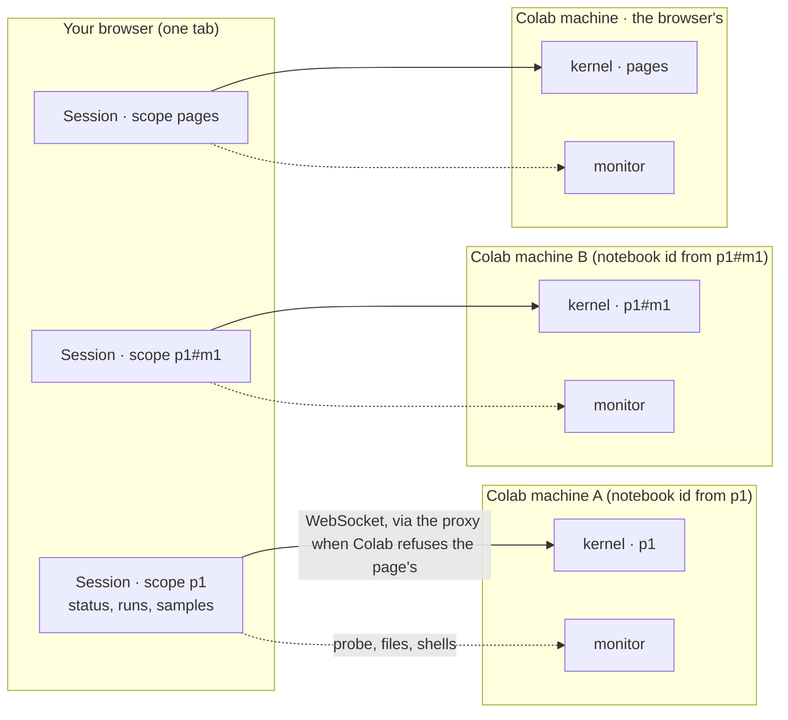
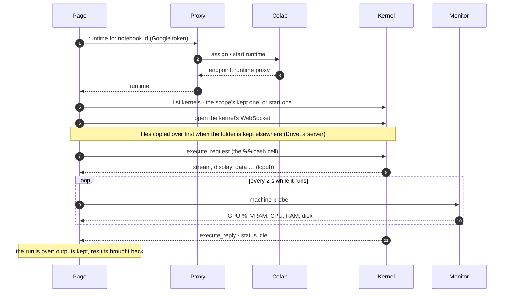
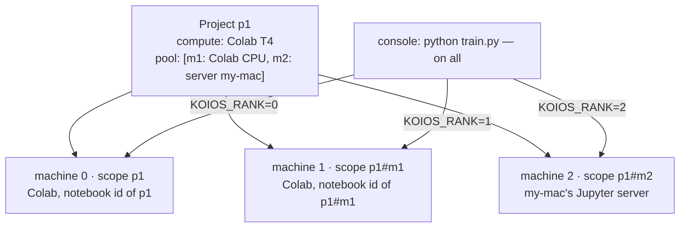
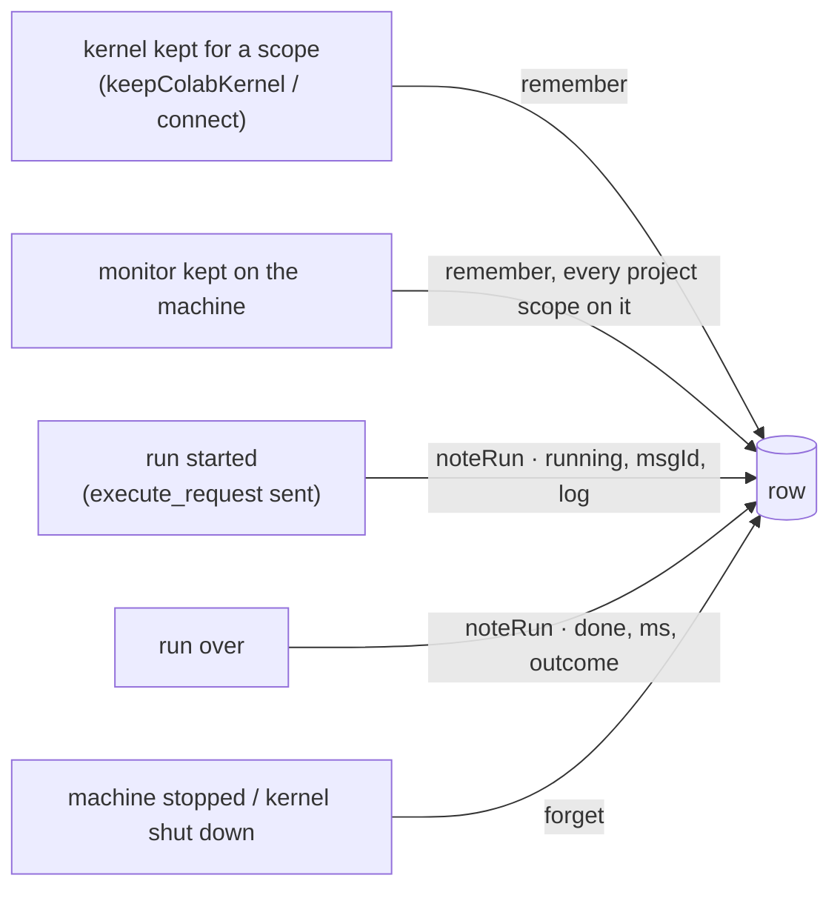
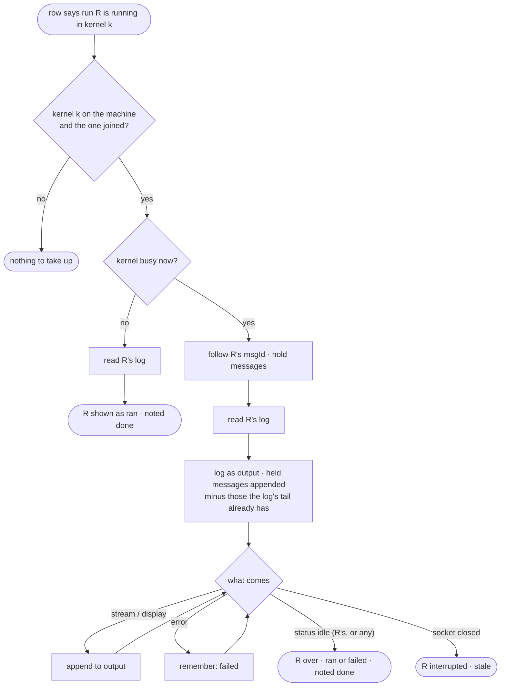
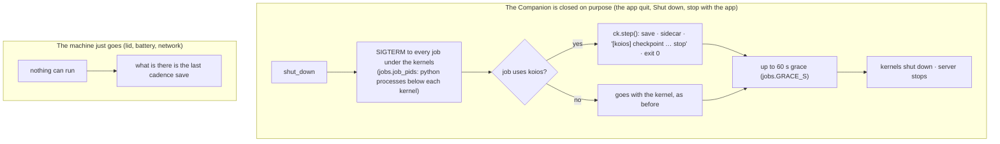

# Where the code runs, and picking it up elsewhere

How a project's code gets to a machine and runs there; how a project runs on
several machines at once (the **pool**); and how a run started on one of your
computers is the same run when you open the project on another (**continuity**).
This is the design as built. The pool's limits — what Colab allows and does not
— have a note of their own, [compute-pool.md](compute-pool.md).

Figures are Mermaid; GitHub draws them.

## 1. The pieces

| Piece | What it is | Where |
| --- | --- | --- |
| **Machine** | Where a kernel can live: a Colab runtime, or a Jupyter server of yours (a Reader Companion on your computer, a GPU box). | `src/lib/colab.ts`, `Backend` |
| **Kernel** | One Python process on a machine. Variables live in it; a cell or command runs in it. | Jupyter, on the machine |
| **Monitor** | A second, small kernel on each machine the page uses for its own housekeeping: the machine probe every two seconds, file listing and writing, the shells of the kernel terminal. Never for your cells. | `ensureMonitor` |
| **Scope** | Whom a kernel is for: a project (its id), a pool member (`<project>#<member>`), or the paper pages (`pages`). | `memberScope`, `PAGES` |
| **Session** | The page's hold on one kernel for one scope on one machine: its status, its runs, its samples. Several per tab; one is the foreground. | `Session`, `sessionFor` |
| **Run** | One cell or command, by key: its state, its output, when it started, the machine's use while it ran. | `CellRun`, `runs` |
| **Row** | What one browser knows about a scope that another would need: the machine, the kernels on it, the runs going. Kept per account on the proxy. | `worker/kernels.js`, `src/lib/continuity.ts` |



*Figure 1. One tab holds a session per scope; each session has a kernel on
its machine, and each machine a monitor beside it. A project of its own gets
its own Colab machine, because Colab assigns one runtime per notebook id and
the project's id is made into one.*

## 2. One machine: how a command runs

A command typed in the project's console becomes a `%%bash` cell: the folder
made and entered, then the command. With a pool it also exports its place
(`KOIOS_RANK`, `KOIOS_WORLD`, `KOIOS_MACHINE`); and it logs itself on the
machine, for continuity (section 5):

```bash
%%bash
export KOIOS_RANK='1'
export KOIOS_WORLD='3'
export KOIOS_MACHINE='Colab · T4'
mkdir -p '/content/playgrounds/sweep-x1' && cd '/content/playgrounds/sweep-x1' || exit 1
mkdir -p '/content/playgrounds/sweep-x1/.reader/runs' && exec > >(tee -a '/content/playgrounds/sweep-x1/.reader/runs/c7.log') 2>&1
python train.py --seed $KOIOS_RANK
```



*Figure 2. A command on a Colab machine. On a Jupyter server of yours the
proxy is not in the picture: the page talks to the server by its address.*

## 3. Several machines: the pool

A project's record has a first machine (`compute`) and, when it is a pool,
more (`pool: PoolMember[]`, each `{ id, compute }`). Every machine gets a
session of its own under its scope, and — on Colab — a runtime of its own,
because its notebook id is made from the member's scope.



*Figure 3. One command on all machines: the same command in each machine's
own kernel, told its rank. The machines are separate computers running one
job each; nothing passes between them (why not: [compute-pool.md](compute-pool.md)).*

What the workspace does with a pool:

- **The pool row** under the bar: a chip a machine (state, GPU and CPU, a
  menu to connect, interrupt, restart, stop, take out) and **Add a machine**.
- **The console's "on"**: one machine, or all. Output is shown a machine.
- **Terminals**: the **+** asks which machine; a tab says which it is on.
- **The Runtime pane**: one pane a machine, each with its own runs only.
- **The pulse**: every machine of the open project is read between cells,
  not only the one the cells go to.
- **The idle stop** applies to every Colab machine of the project.

## 4. What only the browser knew

A kernel, and whatever runs in it, lives on the machine. Close the laptop
and the command runs on; Colab keeps the machine until its own idle limit
(about an hour and a half with nobody attached on the free tier, twelve
hours in all). What lived in the browser alone was:

| | Lives on the machine | Lived only in the tab | Now |
| --- | --- | --- | --- |
| The kernel (variables, the process) | yes | *which* kernel is the project's | kept in the row |
| The monitor and its shells | yes | which kernel it is | kept in the row |
| The run's process | yes | that it is running; its request id | kept in the row |
| The run's output so far | no (iopub goes to whoever is attached) | yes | logged on the machine, read back |
| The machine's samples (GPU %, …) | no | yes | the page's own, from when it joins |
| The project's files | on the machine; in Drive when kept there | — | as before |

Before: a second browser connected to the same machine (same notebook id →
same runtime), found no kernel id of its own for the scope, and **started a
second Python**. The first browser's run went on unseen, uninterruptible from
the new tab, its output lost to it.

## 5. Continuity: the row, and joining a kernel

### The row

One Durable Object per Google account on the Worker (`worker/kernels.js`,
binding `KERNELS`, migration `v7`), holding a row per scope:

```json
{
  "scope": "p1#m1",
  "endpoint": "https://…colab…/tun/…",
  "kernels": { "p1#m1": "4f2c…", "#monitor": "a91e…" },
  "runs": {
    "pgsh:p1:c7@m1": {
      "startedAt": 1760790000000,
      "state": "running",
      "msgId": "e3b0…",
      "kernelId": "4f2c…",
      "where": "Colab · T4",
      "log": "/content/playgrounds/sweep-x1/.reader/runs/c7.log"
    }
  },
  "updatedAt": 1760790001234,
  "by": "Chrome on a Mac"
}
```

| Rule | Value | Why |
| --- | --- | --- |
| Who may read or write | the account's pass, every call | another account's browser sees nothing |
| What is never in it | tokens, output, file contents | the machine is reached as always (Colab assignment, the server's address); output is on the machine |
| Rows per account | 200, the least recently touched go first | bounded storage |
| Runs per row | 30 newest; done runs let go after 12 h | nobody comes back for old runs |
| Row size | 24 KB, runs trimmed to fit | one request's worth |
| Row age | gone after 2 days untouched | no runtime lives that long |
| Two browsers writing | the newer `updatedAt` wins | a slow browser's stale row does not undo a fresh one |
| Writes from a tab | batched, 0.8 s after the last change; flushed on `pagehide` | one write per burst; a run started just before closing is not lost |
| Reads in a tab | at most every 20 s | one GET per attach, cached |
| When the machine stops | the row is dropped | its kernels and runs went with it |
| When the account is deleted | the object is erased | `worker/account.js` |

Routes: `GET /kernels` (the account's rows), `POST /kernels/put` (one row),
`POST /kernels/drop` (one scope). The client is `src/lib/continuity.ts`:
`recall(scope)`, `remember(scope, endpoint, kernels)`, `noteRun(scope,
endpoint, key, note)`, `forget(scope)`.

### What writes the row



*Figure 4. The moments a browser writes its scope's row. Only project
scopes: the paper pages' kernel stays the browser's own.*

### Joining from another browser

```mermaid
sequenceDiagram
  autonumber
  participant B as Browser 2 (new)
  participant X as Proxy (KERNELS)
  participant C as Colab
  participant K as Kernel (B1's)
  participant M as Monitor
  B->>C: runtime for the project's notebook id
  C-->>B: the same runtime Browser 1 has
  B->>X: GET /kernels (pass)
  X-->>B: the row for the scope: endpoint, kernels, runs
  B->>K: list kernels
  Note over B: row.endpoint matches, row's kernel is listed → join it (no new Python)
  Note over B: row's monitor listed, none kept here → take it (its shells are yours too)
  B->>K: open the kernel's WebSocket
  B->>K: list kernels (is it busy?)
  alt kernel busy
    B->>K: follow(msgId): messages whose parent is the row's request
    B->>M: read the run's log (last 200 KB)
    M-->>B: the output so far
    Note over B: run shown running, "started elsewhere, followed here"
    K-->>B: stream … (held while the log is read, then appended, less what the log already has)
    K-->>B: status idle
    Note over B: run over · noted done in the row
  else kernel idle
    B->>M: read the run's log
    Note over B: run shown as ran, with its log; noted done
  end
```

*Figure 5. The join. Browser 1 need not be open: the row and the machine
are enough. Stop from Browser 2 interrupts the kernel, as from Browser 1.*

### Following a run: the rules



*Figure 6. Why "any" idle ends the run: a kernel executes one request at a
time, so when it is idle, every request is over.*

### What carries over, and what does not

| | Carries over | Note |
| --- | --- | --- |
| The same kernel (variables, imports) | **yes** | by the row's kernel id, if still on the machine |
| A console command running | **yes**, with its output so far | from its log on the machine, then live |
| A console command that finished meanwhile | **yes**, as ran, with its log | |
| A notebook cell running | **followed**, from the moment of joining | its earlier output stayed with the browser that ran it: no log |
| Terminals' shells | **yes** | the monitor is taken too |
| The machine's samples and history | **no** — the page's own from when it joins | the Runtime pane fills from there |
| A "Shared" project | **no** | its runtime is the browser's own notebook id, which differs per browser |
| After Colab's idle limit | **no** | the machine is gone, and the row with it (the row says so: its kernel is not listed) |
| A reload of the same browser | **yes** | the same path: the row is this browser's own |

### Where things are

| | |
| --- | --- |
| The store | `worker/kernels.js` (routes in `worker/index.js`; erase in `worker/account.js`; binding and migration in `wrangler.toml`) |
| The client | `src/lib/continuity.ts` |
| Remembering kernels | `src/lib/colab.ts`: `keepColabKernel`, the Jupyter connect path, `rowEndpoint` |
| Joining | `attach` (the row's kernel and monitor), `s.recalled` |
| Following | `adoptRuns`, `followRun`, `readLog`; `Kernel.follow`, `onIdle`, `onClosed` |
| Noting runs | `runIn` (`RunMeta.log`), `runCell` / `runCellFor` |
| The shell log | `src/lib/playground.ts`: `shellCell(…, log)`, `runLogPath`; the workspace's `runOn` |
| Showing it | `src/components/Colab.tsx`: `RunState`, `CellRunOutput` (`run.elsewhere`) |
| Tests | `scripts/kernels.test.mjs`, `scripts/continuity.test.mjs`, `scripts/playground.test.mjs` |

## 6. Checkpoints, and a machine that goes away

A Companion closed, a laptop shut, a network gone: the Jupyter server and
every kernel run inside the Companion, so the job is **gone with it**, not
paused. Nothing on that machine can act after the fact. What can be done is
done before, in two ways, and the page tells you where things stand.

### The helper

The page writes a small Python module, `koios`, into the project's folder on
every machine before a command runs there (`.reader/pylib`, which the sync
rules leave alone), and puts it on `PYTHONPATH`. Nothing to install, on
Colab or a Companion alike. A training loop uses it so:

```python
import koios

ck = koios.checkpoint("checkpoints", every_steps=500, every_minutes=10)
ck.on_save(lambda path: torch.save(model.state_dict(), path))
start = ck.resume(lambda path: model.load_state_dict(torch.load(path)))  # a step, or 0

for step in range(start, steps):
    ...
    ck.step(step, loss=loss.item())
```

| Call | What it does |
| --- | --- |
| `koios.checkpoint(dir, every_steps, every_minutes, keep=3)` | Where and how often; the newest `keep` are kept, older ones removed |
| `ck.on_save(fn)` | Your function that writes the file at the path given |
| `ck.resume(load)` | The step to start from: the checkpoint `KOIOS_RESUME` names (the page sets it when you resume), else the newest in the folder; `load` restores it; 0 when there is none |
| `ck.step(step, **metrics)` | Once a step: saves when due, and **at once when the process was asked to stop**, then leaves with 0 |
| `ck.save()` | Save now |
| `koios.rank()`, `koios.world()` | The pool's `KOIOS_RANK` and `KOIOS_WORLD` |

Every save writes the file, a sidecar `<file>.koios.json` (step, metrics,
time, rank, the GPU's use at that moment) and `latest.json`, and prints one
line the page reads:

```
[koios] checkpoint {"path": "/content/…/checkpoints/step-00004200.pt", "step": 4200, "at": "…", "reason": "cadence", "metrics": {"loss": 0.41}, "rank": 1, "gpu": {"util": 93, …}}
```

### Two ways the machine goes



*Figure 7. A closed Companion asks its jobs to stop first and waits; a hard
disconnect leaves only the cadence saves. Both are why `every_minutes`
defaults to 10.*

### What the page does

```mermaid
sequenceDiagram
  participant K as Kernel on the machine
  participant P as Page
  participant U as You
  K-->>P: "[koios] checkpoint {…step 4200…}" in the run's output
  Note over P: the run shows ⛁ Checkpoint · step 4200 · step-00004200.pt
  K--xP: socket closes · reconnects fail · session lost
  Note over P: the machine's chip goes red; its runs are marked interrupted
  P->>U: banner: "my-mac disconnected at 23:08 — the connection closed… Last checkpoint: step 4200 at 23:05 · step-00004200.pt · loss 0.41"
  U->>P: Resume from step 4200 · on the same machine / on 1 · Colab T4
  P->>K: the command again, with KOIOS_RESUME=/…/step-00004200.pt
  Note over K: koios.resume() loads it and returns 4200
```

*Figure 8. The notice and the resume. The page knows the last checkpoint
from the lines the run printed, which it had before the machine went; the
checkpoint file itself is where the job wrote it.*

### Where the checkpoint is, and where you can resume

| The checkpoint folder is… | Resume on the same machine | Resume on another machine |
| --- | --- | --- |
| on the machine's own disk (the default: `checkpoints/` under the project folder on the machine) | **yes**, once it is back | only if that path exists there too; otherwise `koios.resume` says so and starts from 0 |
| in the project's folder kept on a server both reach (home = a Companion's folder) | yes | **yes** |
| in Drive | — | the sync brings text files back after a run, not checkpoints (`*.pt`, `*.ckpt` are left on the machine by the ignore rules, and the copy is text-only); copying checkpoints into Drive as they are saved is **not built** |

The honest version of "pause and continue elsewhere" is checkpoint and
restart, which is what every training framework does. The pieces here make
it one click when the checkpoint is somewhere the next machine can read.

### Where things are

| | |
| --- | --- |
| The helper | `src/lib/koiosHelper.ts` (`KOIOS_PY`, written to `.reader/pylib/koios/__init__.py`) |
| On the path | `src/lib/playground.ts`, `shellCell` (`KOIOS_PYLIB` → `PYTHONPATH`) |
| Reading the lines | `src/lib/telemetry.ts`, `checkpointsOf`, `latestCheckpoint` |
| The Companion's gentle stop | `companion/reader_companion/extension.py`, `shut_down` → `stop_jobs_gently`; `jobs.py`: `kernel_pids`, `job_pids`, `descendants`, `ask_to_stop`, `wait_gone` |
| The notice and Resume | `src/components/PlaygroundWorkspace.tsx`: `gone`, `resume`, the banner; `ensureHelper` writes the helper |
| Under a run's output | `src/components/Colab.tsx`, `CellRunOutput` (`.cell-checkpoint`) |
| Tests | `scripts/checkpoints.test.mjs` (the lines, and the helper run for real), `companion/tests/test_jobs.py` |
