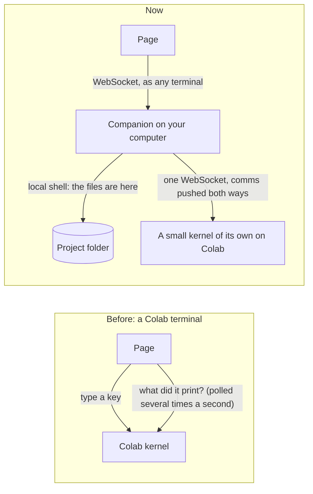

# One terminal for your files and your compute

Your project's files can be on your own computer while its code runs somewhere else: Colab's GPU, or a GPU server of
yours. In that setup, the terminal opens **on the computer that has the files**. It is a local shell, so it answers
as fast as any terminal on your Mac. From it, a few `koios` commands reach the compute:

```bash
koios run python train.py   # copy what changed, run it on the GPU, watch the output here
koios shell                 # a shell on the GPU machine, in this terminal
koios push                  # copy what changed, run nothing
koios pull outputs/         # bring results back here
koios status                # where the project runs, and whether it can be reached
```

This needs Koios Companion **0.17.0 or later** on the computer that has the files. Update it under Settings →
Updates.

## 0. The agent, by the files

With the link up, the agent pane's last choice is **On <your computer>**: Claude Code, Codex or any agent with a
command line, in a terminal on the computer that has the files, in the project's folder. It edits the files where
they are — no copy, nothing to bring back — and reaches the compute the way you do from that terminal: `koios run`
for anything that needs the GPU or a simulator, `koios pull` for the results. Claude Code is told all this in its
briefing (its `--append-system-prompt`); another agent you tell in your first message. The runs it starts there
show in the Sim pane and are filed as experiments like any other. The **Claude Code** and **Codex** choices beside
it still run on the compute's copy of the folder, with their edits brought back when they finish.

The computer with the files can be a Mac, a Windows PC or a Linux box: the Companion runs on all three, `koios`
keeps its terminal raw mode to POSIX systems and works through PowerShell otherwise, and the agent's command is
quoted for the shell it lands in (PowerShell doubles a single quote inside a word; a POSIX shell takes `'\''`).

## 1. What you see

The panel's first terminal is now **here**, on the computer the files are on, in the project's folder. The **+**
button asks where a new terminal should run:


*Figure 1. Each terminal tab is marked **here** (the computer with the files) or **gpu** (the compute).*

A **gpu** tab is a shell on the compute machine, reached through the Companion. It opens in the project's folder
there:


*Figure 2. A shell on the GPU machine. `exit` or ⌃D closes the tab.*

In a **here** tab, `koios run` sends only the files that changed, runs the command on the compute, and shows its
output as it is printed:


*Figure 3. The files stay on your computer. Only what changed goes over, and the output comes back live.*

The **▶ Run** button and **Copy now** work the same way. In a **here** tab, Run types
`koios run --no-push -c '<your command>'`, so the command runs on the compute with its output in the terminal you're
looking at. Copy now asks the Companion to send the changed files as one archive, instead of the page copying them one
at a time.

## 2. Why it is faster



*Figure 4. Before, the page typed into a shell on Colab and kept asking what it had printed, so every key waited for
a round trip and a poll. Now the terminal is a local shell. When it reaches the compute, the Companion keeps one
WebSocket to a kernel of its own there. Keys go out as they are typed, and output comes back the moment it is printed.
Nothing is polled.*

| | Before | Now |
| --- | --- | --- |
| Terminal by the files | — (only on the compute) | A local shell on your computer |
| Typing on the compute | A round trip and a poll per key | A push each way over one open socket |
| Copying files over | One file at a time through the browser, text only, under 2 MB | One gzip'd tar of only the changed files, any type (over 100 MB only with `--big`) |
| Running a command | From the page | `koios run …` from any terminal on your computer, VS Code's included |

## 3. How it fits together

```mermaid
sequenceDiagram
  autonumber
  participant Page
  participant Comp as Companion (your computer)
  participant Shell as koios (in your terminal)
  participant Colab as Colab runtime
  Page->>Comp: POST companion/compute {root, compute: Colab's address and pass}
  Note over Page,Comp: Sent again whenever the pass changes; renewed 10 min before it runs out, while the page is open
  Shell->>Comp: reads the link for this folder (~/.reader-companion/compute/, 0600)
  Shell->>Colab: start (or reuse) its own kernel · open a WebSocket
  Shell->>Colab: comm koios.push {files: path → size, mtime}
  Colab-->>Shell: {need: changed paths}
  Shell->>Colab: the changed files, one tar.gz in 256 KB chunks
  Shell->>Colab: comm koios.shell {folder, argv, rows, cols}
  Colab-->>Shell: output, pushed by a thread as it is printed
  Shell->>Colab: keys, resizes, ⌃C
  Colab-->>Shell: exit code
```

*Figure 5. The page only hands over the address. The Companion and `koios` do the rest, straight from your computer
to Colab.*

- **The link.** The page sends the Companion the compute's address, its pass, the project's folder there and the
  project's ignore rules. For Colab, the pass is the runtime proxy token. For a server, it is that server's token. The
  Companion keeps the link beside its own settings with owner-only permissions, never in the project folder. The page
  is never told the pass back.
- **The pass.** Colab's runtime pass lasts about an hour. While the project is open in Koios, the page renews it ten
  minutes before it runs out and hands it over again. If it does run out with the page closed, `koios` says so and
  tells you to open the project in Koios.
- **The kernel.** `koios` starts one small kernel of its own on the compute and reuses it afterwards. It is separate
  from the notebook's kernel, so a long cell never holds up the shell.
- **What a push sends.** Every file the project's ignore rules (Storage & compute → sync rules) let through, minus
  `.git/`, `.reader/`, `__pycache__/`, virtual environments and `node_modules/`. Only files whose size or modification
  time changed since the last push are sent. Files over 100 MB are left out unless you pass `--big`.
- **What a push removes.** On the compute, it removes only files that an earlier push put there and that have since
  been deleted on your computer. Files a run creates there (checkpoints, logs) are never removed. The compute's record
  is `.reader/koios-pushed.json` in the project's folder there.
- **Pull.** `koios pull PATH…` brings files or folders back into the same place in your folder, written safely (no
  paths outside the folder).

## 4. Step by step

1. Update the Companion on the computer with the files to 0.17.0 (Settings → Updates).
2. Open the project. Its files must be on that computer: Storage & compute → **Move files here**, see
   [storage-moves.md](storage-moves.md). Its code runs on Colab or a server (**Run here**).
3. Connect the compute as usual: the chip at the top right, for example **Colab · T4**.
4. In the panel, **Terminal 1 · here** is your computer, in the project's folder. Edit and look at files there.
5. Type `koios run python main.py`, or press **▶ Run**, to run on the compute.
6. **+** → the compute (for example **Colab · T4**) opens a shell there.
7. Type `koios pull outputs/` to bring results back.

`koios` also works in any terminal on that computer, such as Terminal.app or VS Code. `cd` into the project's folder
(`~/Reader/playgrounds/<project>`) and run it there. The page must have linked the project at least once, and for
Colab, the pass must still be valid.

## 5. When something goes wrong

| It says | What to do |
| --- | --- |
| `this folder isn't a project linked to a compute` | Open the project in Koios with its files on this computer and its compute connected. The page links it. |
| `the pass to Colab · T4 ran out at 14:05` | Open the project in Koios. The page renews the pass, then try again. |
| `Colab · T4 is gone — Colab ends idle runtimes` | Connect Colab again from the project. The new runtime is linked as it connects. |
| `koios: command not found` (in a terminal outside Koios) | Use the terminal in Koios, or put the Companion's `bin` folder on your PATH. In Koios's own terminals, `koios` is always there. |
| A **gpu** tab shows Colab's old shell, not `koios shell` | The Companion is older than 0.17.0: update it. Until then, the page's own Colab shell is used. |

## 6. Reference

| File | What |
| --- | --- |
| `companion/reader_companion/compute.py` | `koios`: the link, the ignore rules, the kernel client, the comms on the machine's side, push, pull, run, shell. |
| `companion/reader_companion/extension.py` | `ComputeHandler`: `GET/POST companion/compute` (link, forget, push). |
| `companion/reader_companion/env.py` | `koios` in every terminal the Companion opens. |
| `src/lib/computeLink.ts` | The page's side: targets, the link, renewals, the lines typed into the shell. |
| `src/lib/colab.ts` | `renewRuntimeProxy`: a fresh pass from Colab's list of runtimes, with no sign-in window. |
| `src/components/PlaygroundWorkspace.tsx` | The terminal by the files, the **gpu** tabs, the **+** menu, Run and Copy through the link. |
| `companion/tests/test_compute.py`, `test_compute_handler.py`, `scripts/compute-link.test.mjs` | Tests, including push, pull, run and a live shell against a real Jupyter server. |
