# Mounting the folder on the compute: how it was built, checked and measured

The companion to [compute-mount.md](compute-mount.md), which describes *what* the mount is and how to use it. This
one is the process: what the code did before, the choices made and the ones turned down, how the pieces fit, what
each test run found, what was measured and what it showed, which limits belong to the mount and which to the tunnel,
and the steps to try it yourself. It is written so that someone who wasn't in the session can retrace the work and
check what it claims.

The branch is `claude/epic-darwin-18jc7s`. `docs/compute-mount-process.pdf` prints both documents as one PDF; run
`node scripts/compute-mount-pdf.mjs` to print it again.

---

## 1. The ask

1. *When I code on my laptop and use Colab's GPU, is the code copied there first?* Yes. Section 2 shows how.
2. *Can the connections we already have run the code on that machine without making a whole copy of the codebase
   there?* Yes, by mounting the folder. That is the build.
3. *Can Cloudflare's network make it feel like one device?* The mount runs over the Companion's Cloudflare tunnel,
   keeps one socket open, and pushes changes as they are saved (section 4).
4. *Checkpoints should go where the data is kept.* They stay on the GPU machine's disk and go to the data place
   (section 4.3).
5. *Test it over a real tunnel, handle the limits gracefully, and set up Argo Smart Routing.* Sections 6 to 8.

## 2. Before: two ways of copying

When a project's files were in one place and its code ran in another (split mode, `filesAreOnMachine` false), every
command in the console copied the folder first and brought results back afterwards. There were two paths:

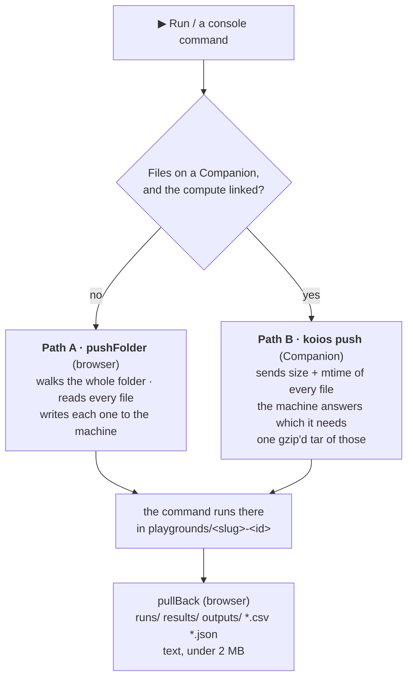

*Figure 1. The copy before the mount. Path A sends every file every time (text only, 2 MB at most each, at most 400
files and six folders deep). Path B sends only what changed, but it still opens a connection to the machine for each command.
Either way, notebook cells got no copy at all; only console commands did.*

| | Path A (browser) | Path B (Companion) |
| --- | --- | --- |
| Used when | Files in Drive, in the browser, on a plain Jupyter server, or on an unlinked Companion | Files on a Companion with a compute link (0.17.0 on) |
| What goes over | Every file, every time | Files whose size or modification time changed |
| How | One request per file; on Colab, one kernel `execute_request` per file, the content in base64 | A tar over Jupyter comm messages on one kernel socket |
| Limits | Text only, 2 MB a file, 400 files, 6 folders deep | 100 MB a file, unless `--big` |
| Results back | `pullBack`, text only, under 2 MB | the same, through the browser |

## 3. The choices

| Question | Chosen | Turned down, and why |
| --- | --- | --- |
| How does the machine see the folder? | **A FUSE mount**, with a live two-way mirror where FUSE isn't allowed | *A Python import hook*: only `import` in the notebook kernel would see the files. `python train.py`, `open()`, shells and agents would not. *sshfs*: needs SSH into the laptop from the internet. |
| Which side dials? | **The machine dials the Companion** | The laptop can't accept connections from the internet, and Colab's runtime only takes requests through its own proxy. The Companion already has an HTTPS address: its tunnel. |
| Over what? | **One WebSocket, through the Companion's Cloudflare tunnel** | *Through the browser* (the page's kernel socket): the run would depend on a tab staying open. *Through the Worker*: an extra hop, and the Worker has no disk. *Jupyter comms from the Companion* (as `koios push` does): the Companion would have to keep a kernel socket per machine, renewing Colab's hourly pass. |
| Who notices a change? | **The Companion pushes it** (it looks over the folder twice a second, stat calls only) | *The machine polling*: a round trip through Cloudflare for every look. |
| What credential does the machine hold? | **A key for one folder** (`mounts/<hash>.json`, 0600) | *The Companion's token*: it opens every folder, terminals, and the update route. |
| Where do checkpoints go? | **The machine's own disk, then the data place** (koios_data) | *Back to the laptop*: gigabytes through the tunnel to a disk that wasn't chosen for data. |
| What decides what is "data"? | **The project's existing sync rules** (`data/`, `*.pt`, …) | A second list to keep in step with the first. |

## 4. How it fits together

### 4.1 The pieces

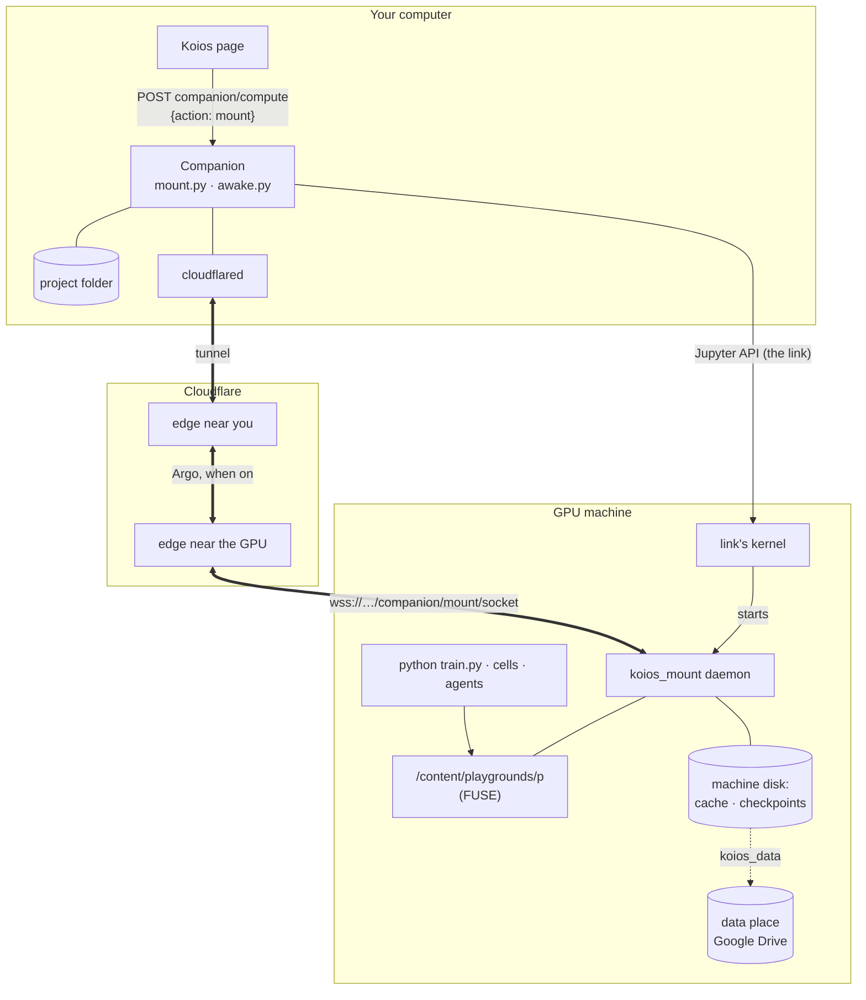

*Figure 2. The page makes one call. The Companion starts the daemon through the compute link's own kernel; from then
on the daemon and the Companion talk directly, through Cloudflare. The page and the browser are not on that path.*

### 4.2 Starting a mount

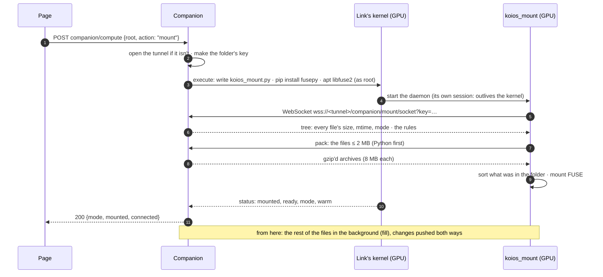

*Figure 3. One call from the page, about a second on a fast link (section 6). The first time on Colab, add the
minute that installing fusepy takes.*

### 4.3 Where a write goes

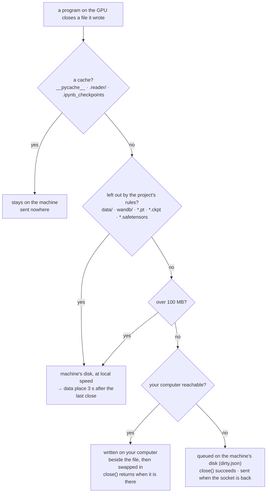

*Figure 4. Every write ends in one of four places, and none of them is "lost". The rules are the ones under **Not
copied** in the Sync pane, so they mean what they meant before.*

### 4.4 A save on your computer

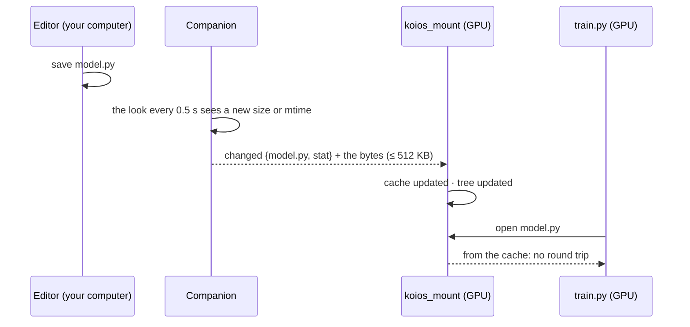

*Figure 5. A change is pushed with the file itself, so by the time anything on the machine opens it, nothing needs
asking. Section 6 shows this takes 0.34 to 0.49 s; most of that is waiting for the half-second look.*

### 4.5 When the connection goes

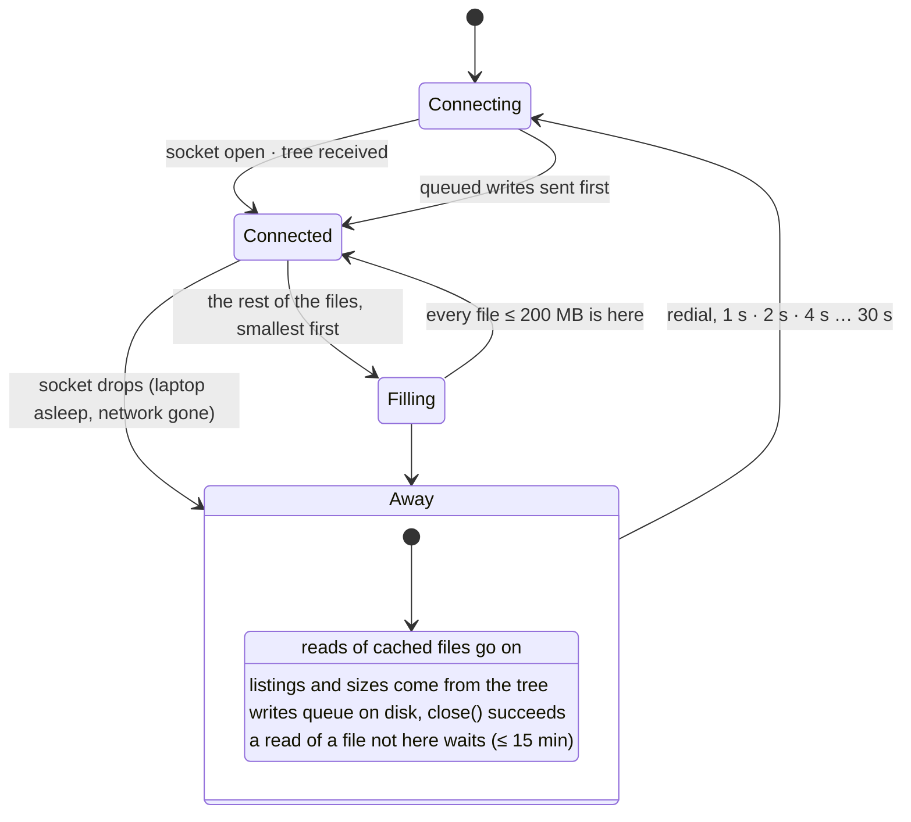

*Figure 6. The daemon's states. "Away" covers both a sleeping laptop and a dropped tunnel, which look the same from
the GPU.*

## 5. The order of work, and what each run found

Each step was chosen so the next could be checked against something real.

| # | Step | What it found |
| --- | --- | --- |
| 1 | Traced the copy paths (an Explore agent over `playground.ts`, `PlaygroundWorkspace.tsx`, `compute.py`, `colab.ts`) | Section 2. Notebook cells never got a copy; only console commands did. |
| 2 | Checked whether FUSE works in the sandbox: `apt-get install fuse libfuse2`, `pip install fusepy`, a hello-world mount | `/dev/fuse` was there and a mount worked, so every test below is a **real** FUSE mount, not a stand-in. |
| 3 | Wrote `koios_mount.py` (the GPU side) and `mount.py` (the Companion side), then `tests/test_mount.py`: both ends on one computer, the daemon in a process of its own | The first run failed: the handshake answered **500**. `MountSocket.write()` shadowed tornado's `RequestHandler.write`. Renamed to `write_piece`. |
| 4 | Data place test: a checkpoint written on the mount must reach a stand-in Drive folder | Two bugs. (a) A key starting with `-` was read by argparse as a flag; the daemon now gets `--key=…`. (b) The status never said where the data went, because nothing rewrote it after a send; the shipper now calls back. |
| 5 | The whole Companion suite | Passed on its own, failed in the suite. An earlier test left the process in a deleted directory, so `os.getcwd()` inside koios_data raised. The daemon now `chdir`s to its own state folder. The same run's log showed `Uncaught exception from FUSE operation lock`: fusepy takes **any attribute named after a FUSE operation** as that operation, and `Ops.lock` was a `threading.RLock`. Renamed to `guard`, so the kernel's own local locking applies. |
| 6 | The page's one call against a real Jupyter server standing in for the GPU box | It passed the first time once the test waited long enough (tornado's test client stops at 5 s). |
| 7 | Review of the socket's path checks | A symlink inside the folder pointing at `/etc/hostname` would have been served. Both `scan` and `path` now refuse links that lead out of the folder, and there is a test for it. |
| 8 | Review of `close()` while away | `flush` raised EIO when the laptop was unreachable, which would crash a training script writing a log. It now leaves the file queued and returns success. |
| 9 | "Away" test: the socket closed under a live mount, a write made, the server started again | FUSE passed. The **mirror failed**: a file written while away was taken for "something that was there before the mirror started" and never sent. That baseline now applies to the first tree only. |
| 10 | Background fill, reads that wait, a durable write queue, keep-awake, notebook cells in the folder, named tunnel and Argo | Tests for each (section 7). In the away test, a 3 MB file never opened was readable with the laptop gone. |
| 11 | A real tunnel from the sandbox (`tests/live_tunnel.py`) | **Could not be done there**. Cloudflare handed out the address (`agenda-virginia-pic-packed.trycloudflare.com`), because that is an HTTPS call. But `cloudflared` couldn't resolve `_v2-origintunneld._tcp.argotunnel.com` or open TCP 7844 to the edge. That is the sandbox's network, not the code. It was done later on a Mac (step 20). |
| 12 | Measured copy against mount, with simulated distance (`tests/bench_mount.py`) | Section 6. |
| 13 | The suite on Python 3.9 (the oldest the Companion supports, and the Mac's Homebrew Python) | The mount's tests passed. Seven tests in two older modules failed. `mover.py` packed with `tarfile.open` in streaming gzip mode with a `compresslevel`, which needs 3.12; it now gzips the stream itself. `test_paper.py` used a union type (`bytes` or `str`) in an annotation evaluated at run time; it now has `from __future__ import annotations`. |
| 14 | The suite run again and again | `ThroughTheLink` failed about once in six runs: the daemon mounted, but the Companion was told it hadn't. A start/stop loop (60 runs) showed why. Several of the daemon's threads wrote `status.json` through **one shared part file**, so it could end up half one write and half the other, and unreadable. Each thread now writes a part file of its own. |
| 15 | The same loop, timing `stop` | **Every stop took 10 s** and ended in SIGKILL. libfuse takes SIGTERM for itself and acts on it only at the next request. And the daemon, once it did exit, stayed a zombie of the process that started it, so `stop` thought it was still running. Now the daemon ends by itself when its mount goes, a thread reaps it, and `stop` treats a zombie as gone. Stop takes 0.05 s, and the suite runs in about 60 s instead of 140 s. |
| 16 | The suite on a Mac (Homebrew Python 3.14) | Every mount test passed (22, the 3 FUSE ones skipped: macOS has no FUSE), including the page's one call through a real Jupyter server, in the mirror mode. **Four older tests failed and one hung**; the commit before the mount work failed the same way, so they were Mac-only bugs from before. |
| 17 | The four failures (#324) | **`/var` is `/private/var` on a Mac:** `koios pull` compared a resolved path with an unresolved one. Code fix, and the `koios run` test compares resolved paths. **A zsh theme's `PS1`** (powerlevel10k, exported by an activated venv) reached `koios shell`'s bash, which printed "bad substitution" instead of a prompt; the remote shell now drops inherited prompt settings. **The developer's own `/Applications/Koios.app`** was found before the test's moved app; the usual places became a setting the test empties. |
| 18 | The hangs (#324, #325, #326, #327) | Three tests opened a terminal with `pty.fork()` from a process that had threads by then, and **on macOS such a child can deadlock before it execs**. `koios shell` itself did the same inside the Jupyter kernel. Each now starts the terminal from a fresh single-threaded Python that takes it as its own (`setsid`, `TIOCSCTTY`). The first try at that gave no output at all: the terminal was closed on one side before the other had opened it, so the reader saw it as ended. It is now handed over open (`pass_fds`). The remaining hang was **closing a terminal that a leftover `sleep` still held**, which blocks on macOS; the cleanup now ends the shell's whole session and reads while it waits. Every waiting test has a time limit, and `test_jobs` has a watchdog that prints every stack after 60 s. |
| 19 | The suite on the Mac again | **`OK (skipped=3)`**, in about a minute: all 177 tests, the three FUSE tests skipped. |
| 20 | `tests/live_tunnel.py` on the Mac, over a real quick tunnel | **The mount works through Cloudflare.** Section 6.2 has the numbers. The run showed three gaps in the script, now fixed: it said nothing while a new address took a minute to resolve; it reported the round trip as 0.0 ms, because the mirror reads nothing on demand; and it kept nothing. It now says what it is waiting for, and gives the fix for a cached "no such name". A connection of its own times 20 small requests and a 6 MB read in either mode, and `--save` writes the numbers to a file. |

## 6. What was measured

### 6.1 Copy against mount, at three simulated distances

`companion/tests/bench_mount.py` runs both ways on one computer:

- For the copy, a Jupyter server stands in for the GPU machine, and the copy is `koios push` (what `koios run` does
  before every command).
- For the mount, the Companion's socket serves the folder and the daemon mounts it with FUSE.
- Between them sits a proxy that holds every byte back for a fixed time each way, for a round trip of **0, 50 or
  150 ms**. Those stand in for a machine in the same city, on the same continent, or across an ocean. The proxy
  limits latency, not bandwidth, and it is not Cloudflare.
- The project is 300 small Python modules (12 KB each) that a package imports, and a 6 MB file.
- The raw numbers are in `docs/compute-mount-bench.json`; run `python3 -m tests.bench_mount` to measure again.

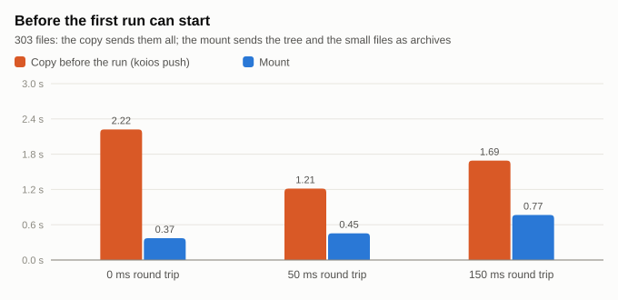

*Figure 7. Before the first run can start. The copy sends all 303 files, and the first one also starts a kernel on the
machine. The mount sends the tree and the 302 small files as archives. The copy's 2.2 s at 0 ms includes that machine's
first kernel start, which was slower than the later ones.*

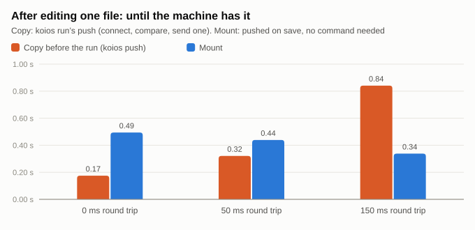

*Figure 8. After editing one file. The copy is `koios run`'s push: connect, compare 303 files, send one. It grows with
distance because each command opens a new connection, several round trips. The mount's time is the half-second look
on your computer plus one trip, so it barely moves with distance. The bigger difference doesn't show in the chart:
with the copy someone has to run it, and with the mount nobody does. At 0 ms the copy is quicker, because the look is
on a 0.5 s timer.*

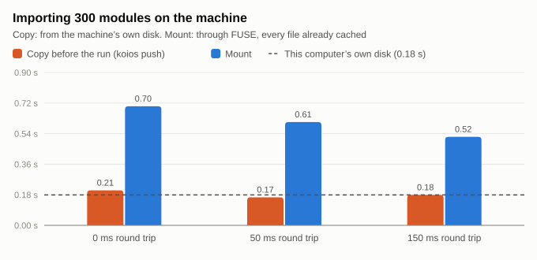

*Figure 9. The cost the mount adds: importing 300 modules takes about 0.5 to 0.7 s through FUSE, against about 0.2 s
from the machine's disk. The files are all cached by then, so the extra is FUSE itself: Python looks up each module
in several places, and every lookup is a call into the daemon. The cost doesn't grow with distance (the 150 ms row is
the fastest), and it is paid once per process start, not per step of a training loop.*

| Round trip | Cold read of 6 MB through the mount | Same file, cached | A write on the machine, on your computer by |
| --- | --- | --- | --- |
| 0 ms | 0.31 s | 0.011 s | the time `close()` returns |
| 50 ms | 0.32 s | 0.013 s | the time `close()` returns |
| 150 ms | 0.50 s | 0.011 s | the time `close()` returns |

*Table. A cold read costs the round trips of two 4 MB pieces, plus the work of copying them. Once read, a file is read
at disk speed. A file written on the machine is sent while it is being closed, so `close()` returning means it is on
your computer. That is why the "write back" time measured as 0.*

What the numbers don't cover: a real Cloudflare path (its own latency, and its throughput for large reads), Colab's
disk, and a laptop on Wi-Fi. Section 6.2 covers the first and the last.

### 6.2 Over a real Cloudflare tunnel

`tests/live_tunnel.py` was run on a MacBook Air over Wi-Fi, through a real quick tunnel
(`contractors-securities-trucks-intro.trycloudflare.com`). Both ends ran on the Mac: the Companion's socket served the
folder, and the daemon mounted it by dialling the tunnel's public address. So every byte went out to Cloudflare and
came back in, crossing the Wi-Fi twice where a Colab run crosses it once. The Mac has no FUSE, so this was the mirror
mode, which copies every file first.

The baseline is the same script and mode with no tunnel (`KOIOS_LIVE_LOCAL=1 KOIOS_LIVE_MODE=mirror`), median of three
runs. It ran in the Linux container the feature was built in, not on the Mac. The raw numbers are in
`docs/compute-mount-live.json`.

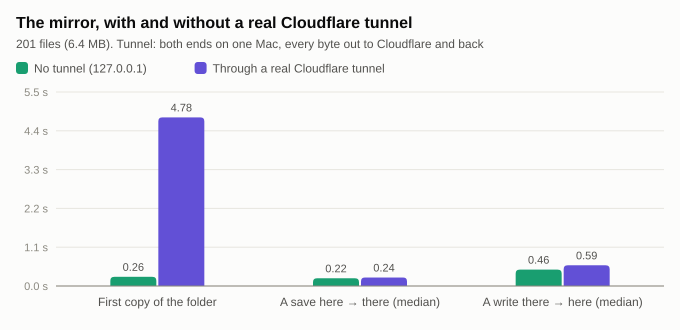

*Figure 10. What the tunnel adds. A save reaches the other side in 0.24 s against 0.22 s without the tunnel, and a
write comes back in 0.59 s against 0.46 s. Both times are mostly the mount's own timers (it looks for changes
every 0.5 s on your computer and every 0.7 s in the mirror), so the tunnel adds a few hundredths of a second to the first and
about a tenth to the second. The first copy is where the tunnel costs: 6.4 MB took 4.8 s, about 1.3 MB/s, against a
quarter of a second without it.*

| | No tunnel | Real tunnel | What the tunnel adds |
| --- | --- | --- | --- |
| Opening the tunnel | — | 7.2 s | once per Companion start |
| The mount ready (mirror: the tree and every file) | 0.46 s | 6.19 s | 5.7 s |
| First copy: 201 files, 6.4 MB | 0.26 s | 4.78 s (≈ 1.3 MB/s) | 4.5 s |
| A save here → there, median (max) | 0.22 s (0.42) | 0.24 s (0.43) | ≈ 0.02 s |
| A write there → here, median (max) | 0.46 s (0.68) | 0.59 s (0.75) | ≈ 0.13 s |
| Round trip of a small request | 0.9 ms | not measured (fixed since) | — |

What it shows:

- **Edits cross as fast as the mount's own timers allow.** The real tunnel barely changes how quickly a save on one
  side shows on the other.
- **Throughput is the tunnel's cost.** 1.3 MB/s is the figure to plan around for the first copy, and this run
  understates it: the bytes crossed the Mac's Wi-Fi twice. The FUSE mode (Colab) needs it less, because only files of
  2 MB or less are sent before the mount is ready, Python files first; everything else follows in the background.
  For a project with many large files, a named tunnel with Argo (section 6 of compute-mount.md) is where to look.
- **What still needs measuring:** a Colab run (FUSE, one crossing), and the round trip and MB/s over the tunnel,
  which the fixed script now reports.

## 7. The tests

| Test | What it proves | Real or stand-in |
| --- | --- | --- |
| `test_mount.Mounted` (FUSE) and `.Mirrored` | Your files are there and current. `python main.py` runs from the mount. A save here is there within seconds, and a write, rename or delete there happens here. Checkpoints and `wandb/` stay on the machine and reach the data place. Caches go nowhere. What was in the folder before is sorted. | Real FUSE, real WebSocket, real processes |
| `…test_a_write_while_your_computer_is_away…` | With the socket gone, a never-opened 3 MB file is readable (fill), and a write succeeds and arrives when the socket is back | Real |
| `…test_stopping_gives_the_machines_own_files_back…` | Unmount puts the machine's files back, and a forgotten key is refused with 403 | Real |
| `test_mount.SocketRefusals` | `../x`, absolute paths, `.git/`, `data/`, `*.pt`, and links out of the folder are refused | Real |
| `test_mount.ThroughTheLink` | The page's one call starts the mount on a Jupyter server through the link's kernel. GET reports it connected. Copy says there is nothing to copy. Unmount stops it. | Real Jupyter server as the GPU box |
| `test_awake` | caffeinate / systemd-inhibit are started with the first mount and stopped after the last; turned off by the setting | Stand-in processes |
| `test_cloudflare` | Setup makes the tunnel, ingress, DNS record and Argo, and reuses them when run again. Without Argo billing the tunnel still works. The API token is never saved. The tunnel's token goes in the environment, not on the command line. | A stand-in for Cloudflare's API |
| `scripts/compute-link.test.mjs` | The page's mount calls, their errors, and the words shown | Stand-in fetch |
| `tests/live_tunnel.py` | The mount over a real tunnel, measured | **Real Cloudflare**; run on a Mac (section 6.2) |

Totals at the last run: 177 Companion tests pass on Linux with Python 3.9 and 3.14 (1 skipped, as before) and on a Mac
with Python 3.14 (3 skipped: no FUSE). The page's 75 related tests pass, and `tsc -b` is clean.

## 8. Which limits are the mount's, and which the tunnel's

A quick test: if a limit would still apply with a cable straight from the laptop to the GPU, it belongs to the mount.

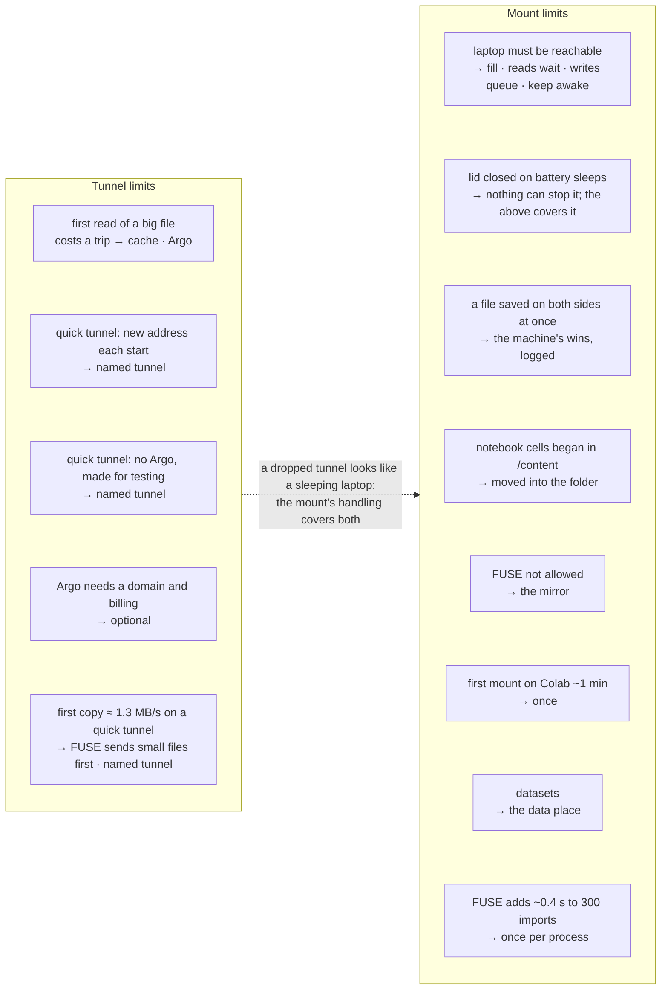

*Figure 11. The limits, sorted. Only one can't be engineered away: the code lives on your laptop. For a run of
several days with the laptop closed, unmounting (copying) is still the safer choice.*

## 9. Trying it yourself, step by step

### 9.1 Before you start

1. Merge or check out `claude/epic-darwin-18jc7s` and deploy the site (or run it locally), so the page has the mount
   switch.
2. Update the Companion on your laptop to **0.19.0**: Settings → Updates, or run the setup line again.
   `reader-companion --version` should say 0.19.0.

### 9.2 The tests on your laptop (10 minutes)

```bash
cd companion
git fetch origin && git checkout claude/epic-darwin-18jc7s   # the mount is on this branch until #322 is merged
python3 -m venv .venv && . .venv/bin/activate
pip install -e . fusepy
python3 -m unittest discover -s tests          # 177 tests; FUSE ones skip where there's no /dev/fuse (macOS)
cd .. && npm ci && npx tsc -b && node --test scripts/compute-link.test.mjs scripts/companion.test.mjs
```

Use `python3` (macOS has no `python` command outside a virtual environment). On macOS, which has no `/dev/fuse`
without macFUSE, the FUSE tests skip and the mirror tests still run. On Linux,
`sudo apt-get install fuse libfuse2` first.

### 9.3 A real tunnel, measured (5 minutes)

```bash
cd companion
python3 -m tests.live_tunnel --save ~/koios-live.json
```

Expect a `trycloudflare.com` address within about 10 s. The script then waits for the new name to resolve and says so
every few seconds; this can take a minute. Then come "mounted" and these lines:

- **6 MB cold / cached** (FUSE only): the cold read is your trip to Cloudflare and back, twice.
- **save here → there:** about 0.25 s (section 6.2).
- **write there → here:** about 0.6 s in the mirror; with FUSE, by the time the file is closed.
- **round trip of a small request** in milliseconds, and **MB/s** for a 6 MB file through the tunnel.

If it gives up waiting for the name, your computer has cached "no such name" from its first look. On a Mac, run
`sudo dscacheutil -flushcache; sudo killall -HUP mDNSResponder`, then run it again; each run gets a new address. For a
baseline without the tunnel on the same computer: `KOIOS_LIVE_LOCAL=1 python3 -m tests.live_tunnel`.

### 9.4 The mount on Colab (15 minutes)

1. Open a project whose files are on your laptop (Storage & compute → **Move files here** if they aren't), with its
   code on Colab, and connect a GPU runtime.
2. Storage & compute → **Sync** → tick **Mount the folder on Colab**. The first time, wait about a minute while fusepy
   installs. The bar should then read **Mounted on Colab ⇄ live**.
3. In the compute's terminal: `ls /content/playgrounds/*/` shows your files, and `mount | grep koios` shows the FUSE
   mount.
4. Edit a `.py` file on your laptop and save it. Within about a second, `cat` it on Colab.
5. In a notebook cell: `import os; os.getcwd()` should be the project's folder, and `import yourmodule` should work.
6. Run something that writes `results/x.json` and `checkpoints/model.pt`. The JSON appears on your laptop; the
   checkpoint doesn't, and turns up in Drive under `Koios/Data/<project>/` a few seconds later.
7. On macOS, while it is mounted, `pmset -g assertions | grep caffeinate` shows the Companion holding sleep off.
8. Turn Wi-Fi off for a minute and keep running. Reads go on, and a file written meanwhile appears on your laptop
   once Wi-Fi is back. `cat ~/.koios-mount/*/status.json` on Colab shows `awaySince` and `waitingToWrite`.
9. Untick the switch. The bar goes back to **Send code**, and runs copy again.

### 9.5 Argo Smart Routing (20 minutes, needs a Cloudflare account)

1. Add a domain to Cloudflare, and set up billing if you want Argo.
2. Make an API token with: Account · Cloudflare Tunnel: Edit; Zone · DNS: Edit; Zone · Zone Settings: Edit;
   Zone · Zone: Read.
3. `reader-companion tunnel setup --hostname koios.yourdomain.com --api-token <token>`, then `reader-companion start`.
4. `reader-companion tunnel status` should say "named tunnel … Argo Smart Routing on".
5. Measure again with your tunnel, and compare with 9.3:

   ```bash
   KOIOS_LIVE_HOSTNAME=koios.yourdomain.com KOIOS_LIVE_TUNNEL_TOKEN=<from ~/.reader-companion/config.json> python3 -m tests.live_tunnel
   ```

6. If you decide Argo isn't worth what it costs, turn it off under the domain → Traffic → Argo Smart Routing, or run
   `reader-companion tunnel quick` to go back to quick tunnels.

### 9.6 What isn't verified yet

| | Why | How it gets verified |
| --- | --- | --- |
| The FUSE mount over a real tunnel, and the tunnel's round trip and MB/s | The Mac run was the mirror (no FUSE), with the earlier script | 9.4 (Colab), 9.3 again |
| fusepy and libfuse2 installed by the mount on a real Colab runtime | No Colab here | 9.4, steps 2 and 3 |
| Argo on a real account | Needs your account and billing | 9.5 |
| Keep-awake on a real Mac or Windows PC | Tested with stand-in processes only | 9.4, step 7 |
