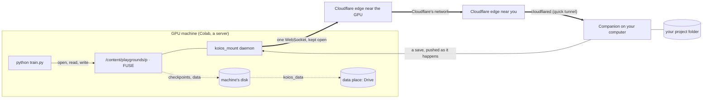

# Your folder, mounted on the compute

Your project's files can stay on your computer while its code runs on Colab's GPU or a GPU server of yours. Until
0.19.0 the code got there as a copy: before each run the changed files were copied over, and after it the results
were copied back. With the **mount**, the GPU machine reads the folder where it is, the way a notebook reads Google
Drive once it is mounted. Nothing is copied before a run and nothing is brought back after it.

This needs Koios Companion **0.19.0 or later** on the computer that has the files, and a compute link
([compute-link.md](compute-link.md)).

## 1. Turning it on

Storage & compute → **Sync** → **Mount the folder on <machine>**. The setting is kept with the project. Whenever the
machine doesn't have the folder mounted (a new Colab runtime, say), the page starts the mount again. The chip above
the terminal reads **Mounted on Colab ⇄ live** while it is up. From a terminal on the computer with the files:

```bash
koios mount            # fuse where the machine allows it, else a live mirror
koios mount --mode mirror
koios unmount          # back to copying before each run
koios status           # says whether it is mounted, and connected
```

While the folder is mounted, `koios run` and the page's **▶ Run** skip the copy, and **Copy now** says there is
nothing to copy.

## 2. What goes where

| A file… | Lives | Reaches the other side |
| --- | --- | --- |
| of your project (code, configs, notebooks, small results) | on your computer | the machine reads it there; a save on either side is on the other within about a second |
| the project's sync rules leave out (`data/`, `wandb/`, `*.pt`, `*.ckpt`, `*.safetensors`, by default) | on the machine's own disk, under the mount | put in the project's **data place** (Google Drive by default, or a computer of yours) a few seconds after it is closed |
| over 100 MB, written on the machine | on the machine's own disk | the data place, never the tunnel |
| a cache (`__pycache__`, `.ipynb_checkpoints`, `.reader/`) | on the machine | nowhere |

So a checkpoint written to `checkpoints/model.pt` is written at local disk speed on the GPU machine and goes to
wherever you keep data. It never crosses the tunnel to your laptop. The rules are the ones under **Not copied** in the
Sync pane, and they mean the same thing they did before.

## 3. How it reaches your computer



*Figure 1. The machine dials out to the nearest Cloudflare edge. Cloudflare carries the connection to the edge nearest
your computer, and the Companion's `cloudflared` hands it on. The browser and the Worker are not on the path, and
neither machine accepts a connection from the internet.*

- **One socket, kept open.** The daemon on the machine (`koios_mount.py`) holds one WebSocket to
  `/companion/mount/socket` on the Companion's tunnel. It doesn't open a connection per file or per run. If the socket
  drops, the daemon reconnects with backoff, and the Companion sends the tree again on reconnect.
- **The small files first.** On connecting, the Companion sends the folder's tree. Every file of 2 MB or less then
  comes over in a few gzip'd archives (Python files first), so imports and configs are local from the start. Bigger
  files are fetched in 4 MB pieces the first time they are opened, then kept in the cache.
- **Your saves are pushed, not polled for.** While a machine is connected, the Companion looks over the folder twice a
  second (stat calls only) and pushes each change straight away. A change of 512 KB or less carries the file itself, so
  the machine never has to ask for it. A write from the machine is not echoed back to it.
- **Writes go back on close.** A file written on the machine is sent when it is closed (or `fsync`'d), in pieces. The
  Companion writes it beside the original and swaps it in, so a reader on your computer never sees half a file.
- **The key opens one folder.** The machine holds a key made for this project's folder, kept in
  `~/.reader-companion/mounts/` (0600). It never gets the Companion's token. The socket refuses paths outside the
  folder, links that lead out of it, and paths the rules say are the machine's own. **Unmount** forgets the key, which
  closes every socket that used it.

## 4. Two modes

- **fuse** (Colab and most servers: `/dev/fuse` and libfuse 2). This is a real mount, and it is lazy: only what is
  opened is fetched. The first mount on Colab runs `pip install fusepy` and, as root, `apt-get install fuse libfuse2`.
  Allow about a minute for that.
- **mirror** (containers that don't allow FUSE). The folder is a real directory that the daemon keeps current both
  ways over the same socket. Every file is on the machine, but your saves still arrive as you make them, and edits made
  on the machine go back within a second.

In fuse mode, what was in the folder before the mount is sorted when the mount starts:

- **Copies of your files** from earlier pushes are dropped, because the mount is current.
- **The machine's own files** (checkpoints, the helpers under `.reader/`) are kept under the mount.
- **Anything else a run left there** is sent back to your computer.

Unmounting puts the machine's own files back in the folder, so copy-before-run works again as it did. A mirror
leaves what was there as it was, and sends only what changes after it starts.

## 5. What it costs, and what it can't do

- **The first read** of a file over 2 MB takes a round trip from the GPU machine to your computer through Cloudflare.
  That is tens of milliseconds within a region, a few hundred across oceans. Later reads come from the cache.
- **Your computer must stay on.** If it sleeps, a running job can still read what is already cached, and writes wait
  and are sent when the socket is back. A file it has never opened can't be read until then. For a run of several
  days with your laptop closed, copy-before-run (unmount) is still the safer choice.
- **Datasets** belong in the data place (`koios_data.path(...)`), not in the project folder. The mount carries code
  and results, not terabytes.
- **Notebook cells** run in the notebook's kernel, which starts in the machine's home folder (`/content` on Colab).
  To import the project from a cell, `%cd /content/playgrounds/<project>` first, as before.

## 6. Reference

| File | What |
| --- | --- |
| `companion/reader_companion/koios_mount.py` | The machine's side: the socket, the cache, the FUSE operations, the mirror, the data shipper, `start`/`stop`/`status`. Standard library, tornado and fusepy. |
| `companion/reader_companion/mount.py` | The Companion's side: the keys, the socket (`MountSocket`), the watch, and starting the daemon there through the link's kernel. |
| `companion/reader_companion/extension.py` | `ComputeHandler`: `POST companion/compute {action: "mount" \| "unmount" \| "mount-status"}`. `GET` says whether a machine is connected. |
| `companion/reader_companion/compute.py` | `koios mount`, `koios unmount`; `koios run` and `koios push` skip the copy while the folder is mounted. |
| `src/lib/computeLink.ts` | `mountThroughCompanion`, `unmountThroughCompanion`, `linkState`. |
| `src/components/PlaygroundWorkspace.tsx` | The switch in the Sync pane, the **Mounted** chip, and runs that skip the copy. |
| `companion/tests/test_mount.py`, `scripts/compute-link.test.mjs` | Tests. These include a real FUSE mount and a mirror, each edited on both sides, and the page's one call against a real Jupyter server standing in for the GPU box. |
