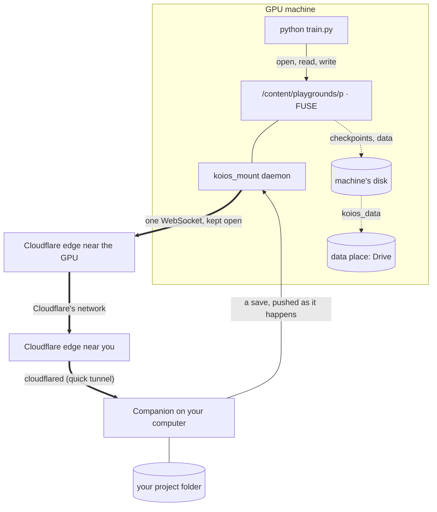

# Your folder, mounted on the compute

Your project's files can stay on your computer while its code runs on Colab's GPU or a GPU server of yours. Before
Companion 0.19.0 the code got there as a copy: before each run the changed files were copied over, and after it the results
were copied back. With the **mount**, the GPU machine reads the folder where it is, the way a notebook reads Google
Drive once it is mounted. Nothing is copied before a run and nothing is brought back after it.

How it was built, checked and measured, with the step-by-step test plan, is in
[compute-mount-process.md](compute-mount-process.md). Both documents are printed as one PDF,
`docs/compute-mount-process.pdf` (`node scripts/compute-mount-pdf.mjs`).

This needs Koios Companion **0.19.0 or later** on the computer that has the files, and a compute link
([compute-link.md](compute-link.md)).

## 1. Turning it on

Storage & compute → **Sync** → **Mount the folder on <machine>**. The setting is kept with the project. Whenever the
machine doesn't have the folder mounted (a new Colab runtime, say), the page starts the mount again. The chip above
the terminal reads **Mounted on Colab ⇄ live** while it is up. From a terminal on the computer with the files:

```bash
koios mount            # fuse where the machine allows it, else a live mirror
koios mount --mode mirror
koios unmount          # back to copying before each run
koios status           # says whether it is mounted, and connected
```

While the folder is mounted, `koios run` and the page's **▶ Run** skip the copy, and **Copy now** says there is
nothing to copy.

## 2. What goes where

| A file… | Lives | Reaches the other side |
| --- | --- | --- |
| of your project (code, configs, notebooks, small results) | on your computer | the machine reads it there; a save on either side is on the other within about a second |
| the project's sync rules leave out (`data/`, `wandb/`, `*.pt`, `*.ckpt`, `*.safetensors`, by default) | on the machine's own disk, under the mount | put in the project's **data place** (Google Drive by default, or a computer of yours) a few seconds after it is closed |
| over 100 MB, written on the machine | on the machine's own disk | the data place, never the tunnel |
| a cache (`__pycache__`, `.ipynb_checkpoints`, `.reader/`) | on the machine | nowhere |

So a checkpoint written to `checkpoints/model.pt` is written at local disk speed on the GPU machine and goes to
wherever you keep data. It never crosses the tunnel to your laptop. The rules are the ones under **Not copied** in the
Sync pane, and they mean the same thing they did before.

## 3. How it reaches your computer



*Figure 1. The machine dials out to the nearest Cloudflare edge. Cloudflare carries the connection to the edge nearest
your computer, and the Companion's `cloudflared` hands it on. The browser and the Worker are not on the path, and
neither machine accepts a connection from the internet.*

- **One socket, kept open.** The daemon on the machine (`koios_mount.py`) holds one WebSocket to
  `/companion/mount/socket` on the Companion's tunnel. It doesn't open a connection per file or per run. If the socket
  drops, the daemon reconnects with backoff, and the Companion sends the tree again on reconnect.
- **The small files first.** On connecting, the Companion sends the folder's tree. Every file of 2 MB or less then
  comes over in a few gzip'd archives (Python files first), so imports and configs are local from the start. Bigger
  files are fetched in 4 MB pieces the first time they are opened, then kept in the cache.
- **Your saves are pushed, not polled for.** While a machine is connected, the Companion looks over the folder twice a
  second (stat calls only) and pushes each change straight away. A change of 512 KB or less carries the file itself, so
  the machine never has to ask for it. A write from the machine is not echoed back to it.
- **Writes go back on close.** A file written on the machine is sent when it is closed (or `fsync`'d), in pieces. The
  Companion writes it beside the original and swaps it in, so a reader on your computer never sees half a file.
- **The key opens one folder.** The machine holds a key made for this project's folder, kept in
  `~/.reader-companion/mounts/` (0600). It never gets the Companion's token. The socket refuses paths outside the
  folder, links that lead out of it, and paths the rules say are the machine's own. **Unmount** forgets the key, which
  closes every socket that used it.

## 4. Two modes

- **fuse** (Colab and most servers: `/dev/fuse` and libfuse 2). This is a real mount, and it is lazy: only what is
  opened is fetched. The first mount on Colab runs `pip install fusepy` and, as root, `apt-get install fuse libfuse2`.
  Allow about a minute for that.
- **mirror** (containers that don't allow FUSE). The folder is a real directory that the daemon keeps current both
  ways over the same socket. Every file is on the machine, but your saves still arrive as you make them, and edits made
  on the machine go back within a second.

In fuse mode, what was in the folder before the mount is sorted when the mount starts:

- **Copies of your files** from earlier pushes are dropped, because the mount is current.
- **The machine's own files** (checkpoints, the helpers under `.reader/`) are kept under the mount.
- **Anything else a run left there** is sent back to your computer.

Unmounting puts the machine's own files back in the folder, so copy-before-run works again as it did. A mirror
leaves what was there as it was, and sends only what changes after it starts.

## 5. When your computer sleeps, or is far away

The mount is built so a laptop that sleeps, loses its network, or sits on another continent slows a run down at
worst. It never stops one.

- **Everything comes over in the background.** After the first archives, the daemon fetches the rest of your files
  one at a time, smallest first. That covers each file up to 200 MB, and up to 4 GB in all
  (`KOIOS_MOUNT_FILL_FILE_MB`, `KOIOS_MOUNT_FILL_MB`; `0` turns it off). After that the machine reads nothing from your
  computer, so a sleep mid-run costs nothing for reads.
- **A read that does need your computer waits instead of failing.** If a file isn't on the machine yet and your
  computer can't be reached, the read waits up to 15 minutes for the connection to come back (`KOIOS_MOUNT_WAIT_S`).
  The program is held up, not crashed. Listings and file sizes never wait: they come from the tree the machine
  already has.
- **Writes queue.** A file written while your computer is away is kept on the machine, and the program's `close()`
  succeeds. The queue is saved on disk, so it survives a restart of the daemon. It is sent as soon as the socket is
  back, and the daemon redials with backoff. If your computer saved the same file in the meantime, the machine's
  version wins, and the daemon logs it.
- **Your computer is kept awake while it is mounted.** While a machine is connected, the Companion holds the system's
  own lock against sleep: `caffeinate -i -s` on macOS, `systemd-inhibit` on Linux, `SetThreadExecutionState` on
  Windows. It lets go when the last machine disconnects. The display can still sleep. A laptop on battery with its lid
  closed sleeps anyway; nothing a program does changes that, and the three points above cover it. To turn this off,
  put `"keep_awake": false` in `~/.reader-companion/config.json`.
- **Notebook cells run in the project's folder.** While the folder is mounted, the page moves the notebook's kernel
  into it, quietly, once per kernel: no output, and no cell number used. So `import mymodule` and relative paths work
  from a cell as they do from the console.
- **Distance.** The first read of a big file costs a round trip through Cloudflare: tens of milliseconds within a
  region, a few hundred across an ocean. Argo Smart Routing (below) shortens that middle leg. Datasets still belong
  in the data place (`koios_data.path(...)`), not in the project folder.

## 6. A tunnel of your own, with Argo Smart Routing

The Companion's default tunnel is a free **quick tunnel**. It needs no account, but it gets a new
`….trycloudflare.com` address at every start and can't use Argo. **Argo Smart Routing** is Cloudflare's paid
routing. It carries traffic between Cloudflare's data centres on the paths it currently measures as fastest. For a
mount, that is the leg between the edge near the GPU machine and the edge near your computer. To use it, give the
Companion a **named tunnel** on your own Cloudflare account:

1. You need a domain on Cloudflare (any plan) with billing set up; Argo is billed per month and per GB.
2. Create an API token at dash.cloudflare.com → My Profile → API Tokens. It needs these permissions, and can be
   limited to the one zone:
   - Account · Cloudflare Tunnel: Edit
   - Zone · DNS: Edit
   - Zone · Zone Settings: Edit
   - Zone · Zone: Read
3. On the computer with the files:

   ```bash
   reader-companion tunnel setup --hostname koios.example.com --api-token <token>
   reader-companion start            # or reopen the Koios app
   reader-companion tunnel status    # named tunnel, Argo on
   ```

Setup does the following through Cloudflare's API:

- creates (or reuses) a tunnel named `koios-<computer id>`;
- points `https://koios.example.com` at the Companion;
- adds the DNS record;
- turns Argo Smart Routing on for the zone;
- keeps the tunnel's own token in the Companion's settings (0600).

The API token is not saved. The Companion runs `cloudflared tunnel run` with the tunnel's token in its environment,
not on the command line. Mounts then dial the fixed address, so a restart of the Companion no longer changes it.

If Argo can't be turned on (no billing, or a token without Zone Settings: Edit), setup says why and the tunnel works
without it. You can turn Argo on later under your domain → Traffic → Argo Smart Routing.
`reader-companion tunnel quick` goes back to quick tunnels.

## 7. Measuring it over a real tunnel

`companion/tests/live_tunnel.py` serves a folder and mounts it through a real tunnel, measures it, and prints:

- how long the mount takes to be ready;
- a cold and a cached read of a 6 MB file;
- how long a save takes to reach the other side, each way;
- the round trip of a read.

```bash
cd companion && python3 -m tests.live_tunnel                    # a quick tunnel
KOIOS_LIVE_HOSTNAME=koios.example.com KOIOS_LIVE_TUNNEL_TOKEN=<tunnel token> python3 -m tests.live_tunnel   # yours, with Argo
```

Both ends run on one computer, but the daemon dials the tunnel's public address, so every byte goes out to
Cloudflare and back in. It needs `cloudflared` to reach Cloudflare's edge: TCP or UDP port 7844 out, and DNS for
`argotunnel.com`. Many CI sandboxes block that; the one this feature was built in did. There, `cloudflared` was handed
a `trycloudflare.com` address (that request is ordinary HTTPS) but couldn't open the tunnel itself.

## 8. Reference

| File | What |
| --- | --- |
| `companion/reader_companion/koios_mount.py` | The machine's side: the socket, the cache, the FUSE operations, the mirror, the data shipper, `start`/`stop`/`status`. Standard library, tornado and fusepy. |
| `companion/reader_companion/mount.py` | The Companion's side: the keys, the socket (`MountSocket`), the watch, and starting the daemon there through the link's kernel. |
| `companion/reader_companion/extension.py` | `ComputeHandler`: `POST companion/compute` with the action `mount`, `unmount` or `mount-status`. `GET` says whether a machine is connected. |
| `companion/reader_companion/awake.py` | This computer kept from sleeping while a machine has a folder mounted. |
| `companion/reader_companion/cloudflare.py`, `tunnel.py` | `reader-companion tunnel setup`: a named tunnel at your hostname, with Argo Smart Routing; the Companion runs it instead of a quick tunnel. |
| `companion/reader_companion/compute.py` | `koios mount`, `koios unmount`; `koios run` and `koios push` skip the copy while the folder is mounted. |
| `src/lib/computeLink.ts` | `mountThroughCompanion`, `unmountThroughCompanion`, `linkState`. |
| `src/components/PlaygroundWorkspace.tsx` | The switch in the Sync pane, the **Mounted** chip, and runs that skip the copy. |
| `companion/tests/live_tunnel.py` | The mount over a real tunnel, measured (section 7). |
| `companion/tests/test_mount.py`, `test_awake.py`, `test_cloudflare.py`, `scripts/compute-link.test.mjs` | Tests. These include a real FUSE mount and a mirror, each edited on both sides, and the page's one call against a real Jupyter server standing in for the GPU box. |
