# Files on your computer, code on Colab: the whole process

This is the process document for the October 2026 updates to the Playground: moving a project's files to your own
computer, seeing how far a move is, and then working from one terminal that has the files beside it and the compute
a command away. It ties together three pieces, each with its own detailed page:

| Piece | What it does | Detailed page |
| --- | --- | --- |
| Storage & compute | Moves a project's files between Drive, your computers and Colab's disk, and changes the machine | [storage-moves.md](storage-moves.md) |
| The progress bar | Shows how far a move is, step by step, with speed and time left | [storage-moves.md, "Reading the progress bar"](storage-moves.md#reading-the-progress-bar) |
| The compute link | A terminal on the computer with the files, and `koios` to reach Colab or a server from it | [compute-link.md](compute-link.md) |

Read this page first for the end-to-end process; go to the detailed pages for the mechanics.

## 1. The picture

Before these updates a project had one place for its files (usually Drive) and one machine for its code (usually
Colab), and everything, the explorer, the editor, the terminal, went through the page to that machine. With files on
Drive the explorer was slow, and the terminal was a Colab shell the page polled.

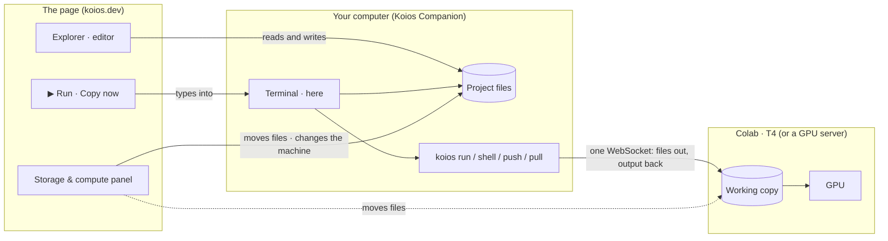

*Figure 1. After the updates. The files live on your computer. The page edits them there. The terminal is a local
shell on that computer. The compute is reached from that shell by `koios`, and by the page's Run and Copy buttons,
which type into the same shell.*

## 2. The process, start to finish

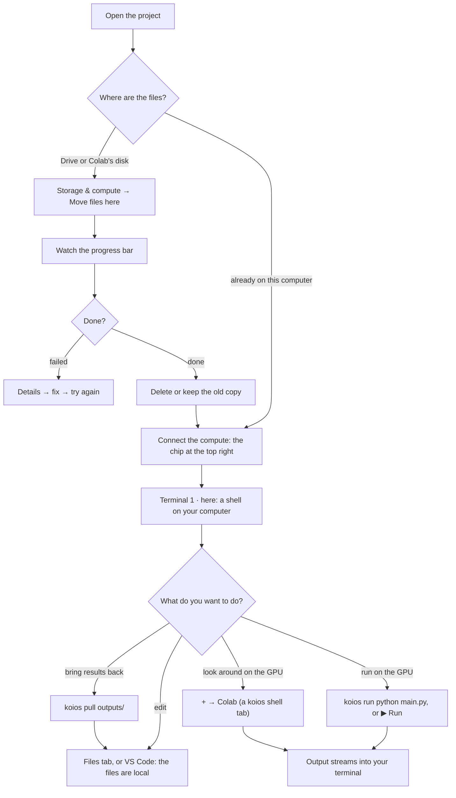

*Figure 2. The decision flow. Steps 2 to 6 are one-time per project; from then on it's the loop at the bottom.*

### Step 1: Update the Companion

Everything here needs Koios Companion **0.17.0** on the computer that will hold the files. Settings → Updates, or
the Koios app updates it on its own. Older Companions keep working as before: the page notices and uses its old ways.

### Step 2: Move the files to your computer

Open the project and click **Storage & compute** in the project's bar. The panel lists every place the files could
be, with free space, and every machine the code could run on.

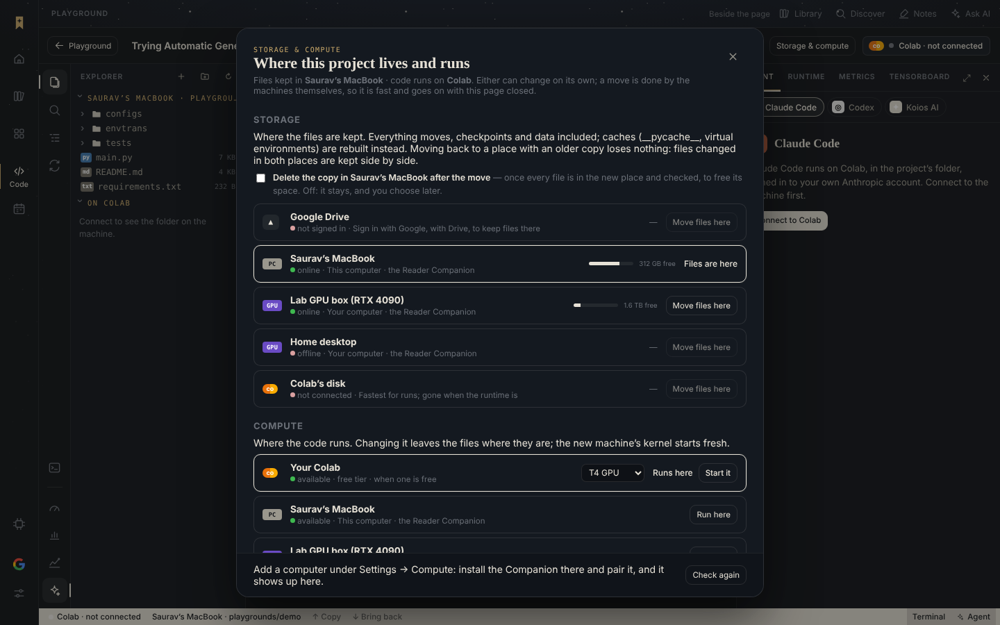

*Figure 3. The panel. Tick **Delete the old copy after the move** if you want the space back where the files were.*

Click **Move files here** next to your computer. The machines do the move themselves: Drive is fetched by your
computer directly, or a Colab disk packs an archive into Cloudflare R2 and your computer unpacks it. Closing the page
doesn't stop a move.

### Step 3: Watch the progress bar

A strip above the editor follows the move from any page of the project:

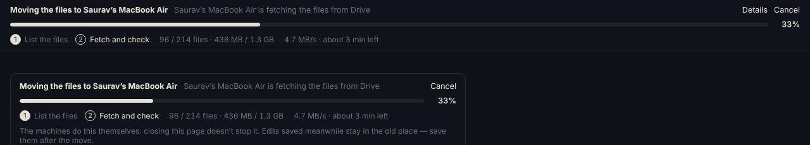

*Figure 4. The bar is counted by bytes. Under it: the steps with the current one marked, the files and bytes done
against the totals, and the speed and time left measured over the last 30 seconds.*

Before there is anything to count against, the bar runs without a number. For a big Drive folder this is the listing,
one call per folder, and the line counts the files found so far:

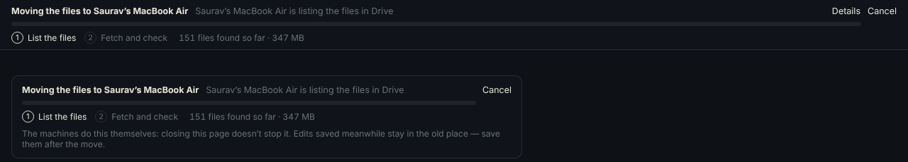

*Figure 5. Listing. The totals aren't known yet, so the count only goes up.*

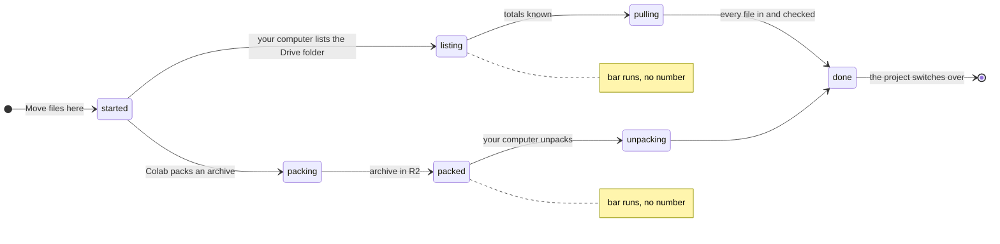

*Figure 6. What the bar shows in each state. The two "no number" states are where there is nothing to count against
yet.*

When the move is done the project switches to your computer by itself, and asks what to do with the old copy.

### Step 4: Connect the compute

The chip at the top right (**Colab · T4**, or a server of yours) connects the machine the code runs on, exactly as
before. Nothing about connecting changed. As it connects, the page hands your Companion the way to reach it (section
3), so the terminal can use it.

### Step 5: Work from one terminal

The panel's first terminal, marked **here**, is a shell on your computer in the project's folder. It answers as fast
as Terminal.app, because it is the same thing: a local shell.

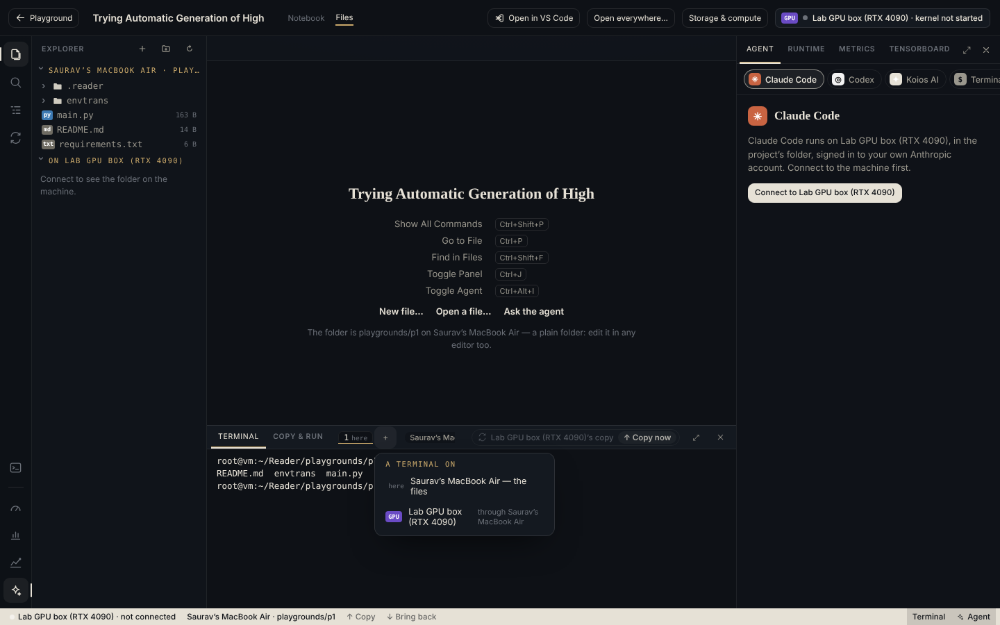

*Figure 7. **+** opens another terminal here, or one on the compute.*

From a **here** terminal:

```bash
koios run python main.py     # push what changed, run on the GPU, output here
koios shell                  # a shell on the GPU, in this terminal; exit comes back
koios pull outputs/          # results back to your computer
koios push                   # push without running
koios status                 # where the project runs; whether the pass is valid
```

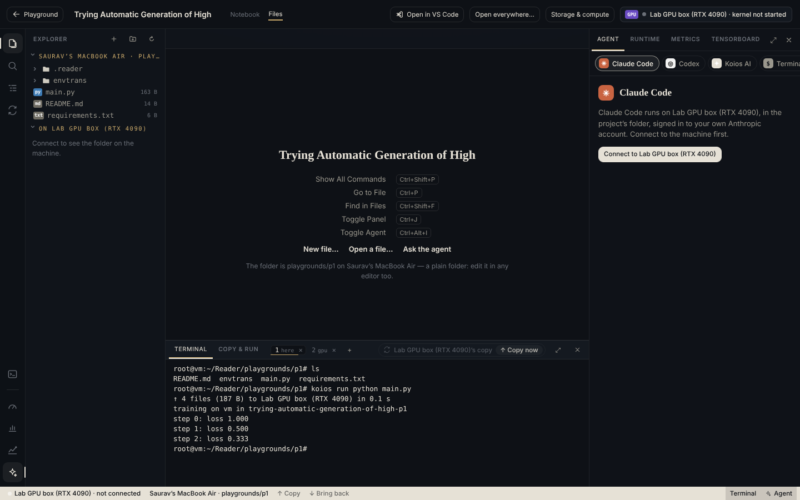

*Figure 8. `koios run`. Only the four files that changed went over, in 0.1 s, then the command ran there with its
output streaming here.*

**▶ Run** does the same as `koios run`: it copies the changed files through the Companion and types
`koios run --no-push -c '<your command>'` into the **here** terminal. **Copy now** copies without running.

A **colab** (or **gpu**) tab is a shell on the compute. It opens in the project's folder there:

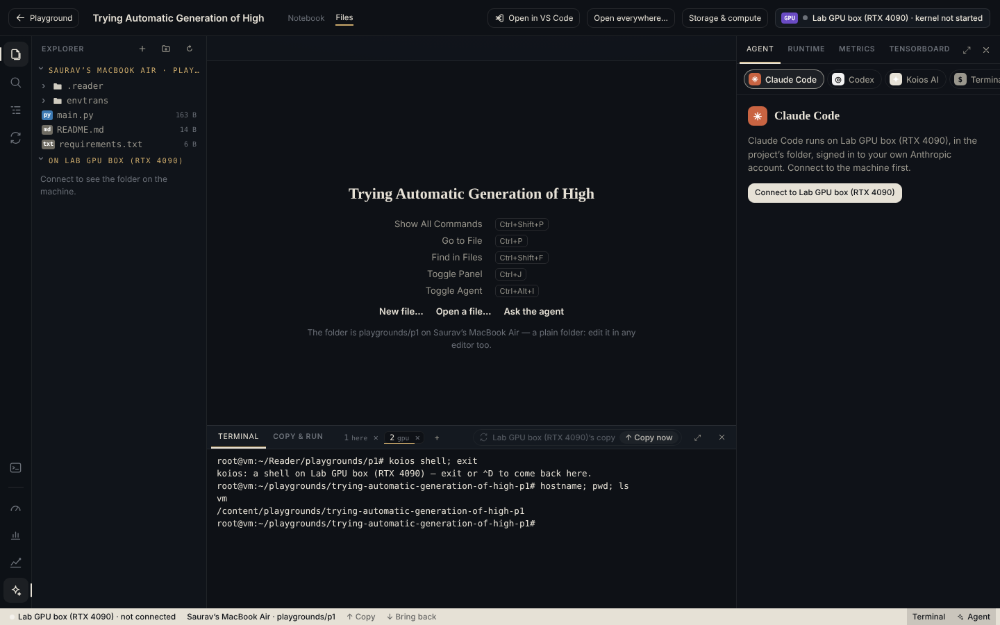

*Figure 9. A shell on the compute, inside the same panel.*

The `koios` command also works outside Koios: in Terminal.app or VS Code's terminal, `cd` into
`~/Reader/playgrounds/<project>` and use it there.

## 3. How the pieces talk to each other

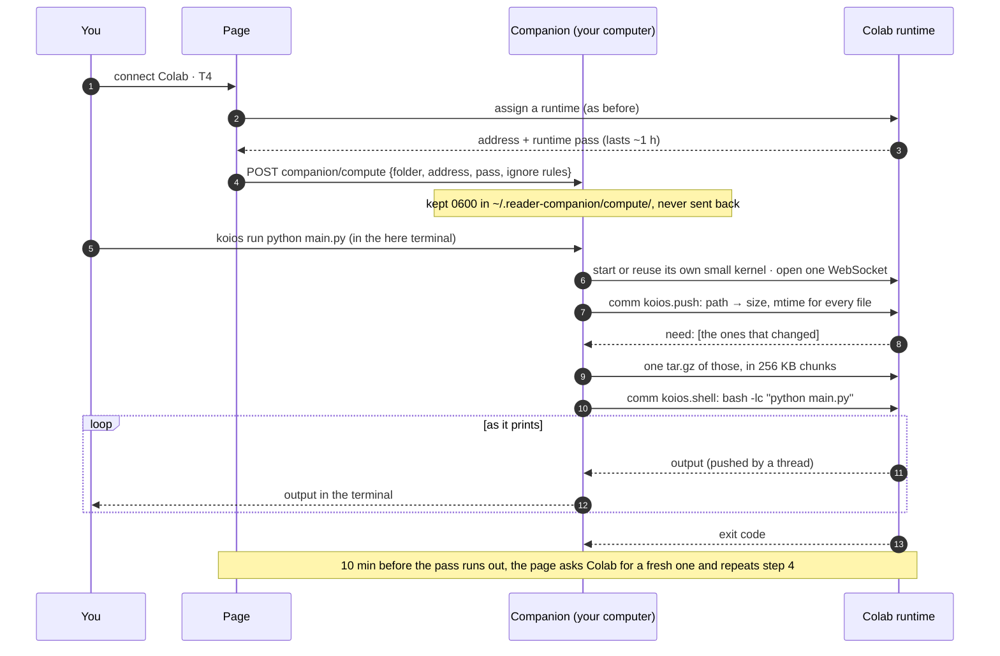

*Figure 10. One run, end to end. The page only hands over the address and keeps the pass fresh. The Companion and
Colab talk directly.*

Why this is fast, in one table:

| | Before | After |
| --- | --- | --- |
| Where the terminal runs | Colab, through the page | Your computer |
| How a key gets to Colab | The page types it into a kernel, then polls for output several times a second | `koios` sends it over an open socket; output is pushed back the moment it is printed |
| How files reach Colab | One at a time through the browser, text only, under 2 MB | One archive of only the changed files, any type (over 100 MB with `--big`) |
| Running from VS Code or Terminal.app | Not possible | `koios run …` |

## 4. What the review of these updates changed

Before merging, the two pull requests were reviewed line by line and test-merged. The progress bar needed nothing.
The compute link had one bug and four things worth tightening, all fixed in the same pull request:

| Found | Fixed |
| --- | --- |
| A pushed file that later grew past 100 MB was taken for deleted and removed on Colab | A push lists every file and says separately which it holds back |
| A **colab** tab reopened after a reload came back as a plain local shell | A tab found again starts `koios shell` itself |
| A project moved back to run on your computer kept a stale link to the old Colab | The link is forgotten when the code no longer runs elsewhere |
| Colab's pass was renewed for whichever session was current | Renewed for this project's own session, with a fallback by notebook |
| Every compute tab was marked "gpu" | "colab" or "gpu", for what the compute is |

What has **not** been tested: a real Colab runtime. The Companion reaches Colab the same way the site's own server
already does (same address, token, headers and origin), so it is expected to work, but the first real run will be on
your machine after the Companion update. If it fails, `koios status` and `koios run` say what went wrong.

## 5. When something goes wrong

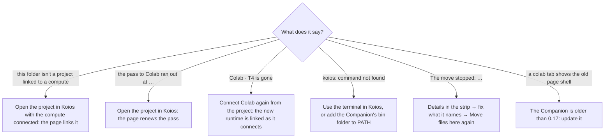

*Figure 11. The messages and what to do. The full table is in [compute-link.md](compute-link.md#5-when-something-goes-wrong)
and [storage-moves.md](storage-moves.md#13-when-something-goes-wrong).*

## 6. Where the code is

| Area | Files |
| --- | --- |
| Moves and the progress bar | `worker/moves.js`, `companion/reader_companion/mover.py`, `src/lib/moves.ts`, `src/lib/movePlan.ts`, `src/components/StoragePanel.tsx` |
| The compute link, Companion side | `companion/reader_companion/compute.py` (the `koios` command and the kernel-side comms), `extension.py` (`companion/compute`), `env.py` (`koios` in every terminal) |
| The compute link, page side | `src/lib/computeLink.ts`, `src/lib/colab.ts` (`renewRuntimeProxy`), `src/components/PlaygroundWorkspace.tsx`, `src/components/Terminal.tsx` |
| Tests | `scripts/move-plan.test.mjs`, `scripts/moves.test.mjs`, `scripts/compute-link.test.mjs`, `companion/tests/test_mover.py`, `test_compute.py`, `test_compute_handler.py` |
| Pull requests | [saurav717/reader#310](https://github.com/saurav717/reader/pull/310) (progress bar), [saurav717/reader#311](https://github.com/saurav717/reader/pull/311) (compute link) |
