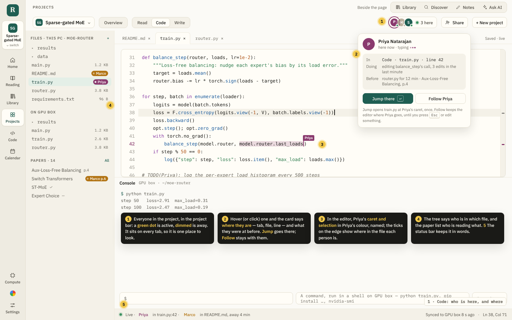
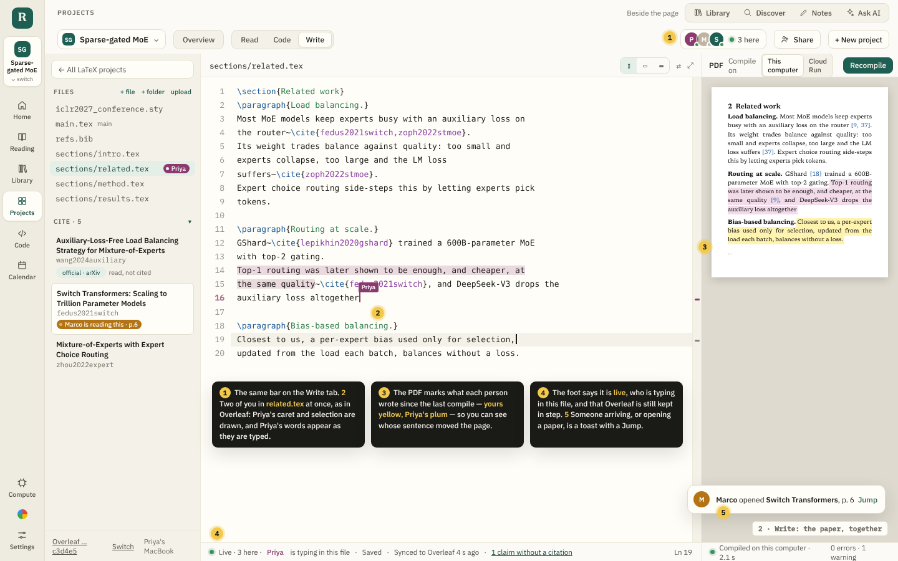
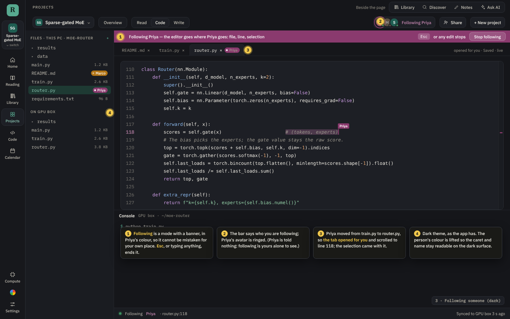
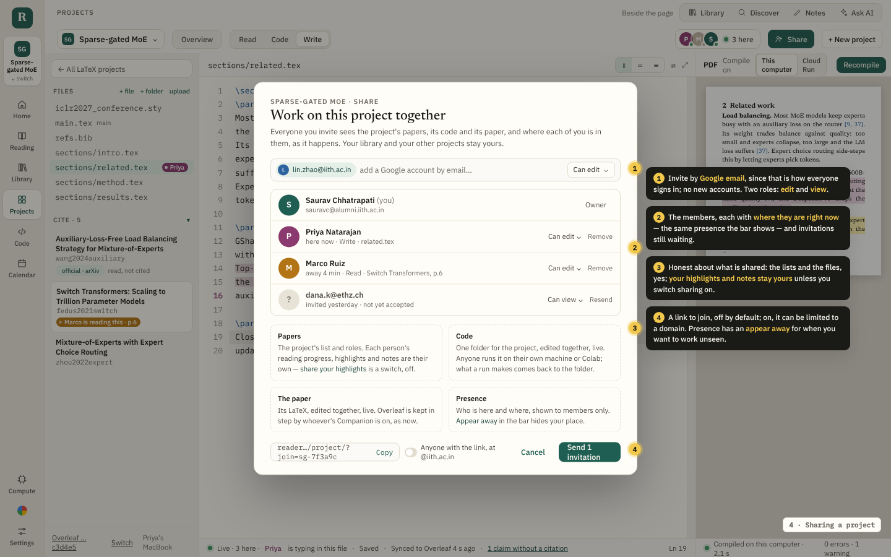
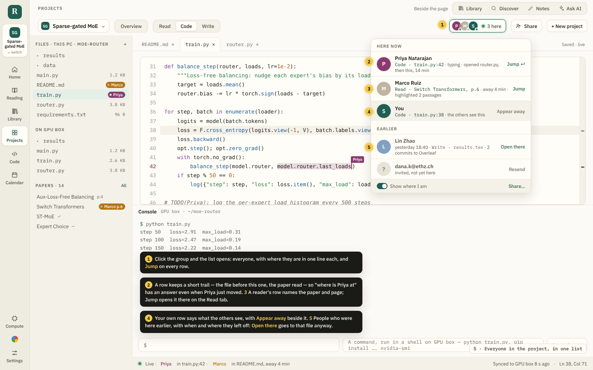

# Working on a project together, live

A project is one person's today: its papers, its code and its paper are in
that person's library, on that person's Drive, and the paper's folder is on
that person's computer. Two people on the same paper meet only through
Overleaf's Git, a few seconds after each stops typing, with conflict marks
where they crossed.

This is the design for **sharing a project with the people you work with,
and seeing where each of them is while you work**: a bar on every project
page naming who is here, a card on each person that says which tab, file and
line they are at, **Jump** to go there and **Follow** to stay with them, their
carets drawn in the editor, and — in a second step — the code and the LaTeX
edited together as Overleaf edits them, every keystroke shared. The pictures
are static mock-ups in the app's own colours and type; their sources are in
[`mockups/live-src/`](mockups/live-src/), and
`node docs/mockups/live-src/render.mjs` renders them again.

---

## The pictures

### 1 · Code: who is here, and where



The project bar — the one with **Overview · Read · Code · Write** on it —
gets the people in the project at its right, so it is in the same place on
every tab: a stack of avatars (the Google picture where there is one,
initials in the person's colour otherwise), a green dot for someone active,
dimmed for someone away, and *3 here*. Hover one and a card says where they
are in words a person would use — *Code · train.py · line 42 · typing* —
what they were at before, and two buttons. **Jump there** opens that tab, that
file, and puts the caret where theirs is, once. **Follow** keeps the editor
wherever they go until you press Esc or edit something.

The editor draws every other person's caret in their colour with their name
on a flag, and their selection tinted the same, as Overleaf and VS Code Live
Share do. Ticks on the editor's right edge show where in the file each person
is. The file tree names who is in which file, the paper list who is reading
what, and the status bar at the foot says the same in words.

### 2 · Write: the paper, together



The same bar, the same carets, in the LaTeX. Two people in `related.tex` at
once: Priya's words appear as they are typed, and the compiled page marks
what each person wrote since the last compile in that person's colour, so
*whose sentence moved the page* has an answer. The foot says it is live, who
is typing in this file, and that Overleaf is still kept in step — the Git
sync does not go away; it is how the paper reaches coauthors who stay in
Overleaf. Someone arriving, or opening a paper, is a toast with a Jump on it.

### 3 · Following someone



Following is a mode, and looks like one: a banner across the editor in the
person's colour, so it cannot be mistaken for your own place. When Priya
moves from `train.py` to `router.py`, the tab opens for you and scrolls to
Priya's line; the selection comes with it. Esc, or typing anything, ends it.
The person followed is told nothing — following is yours alone to see.

### 4 · Sharing a project



**Share** on the project bar. Invitations are by Google email, because that
is how everyone signs in: no new accounts, no passwords. Two roles, *edit*
and *view*. The members are listed with where each is right now — the same
presence the bar shows — and invitations still waiting. Four boxes say
plainly what is shared and what is not: the project's papers and their
roles, yes; **your reading progress, highlights and notes stay yours** unless
you switch sharing on; the code folder and the LaTeX, live; who is here and
where, to members only. A join link exists, off by default, and can be
limited to a domain.

### 5 · Everyone in the project, in one list



Click the group and the list opens: everyone, one line each, Jump on every
row. A row keeps a short trail — the file before this one, the paper read —
so *where is Priya at* has an answer even when Priya just moved. A reader's
row names the paper and page, and Jump opens it there on the Read tab. Your
own row says what the others see, with **Appear away** beside it. People who
were here earlier are listed with when and where they left off; *Open there*
goes to that file anyway.

---

## How it works

### A shared project is a room

Underneath, a project is a collection with a project record on it, in
`library.json` on the owner's Drive (`src/lib/projects.ts`). Sharing adds
one thing beside it: a **room** on the Worker, a Durable Object
(`worker/projectRoom.js`, bound as `ROOMS` in `wrangler.toml`, SQLite-backed
like `Devices` and `LatexJob`), named `room:<owner email>:<project id>`.
The room holds:

- **the members** — email, role, name, picture, the colour assigned to them,
  when they joined — and the invitations waiting;
- **the project's list** — its paper ids and roles, its question and to-do,
  so every member's copy of the project shows the same papers;
- **presence** — where each member is right now, in memory, and when each was
  last here, in storage;
- in the second step, **the live documents** (below).

Inviting writes an invitation to the room and sends nothing itself: the
owner copies the link, or the app mails it through Gmail if that is
connected. Opening `/project/?join=<token>` with a pass whose email is
invited makes that person a member, and puts a project record in their own
library that points at the room (`shared: { owner, room }`). Their library
and their other projects are untouched. Reading progress, highlights and
notes stay per person, in each person's own database, exactly as a paper in
two of one person's collections keeps one set of highlights today.

Every request to a room carries the thirty-day pass the app already holds
(`server/passes.js`); the room checks the email on it against its members.
There is nothing to paste.

### Where someone is, as a record

```ts
interface Place {
  tab: 'overview' | 'read' | 'code' | 'write';
  path?: string;            // the file open, Code or Write
  line?: number; col?: number;
  sel?: [number, number];   // offsets in the file, when something is selected
  hash?: string;            // a short hash of the file as they see it
  paperId?: string; page?: number;   // Read
  active: boolean;          // false after 60 s without a key or a click, or when the tab is hidden
  at: number;               // when this was true
}
```

Everything in it already exists in the page. `CodeEditor` reports its caret
through `onCursor` (line, column, offset, how much is selected) to both the
workspace (`PlaygroundWorkspace.tsx`) and the Write tab (`Write.tsx`); the
Read tab knows its paper and page. A hook, `useMyPlace(project)`, publishes
the place: at once when the tab, file or paper changes, and caret moves
coalesced to one message every 150 ms. It sends nothing unless the project
is shared, and nothing at all with **Show where I am** off — the others then
see you here, with no place.

### The wire

One WebSocket per open shared project, from the page to the room
(`wss://<worker>/rooms/<id>/live`), the way the browser pane streams its
picture from `BrowserSession` today. The room uses Cloudflare's WebSocket
**hibernation** API — `state.acceptWebSocket`, `webSocketMessage`,
`webSocketClose` — so a room with nobody typing costs nothing and keeps its
sockets across the object being evicted; each socket's attachment carries
the member's email. Messages are small JSON:

| From the page | From the room |
|---|---|
| `{ type: 'place', place }` | `{ type: 'here', members: [{ who, place }] }` on connect |
| `{ type: 'away' }` / `{ type: 'back' }` | `{ type: 'place', who, place }` fanned out to the others |
| | `{ type: 'joined' \| 'left', who }` |
| | `{ type: 'members', … }` when the share dialog changes something |

A caret at seven messages a second from each of a dozen people is nothing
to a Durable Object. The page reconnects with backoff when the socket drops,
and the room drops a member's place when their socket closes. `GET
/rooms/<id>` answers the members and a snapshot of presence, for the share
dialog and for the Board, which can say *Priya is in Sparse-gated MoE now*.

### The bar, the card, the list

`PresenceBar` (`src/components/PresenceBar.tsx`) sits in `ProjectBar`
(`Projects.tsx`), after the spacer and before **New project**, so it is on
every tab of every shared project. The avatar is the Google picture the
sign-in already returns (`GoogleUser.picture`), or initials on the member's
colour. Colours come from a fixed palette of six, assigned by the room in
join order and kept there, so Priya is plum for everyone. The group is a
button; opening it gives the list of picture 5; hovering one person gives
the card of picture 1. The card, the list, the file tree's chips, the ticks
on the editor's edge and the status bar all read the same `places` map, so
they never disagree.

### Jump, and follow

A place is a destination. **Jump** sets the view (`onView({ kind:
'project', id, mode })`) and leaves the rest in a small store
(`src/lib/presence.ts`), the way `rememberWorkspacePaper` already tells the
workspace which paper to open: when the tab mounts it opens the file, calls
the editor's `goToLine` and `select` (both on `CodeEditorHandle` today), or
opens the paper at the page. A place is also a link: `route.ts` grows an
`&at=<path>:<line>` on the project address, so *copy a link to where Priya
is* works, and a Jump from a toast or a Board card is the same code.

**Follow** subscribes to one member's place and replays Jump each time it
changes, with the banner of picture 3; it stops on Esc, on any edit, or when
the person leaves. Your own place keeps being sent as the file and line you
are looking at, with no mention of following.

### In the editor

`CodeEditor` gains a `peers` prop: `{ id, name, color, offset, selected }[]`.
It is a textarea over a highlighted `<pre>`, and it already answers
`caretPoint(offset)` with the x and y of any offset in its box, for the
citation card. The peers layer is a third element over the `<pre>`: for each
peer, a two-pixel bar at `caretPoint`, a flag with the name above it, and
the selection as a tinted range drawn by the same line measure. The ticks on
the right edge are each peer's line over the file's lines. In the Write tab
the same layer works in wrapped mode, since `caretPoint` is what places the
suggestions there now.

Until files are edited together (next section), a peer's offset is into
*their* copy of the file. The place carries a short hash of that copy; where
it differs from yours, the caret is drawn grey at the line, and the card says
*editing a version you don't have yet*, rather than pointing at the wrong
word.

### Editing together

Presence alone is worth having, and ships first. Editing the same file at
the same time — what Overleaf does, and what picture 2 shows — is the
second step, and needs the files to live somewhere both people can reach.

**Step 1 · awareness.** Everything above. Files move as they do today: the
paper by Overleaf's Git (`overleafCloud.ts`, every few seconds after you
stop typing), the code by the Companion or the Jupyter contents API. Two
people in one file get a chip, *Priya is also editing this file*, and the
conflict marks there are now, which Reader never throws away.

**Step 2 · live documents.** The room holds a Yjs document per project — a
`Y.Text` per text file — and speaks Yjs's sync and awareness protocols over
the same socket; updates are appended to the object's SQLite storage and
compacted now and then, as `y-durableobjects` does. The editor binds to the
`Y.Text`: a local edit becomes insert and delete calls from the diff
(`src/lib/textDiff.ts` already computes it), a remote update is applied to
the textarea with the caret kept by a relative position, and undo is Yjs's
`UndoManager` scoped to this client, so ⌘Z takes back your own typing and
never someone else's. Carets are relative positions too, so they stop
drifting and the hash above is no longer needed.

The room is then the paper's source of truth while the project is shared,
and what exists today becomes its mirrors: the Overleaf Git sync pushes the
room's text instead of the folder's — through the Worker, so it works with
no Companion on — and each member's machine pulls the room's files before a
run, as **Copy to the machine** already does. A coauthor who stays in
Overleaf is still fine: their edits come in by Git, are merged into the
`Y.Text`, and show in the trail as *edited in Overleaf*, with no presence.
Someone offline edits locally and merges on reconnect, which is what a CRDT
is for. Figures and other binary files stay files, uploaded to the room's
storage, never merged.

**Step 3 · reading together.** With **share my highlights** on, highlights
appear in the others' copies as they are made, in the maker's colour; a
reader's place names the page, and the Read tab can show *Priya is reading
this*, page 6. Ask AI threads on a paper could be shared the same way.
Optional, and separate.

### What is never shared

Presence goes to members of that project and nobody else, and only while the
page is open. **Show where I am** off, or **Appear away**, sends no place.
Your library, your other projects, your notes and highlights, and your
conversations with Ask AI stay yours; the text you type is sent only in step
2, only for the project's own files. When someone is removed, their socket
is closed and their copy of the project becomes a plain, unshared one with
whatever papers it had. Last-seen is kept thirty days.

---

## Building it

| Piece | Where | Size |
|---|---|---|
| The room: members, invitations, presence, hibernating sockets, `/rooms/…` routes | `worker/projectRoom.js`, `worker/index.js`, `wrangler.toml` | 2–3 days |
| The place, the socket client, follow, the jump store, `&at=` in the address | `src/lib/presence.ts`, `src/lib/route.ts` | 2 days |
| The bar, the card, the list, the toast | `src/components/PresenceBar.tsx`, `Projects.tsx` | 2–3 days |
| The share dialog, the join link, the project record that points at a room | `src/components/ShareProject.tsx`, `src/lib/projects.ts`, `store.tsx` | 2 days |
| Peers in the editor, the edge ticks, chips in the trees, the status bars | `CodeEditor.tsx`, `PlaygroundWorkspace.tsx`, `Write.tsx` | 2–3 days |
| Tests: coalescing, colours, the jump target from a place, the stale hash | `scripts/presence.test.mjs` | with each |
| **Step 2** — Yjs in the room, the textarea binding, undo, the mirrors | the room, `CodeEditor.tsx`, `overleafCloud.ts`, the Companion | 2–3 weeks |

Step 1 is a fortnight of work and changes no file format: a project that is
not shared behaves exactly as now, and the Worker needs one new binding.

## Open questions

- **Where the folder lives in step 2.** The design makes the room the source
  of truth while shared, with Overleaf and each computer as mirrors. The
  other way round — the owner's Companion holding the files and relaying
  edits — keeps files off the Worker but needs that computer on for anyone
  to write. The room is the simpler story; it is also where Overleaf's
  design sits.
- **The Board.** Every project side by side could show who is in each right
  now, from the rooms' snapshots. Cheap once the rooms exist; not drawn here.
- **A phone.** The bar folds to the avatars alone; the card and the list
  work as they are. Carets in the editor are moot there.
