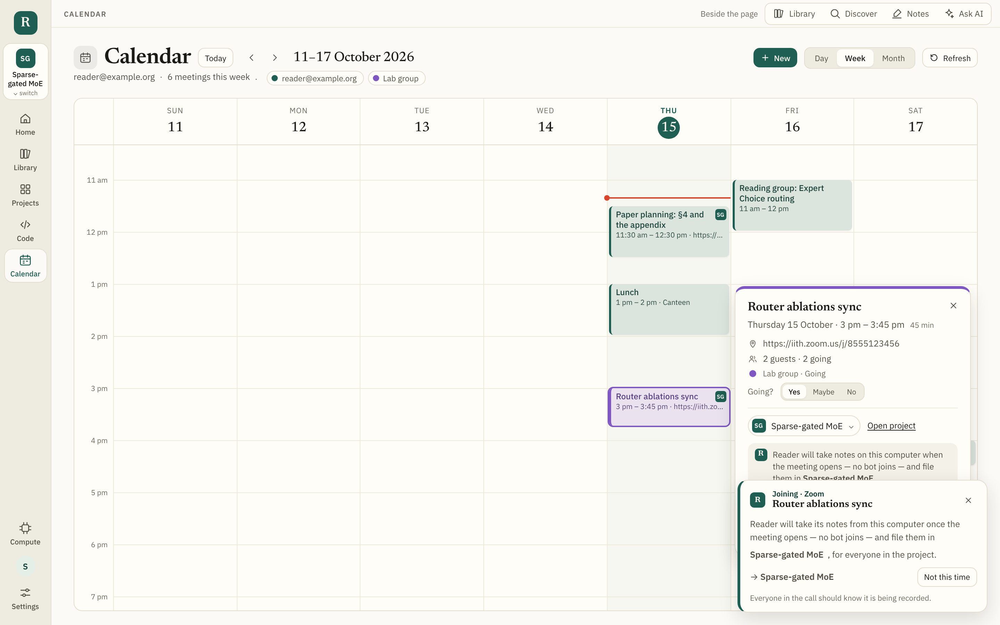

# Meetings and the project logbook

How a meeting made on the Calendar gets a call and its notes, and what a
project keeps besides its papers and code. The user-facing description is in
the README under [Calendar](../README.md#calendar) and
[The logbook](../README.md#the-logbook-meeting-notes-links-a-notepad-and-a-whiteboard).

## The problem

A research project's logistics live everywhere but the project: the Zoom link
in an email, the notes in someone's Granola, the results sheet pasted once in a
call's chat, the diagram on a whiteboard photographed by one person. The aim:
a meeting made here carries its call and its notetaker; its notes land in the
project it is for; and the project has one place for its notes, links, a
running notepad and a whiteboard — the same for everyone in it.

## Calls

Options weighed:

1. **Zoom OAuth per person** (a Zoom "user-managed" app): each person connects
   their Zoom account and meetings are made as them. Best result, but every
   user goes through Zoom's consent and the app needs Zoom's review.
2. **A Server-to-Server app on the Worker**: the site's own Zoom account makes
   meetings; nobody connects anything. Right for a lab sharing one Zoom
   account; wrong for strangers.
3. **A link**: paste one, or the person's own room saved once.

Done: **3 always, 2 when the Worker has credentials** (`worker/meetings.js`).
1 can come later behind the same `makeZoomMeeting` call. The link is written
where every calendar app shows it (place, first line of the description) and
in the event's private extended properties, where this page reads it back
exactly — so editing the event never doubles the line. Meet stays Google's own
conference (made on save, or removed when another call replaces it).

## Notes: Granola

Granola listens on the person's computer and reads the same Google Calendar —
there is no API to start it, and none is needed: a meeting on the calendar is
a meeting Granola sees. What is missing is the way back. Options:

1. **Poll Granola's API with the person's key** after a meeting ends, match the
   note to the meeting, file it. Needs a Business/Enterprise plan for the key.
2. **A webhook** (Granola → Zapier → the Worker) filing notes as they are
   written. No page needs to be open, but each person sets up a Zap.
3. **Paste the notes** (or a Granola share link) into the project.

Done: **1, with 3 as the fallback** ("Write notes"). Filing runs whenever the
Calendar is read or a project's Meetings tab opens, for meetings that asked
for Granola, ended over ten minutes ago, within a fortnight, are tagged with a
project and have no notes yet. A note is matched by Granola's calendar event
id, else the same title within twenty minutes of the start, else the same
title written during or just after the meeting (`src/lib/granola.ts`,
`noteFor`). A meeting is filed once; filing again replaces, never duplicates.
2 is the natural next step and would POST into the same room route.

## Notes: Reader's own, with no bot

Granola's API is for its Business and Enterprise plans, and a bot in the call
was ruled out. Reader records meetings itself instead, the way Granola and
Cluely do: on the person's computer, from the computer's sound and the
microphone, with nothing joining the call. Recall.ai's Desktop Recording SDK
does the hard part — finding the meeting window (Zoom, Meet in a browser,
Teams, Slack), capturing its audio and video, and transcribing as it goes — and
runs in the Reader app (Electron), which already wraps the site.

```
 Reader app (desktop/app/notes.js)          the page (src/lib/notetaker.ts)            Worker
 ────────────────────────────────          ─────────────────────────────────          ──────
 SDK: meeting-detected ───────────────────▶ match it to the calendar event
                                            (its call, else title, else the one on now)
                                            set to Reader notes? start : offer
                                            POST /notes/upload ──────────────────────▶ Recall: sdk_upload
                                            ◀─────────────────────────────────────── upload token
 ◀──────────────────────────── start(windowId, token)
 SDK: recording-started, transcript.data ─▶ turns, kept in IndexedDB as they come
 SDK: recording-ended ────────────────────▶ the Ask AI model writes it up
                                            note + transcript → the project's logbook (the room)
```

### Joining from the calendar

**Join** on an event (its card, or the day's list) opens the call as before and,
in the app, puts the offer in Reader's corner at once — before the meeting
opens, while its lobby is up:



- An event set to Reader notes, for a project: *Reader will take its notes once
  the meeting opens → the project*, with **Not this time**.
- Any other event: *Reader can take its notes…* with the project to pick and
  **Take notes**. Nothing is recorded unless said so.
- The call's own window is in front by then, so a system notification says
  the same over it (*Reader will take notes of …* / *Take notes of …?*);
  clicking it brings Reader to the front. The same word goes out when the
  recorder finds a meeting joined some other way — from Google Calendar, say —
  whether it started by itself or is only offered.
- When the recorder then sees the meeting open, it is taken as the one joined
  (its event's call, else — when the calendar does not know the window — the
  only one joined, unless its link says another call), and starts if said so.
  The offer goes by itself after fifteen minutes with no meeting.
- Once filed, the event's card says so, with **Open notes**, whether or not
  the event was set to notes beforehand.

- The transcript comes back to the app over the SDK's `desktop_sdk_callback`
  realtime endpoint, so the Worker needs no webhook and keeps nothing.
- The page can only ask: the app checks every call comes from the site's
  origin, and the preload exposes five calls, nothing else.
- A page reloaded mid-meeting takes the recording up again with what it had
  heard; one closed has its transcript written up the next time it opens.
- Consent: the card is on screen the whole time, says so when a recording
  started by itself, and the README says what the law may ask.

What needs a real machine to finish: the SDK's native recorder is only on
macOS and Windows, so the build (asarUnpack, the macOS entitlements and usage
strings in electron-builder.config.cjs) is untested here; the page side is
tested with the app stood in for (scripts/logbook-smoke.mjs).

## Where the logbook is kept

A shared project already has a room on the Worker (a Durable Object) that is
the record of its list, with a socket per open page. The logbook goes there
too (`worker/logbook.js`): notes, links and strokes under keys of their own,
each added or taken away whole — so concurrent edits never collide and no
value nears the storage limit — and the notepad as one text with a version,
as the list has. Every member reads; owner and editors write. A project not
shared keeps its logbook in IndexedDB; sharing hands it to the room, and
stopping hands it back (the room's `/close` answers with it).

## The four tabs

- **Meetings** — notes newest first, the open one with who was there, its
  action items (unchecked boxes, or a list under "Action items / Next steps")
  each a one-click project to-do, and the links it mentions, each a one-click
  keep. Beside them, the project's meetings in the coming fortnight.
- **Links** — "the links that might be overlooked" are found, not just kept:
  every link in the meetings' notes that is not kept yet is offered at the top
  (`suggestedLinks`). Kept ones are typed by host (doc, sheet, code, paper,
  dataset, recording…), pinned first.
- **Notepad** — Markdown, saved as you type. A save made on an older version is
  refused by the room with the newer text; the page puts its one changed
  stretch where the same surroundings are in the newer text (`mergePad`), so
  two people typing in different places both keep their words.
- **Whiteboard** — a canvas in fixed board units (1600×1000) scaled to fit.
  Pointer events give pressure for a stylus (width follows it) and coalesced
  points for smooth fast strokes; "Pen only" ignores touches once a pen has
  been seen (palm rejection). Strokes are thinned before they are kept. A
  stroke being drawn is sent over the socket every 80 ms (`ink`, kept by
  nobody), so the others watch it appear; the finished stroke replaces it.
  Ink drawn in the first colour is drawn in the theme's ink, so a board drawn
  in light mode reads in dark.

## Not done yet

- Zoom per-person OAuth; a Granola webhook route.
- Live co-editing of the notepad character by character (it merges on save,
  every ~0.7 s, which is enough for a running page but not for two people in
  the same sentence).
- Pages, pan and zoom on the whiteboard; shapes and text boxes.
