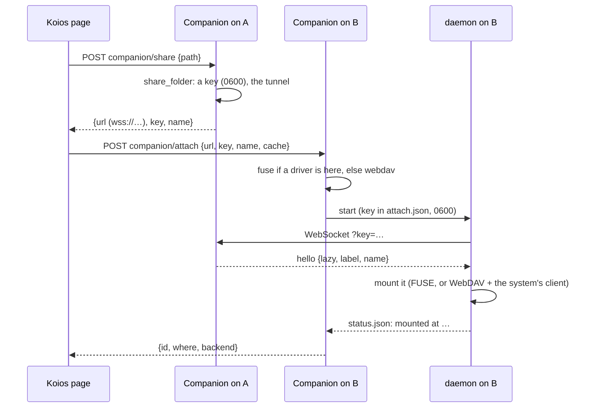
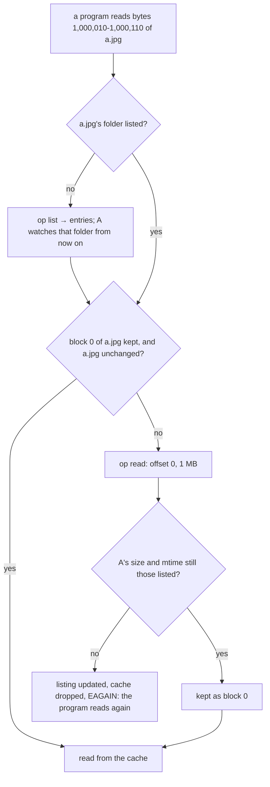

# A folder of one computer, a disk on another: how it was built

What it is and how to use it is in [shared-folders.md](shared-folders.md). This document covers why it is built the way it
is, how the pieces fit, what the tests found on the way, what is and isn't verified, and how to try it yourself.

## 1. The ask

> "Wherever the account is logged in via the app, I want to be able to mount a disk of one computer onto another …
> flexible along Linux, macOS and Windows."

The project mount (Companion 0.19.0, compute-mount.md) already put a folder of your computer on a GPU machine. That
GPU machine was a Linux box that the page reached through a Jupyter kernel. This feature is the general case: any two of
your computers, any of three systems, either direction, and any folder.

## 2. The choices

Three questions were put to you before any code was written. Your answers set the design:

| Question | Chosen | What it means in the code |
| --- | --- | --- |
| What can be shared? | **Folders I pick** | `mount.share_folder(path)`: one key per folder. The whole disk and the home folder are refused. |
| How is it mounted? | **Built in by default, a driver offered** | WebDAV through the system's own client works with nothing installed. FUSE (FUSE-T, WinFsp, libfuse) is used when it is there, and **Install …** fetches it. |
| How much is kept? | **Only what's used** | Lazy listing, 1 MB blocks fetched on read. `all` and `none` are options. |

Three more choices were made along the way:

- **Reuse the mount socket, don't build a second one.** Shares ride `/companion/mount/socket` with the project mount's
  frames, its key checks and its path refusals. A share is a `Share(lazy=True)`: no tree, no project rules, and four new
  ops (`list`, `rmtree`, `copy`, `statfs`).
- **The page introduces, the Companions talk.** The page asks A for `{url, key}` and hands them to B. After that,
  B's daemon talks to A's Companion through A's tunnel. No file passes through the page, the Worker or Koios's
  servers.
- **A WebDAV server of its own, not a library.** About 300 lines of the standard library's `http.server` cover what
  Finder, Windows' WebClient and `gio` actually send: OPTIONS, PROPFIND, PROPPATCH, GET/HEAD with ranges, PUT
  (chunked too), DELETE, MKCOL, MOVE, COPY, and LOCK/UNLOCK, which all three clients insist on before they write.
  The Companion gains no dependency but fusepy, which is pure Python.

## 3. How it fits together

### 3.1 Attaching



*Figure 1. One call to each Companion. B answers once the disk is mounted, or with the daemon's own words if it
couldn't be.*

### 3.2 A read



*Figure 2. Only the blocks a read touches come over. A file that changes on A as it is read is never stitched from
two versions.*

### 3.3 A write, and a change on A

- **Here → A.** `open(…, "w")` writes into the cache copy and marks the file dirty. On `close()`, which the kernel
  turns into FUSE's `flush`, or when a WebDAV `PUT` ends, the file is sent in 4 MB pieces. A puts it beside the
  original and swaps it in, then answers its new size and mtime, which the cache takes as the file's own.
- **A → here.** Twice a second, A looks at the folders that machines have listed (stat calls only). Each change goes
  to every machine as `{op: "entries", dir, changed, gone}`. The daemon updates its listing and drops a kept copy that
  is out of date.

### 3.4 Each system's way in

| | fuse | webdav |
| --- | --- | --- |
| Mac | fusepy + FUSE-T (`FUSE_LIBRARY_PATH` set to `libfuse-t.dylib` when it is there) or macFUSE; `volname` set, so Finder shows the name | `mount_webdav -S -v <name> http://127.0.0.1:<port>/<secret>/ <dir>` |
| Windows | fusepy + WinFsp; a free drive letter from Z: down | `net use * http://127.0.0.1:<port>/<secret>/ /persistent:no`; the letter is read from its answer |
| Linux | fusepy + libfuse 2 | `gio mount dav://127.0.0.1:<port>/<secret>/`, linked from `~/Koios Drives/<name>` |

Unmounting goes through each system's own tool: `fusermount -u`, `umount`, `diskutil unmount`, `net use /delete`, or
`gio mount -u`. Detach asks the daemon to stop, waits 5 s, and then ends it.

## 4. The order of work, and what each run found

1. **The sharing side** (mount.py): `share_folder`, `record_for`, `Share(lazy)`, and the ops `list`, `rmtree`, `copy`,
   `statfs`. The project-mount tests (test_mount.py) still pass unchanged.
2. **The disk** (attach.py `Disk`): listing, block reads, writes, renames, and the background fill. The tests drove it
   in-process against a real socket, and they passed the first time except for one test-only mistake.
3. **WebDAV.** All of Finder's and Windows' verbs, sent with `http.client`, including a chunked PUT. These passed the
   first time.
4. **FUSE, for real.** `start()` spawns the daemon, which mounts a real FUSE filesystem, and the test writes through it.
   **Found:** a file written through the disk wasn't on A right after `close()`. The upload ran in FUSE's `release`,
   which the kernel sends *after* `close()` returns. **Fixed:** the upload runs in `flush`, which `close()` waits for, and
   `release` sends only what a later write left.
5. **The routes** (extension.py), driven by a test the way the page calls them. **Found:** a test-only deadlock. The
   FUSE read needed the socket, whose loop the test had paused. The read now runs from an executor.
6. **The whole suite.** **Found:** `stop_share` closed the sockets from whatever thread called it, and tornado wants
   its own loop for that. The Companion's handler calls it on the loop, but not every caller would. **Fixed:** each
   close is handed to its socket's loop with `add_callback`.

## 5. The tests

`companion/tests/test_attach.py`. On Linux in this sandbox all 11 pass, with /dev/fuse and libfuse 2, and the whole
Companion suite passes too: 191 tests on Python 3.9, 3.13 and 3.14.

| Test | Checks |
| --- | --- |
| `Codes` | An attach code round-trips. The whole disk, the home folder and a missing folder are refused. The key is the same each time a folder is shared. The share file is 0600. Stopping a share forgets its key. |
| `MountCommands` | The exact `mount_webdav` and `net use` commands, and the drive letter read back from Windows' answer. Labels are cleaned of `/ : * " < > |`. |
| `Attached.test_only_what_is_opened…` | One listing, then one 1 MB block for a 100-byte read in the middle of a 3 MB file. Whole after a full read, and kept. A's changes are pushed, a write goes back, and mkdir, rename, copy, rmtree and statfs work. |
| `…stopped_share_cuts…` | Stop sharing closes the attached socket. |
| `…way_out_of_the_folder…` | `..` paths are refused. |
| `…cache_all…`, `…cache_none…` | The background fill gets every file. With `none`, nothing is kept. |
| `…webdav_the_way_finder…` | Wrong secret → 404. PROPFIND depth 0 and 1, GET with a Range and whole, HEAD, a chunked PUT, Finder's `._` file kept local, MKCOL (and 409 for a missing parent), MOVE, COPY with `Overwrite: F` → 412, LOCK/UNLOCK, DELETE of a folder. |
| `…attached_with_fuse_as_a_disk` | A real mount. Listing, a whole read, a write that is on A after close, `.DS_Store` kept local, rename, mkdir/rmdir, A's save seen here. Attaching again reuses the mount, and detach unmounts it. |
| `Routes` | 403 without the token, for the page and for a local program. 400 for `/`. Share → code → listed without its key. The attach list and backends. A bad code → 400, a bad id → 400. Attach by code → the file is readable → detach → stop sharing. |

## 6. What isn't verified yet

Plainly: the sandbox this was built in is Linux, so these weren't run here.

- **A real Mac or Windows mount.** FUSE-T, macFUSE and WinFsp were never loaded. On a Mac, `mount_webdav` against the
  Companion's WebDAV server, and on Windows, `net use`, are tested only as the commands built, not run. Finder and
  WebClient are known to be particular. Section 7 is the way to check them, and a quirk found there is a small fix in
  `DavHandler`.
- **`gio` on a GNOME desktop.** The sandbox has no session bus.
- **The driver installers.** `install_driver` downloads from FUSE-T's and WinFsp's GitHub releases. It was not run.
- **Across a real tunnel.** Every attach test used `ws://127.0.0.1`. The socket and frames are the project mount's,
  which were measured through a real Cloudflare tunnel: a save there in 0.24 s, a write back in 0.59 s
  (compute-mount-process.md §6.2). Expect a first read of an unkept block to cost one round trip through Cloudflare.

## 7. Trying it, step by step

### 7.1 One computer, both sides (10 minutes)

A Mac can attach its own folder. The bytes still go out through its tunnel to Cloudflare and back in.

1. Update the Companion: Settings → Updates → **Update**. It should say 0.20.0.
2. On the Mac:

   ```bash
   mkdir -p ~/Documents/koios-share-test && echo hello > ~/Documents/koios-share-test/hello.txt
   reader-companion share ~/Documents/koios-share-test
   reader-companion attach koios-attach:…        # the code it printed
   ```

3. Finder: **~/Koios Drives/koios-share-test** shows `hello.txt`. Open it, edit it, save it, and the original in
   `~/Documents/koios-share-test` changes. Edit the original, and the attached copy changes within a second or two.
4. `reader-companion attach` lists it as `webdav` until a driver is installed. Then:

   ```bash
   reader-companion attach --install-driver      # FUSE-T's installer opens; finish it
   reader-companion attach --detach <id>
   reader-companion attach koios-attach:… --backend fuse
   ```

   It should say `fuse` now. Try the same edits, and open a big file. With FUSE, only the part read comes over:
   `cachedFiles` in `~/.reader-companion/attached/<id>/status.json` grows only as files are opened whole.

### 7.2 Two computers (15 minutes)

1. Install the Koios app on the second computer (Windows, Linux or another Mac), sign in with the same account, and
   update its Companion to 0.20.0.
2. In Koios on either one: **Settings → Compute & playgrounds → Folders across your computers**. Pick From, the
   folder, To, then **Attach on …**.
3. Windows: the drive letter shows in File Explorer → This PC. Mac: `~/Koios Drives/<name>`. Linux:
   `~/Koios Drives/<name>`.
4. Sleep the computer with the folder, then open a file you haven't opened yet on the other: it waits. Wake it: the
   read finishes. With **Everything, in the background**, the same file opens while it sleeps.
5. **Stop sharing** on the first computer: the second loses the disk's connection at once.

### 7.3 If something goes wrong

- `~/.reader-companion/attached/<id>/attach.log` is the daemon's own log, and `status.json` its state (connected,
  cachedFiles, waitingToWrite, the last error).
- Windows: `net use` saying "the network name cannot be found" means the WebClient service is off. Run
  `sc config webclient start= auto` and `sc start webclient` (as administrator), or install WinFsp.
- Linux with no GNOME: `sudo apt install libfuse2` and attach with `--backend fuse`.
