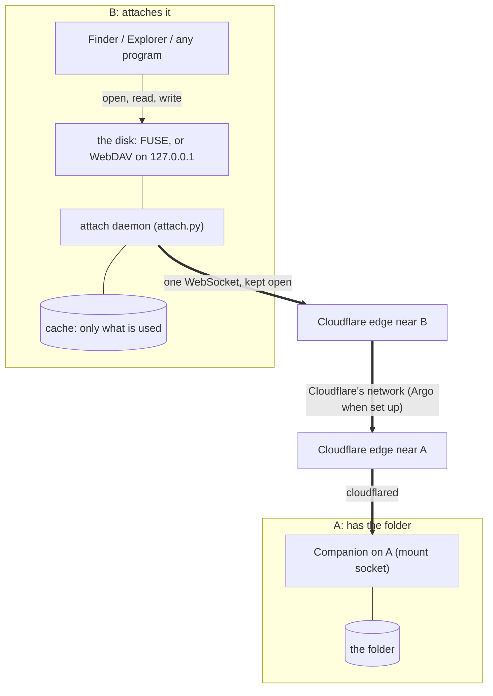

# A folder of one computer, a disk on another

Any computer signed in to your Koios account can attach a folder of another one as a disk of its own. A Mac can
attach a folder of a Windows PC, a Linux box a folder of a Mac, and so on, in any direction. The folder shows up where the
system shows disks: in Finder, in File Explorer, or in your file manager. Every program there can open it, the way it would
open a network drive. Files stay on the computer they are on. They come over when they are opened, and what is
written on the other side goes back when it is closed.

How it was built and checked, with a step-by-step test plan, is in
[shared-folders-process.md](shared-folders-process.md). Both documents are printed as one PDF,
`docs/shared-folders-process.pdf` (`node scripts/compute-mount-pdf.mjs shared-folders`).

This needs Koios Companion **0.20.0 or later** on both computers, each signed in to the same account (Settings →
Updates).

## 1. Attaching a folder

**Settings → Compute & playgrounds → Folders across your computers**:

1. **From**: the computer the folder is on, and the folder. Browse to it or type its path.
2. **To**: the computer it goes to.
3. **Keep here**: how much of it is kept on that computer (section 3).
4. **Attach on …**

The same card lists what each computer has attached, with **Detach**, and what each one shares, with **Stop
sharing**. From a terminal:

```bash
# on the computer with the folder
reader-companion share ~/Documents/Thesis          # prints: reader-companion attach koios-attach:…
reader-companion share                             # what is shared here
reader-companion share --stop ~/Documents/Thesis   # every computer that had it attached is cut off

# on the other computer
reader-companion attach koios-attach:…             # --cache used|all|none  --backend auto|fuse|webdav  --at <where>
reader-companion attach                            # what is attached here
reader-companion attach --detach <id>
reader-companion attach --install-driver           # FUSE-T on a Mac, WinFsp on Windows
```

The code is the folder's address and its key in one word. Keep it to yourself: anyone who has it can open that
folder, and nothing else, until it is stopped.

## 2. Where it appears, on each system

The folder is mounted in one of two ways. The Companion picks the faster one that the computer has:

| | With a driver (**fuse**) | Without one (**webdav**, the default until a driver is installed) |
| --- | --- | --- |
| **Mac** | FUSE-T (or macFUSE), at `~/Koios Drives/<name>` and in Finder's sidebar | The Mac's own network-drive client (`mount_webdav`), at `~/Koios Drives/<name>` |
| **Windows** | WinFsp, as a drive letter (from `Z:` down) | A mapped network drive (`net use`), as a drive letter. Needs the WebClient service, which Windows has on by default |
| **Linux** | libfuse 2, at `~/Koios Drives/<name>` | GNOME's `gio`, under `/run/user/<uid>/gvfs`, with a link at `~/Koios Drives/<name>` |

Nothing is installed without you. On a Mac or a Windows PC without a driver, the card offers **Install FUSE-T** or **Install WinFsp**.
That downloads the driver's own installer from its GitHub releases and opens it, and the system asks for your password (or UAC) as for any installer. On Linux it gives the one command to run
(`sudo apt install libfuse2`). Attach again afterwards to use the driver.

Why offer the driver at all: the system's network-drive clients are slower and fussier. Windows' WebClient won't
take a file over **50 MB** unless the limit is raised in the registry. Finder copies a whole file before it opens
it. With a driver, a program reads just the part of a file it asks for.

## 3. What is kept on the other computer

| Keep here | What it does | Good for |
| --- | --- | --- |
| **Only what's used** (default) | A folder is listed when it is opened. A file comes over in 1 MB blocks as they are read, and is kept until it changes. | Big folders where you open a few files. |
| **Everything, in the background** | The same, and then the rest of the folder comes over, smallest files first, up to 4 GB. | Working while the other computer sleeps or travels. |
| **Nothing kept** | Every read goes to the other computer. | A folder that changes all the time, or a computer short of disk. |

The cache is under `~/.reader-companion/attached/<id>/`, and **Detach** removes it.

## 4. How it reaches the other computer



*Figure 1. The attaching computer dials the other computer's Companion through its Cloudflare tunnel: the same
socket the project mount uses (compute-mount.md), with the same binary frames. The page only introduces the two
computers to each other. No file passes through it, or through the Worker.*

- **One socket, kept open.** The daemon holds one WebSocket to the other Companion and reconnects with backoff if it
  drops.
- **Listed when opened.** Unlike a project mount, a share sends no tree up front, so a folder with a million files
  costs nothing to attach. Each folder is listed the first time it is opened (op `list`). The Companion then watches
  the folders that have been listed, and pushes their changes (op `entries`) as they happen.
- **Read in blocks.** A read fetches the 1 MB blocks it touches, up to 4 MB per request. Blocks are kept, and a file
  is whole once every block is there.
- **Written on close.** A file written here goes back when the program closes it, in 4 MB pieces. The Companion
  writes it beside the original and swaps it in, so nobody there ever sees half a file.
- **The system's own files stay put.** `.DS_Store`, `._*`, `Thumbs.db`, `desktop.ini`, `.Spotlight-V100` and the like
  are kept on the attaching computer. They are never written into your folder.

## 5. What the key opens

- Each shared folder has a key of its own, kept in `~/.reader-companion/shares/` (0600). It is never the
  Companion's token, and the list of shares never shows it.
- The socket refuses any path outside the folder, including a link that leads out of it.
- Neither the whole disk nor your whole home folder can be shared. Pick a folder inside it.
- **Stop sharing** forgets the key and closes every socket that used it, at once.
- On the attaching computer, the key is in `~/.reader-companion/attached/<id>/attach.json` (0600). It is never on a
  command line, where other users could read it. The WebDAV server listens on 127.0.0.1 only, under a random path,
  so another program on that computer can't find it by trying ports.

## 6. When the other computer sleeps

- What has been read stays readable. A folder listed before reads from its last listing, after one short try.
- A read of something not kept waits up to 15 minutes for the other computer to come back, then fails with an I/O
  error. **Everything, in the background** avoids this.
- Writes wait. A file written while the other computer is away is kept, and the program's `close()` succeeds. It
  is sent when the socket is back. The queue is on disk, so it survives a restart.
- A computer with a folder attached somewhere is kept awake while it is attached, as for the project mount: `caffeinate`,
  `systemd-inhibit` or `SetThreadExecutionState`. A laptop with its lid closed on battery sleeps anyway.

## 7. Reference

| File | What |
| --- | --- |
| `companion/reader_companion/attach.py` | The attaching side: the disk (`Disk`), the FUSE operations, the WebDAV server, mounting with each system's own client, the daemon, attach codes, the driver installers. |
| `companion/reader_companion/mount.py` | The sharing side: `share_folder`, `stop_share`, `list_shares`, and the socket's `list`, `rmtree`, `copy` and `statfs` ops for shares. |
| `companion/reader_companion/extension.py` | `ShareHandler` (`companion/share`) and `AttachHandler` (`companion/attach`). |
| `companion/reader_companion/cli.py` | `reader-companion share` and `reader-companion attach`. |
| `src/lib/shares.ts`, `src/components/SharedFolders.tsx` | The page: the calls, and the card in Settings → Compute & playgrounds. |
| `companion/tests/test_attach.py` | Tests: attach codes, the refusals, the commands each system mounts with, the disk end to end, WebDAV as Finder and Windows speak it, a real FUSE attach, and the two routes. |
