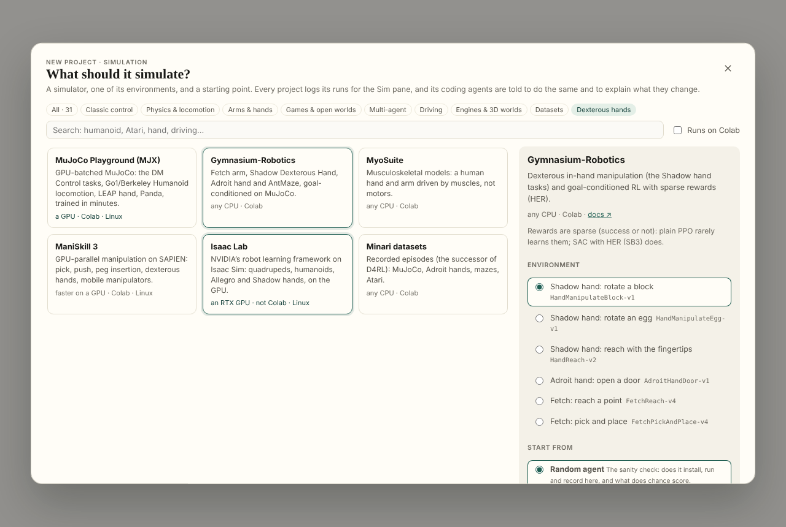
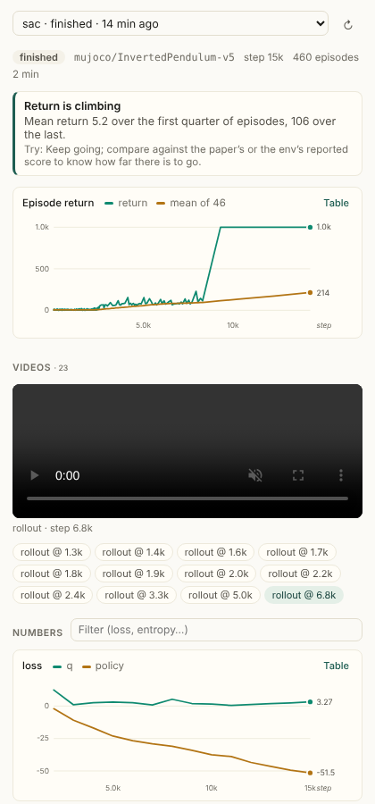
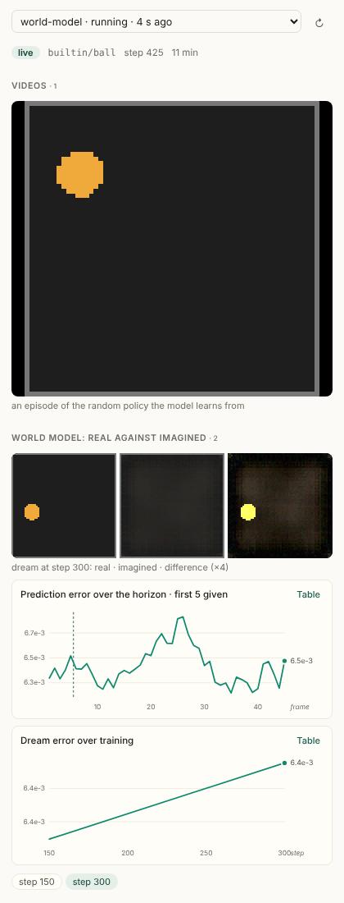
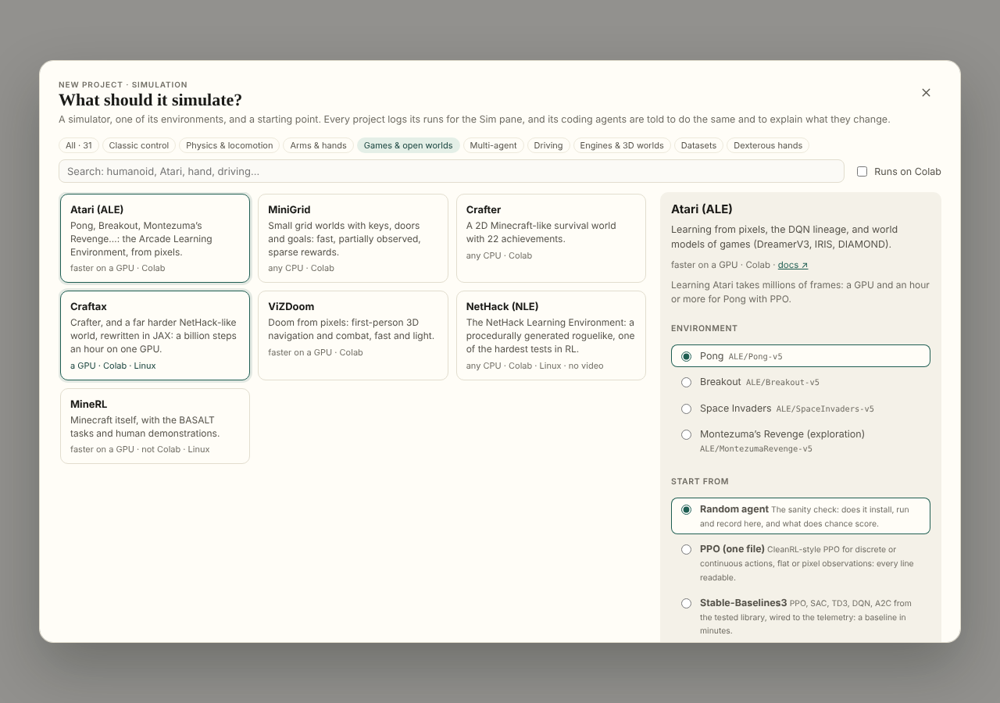
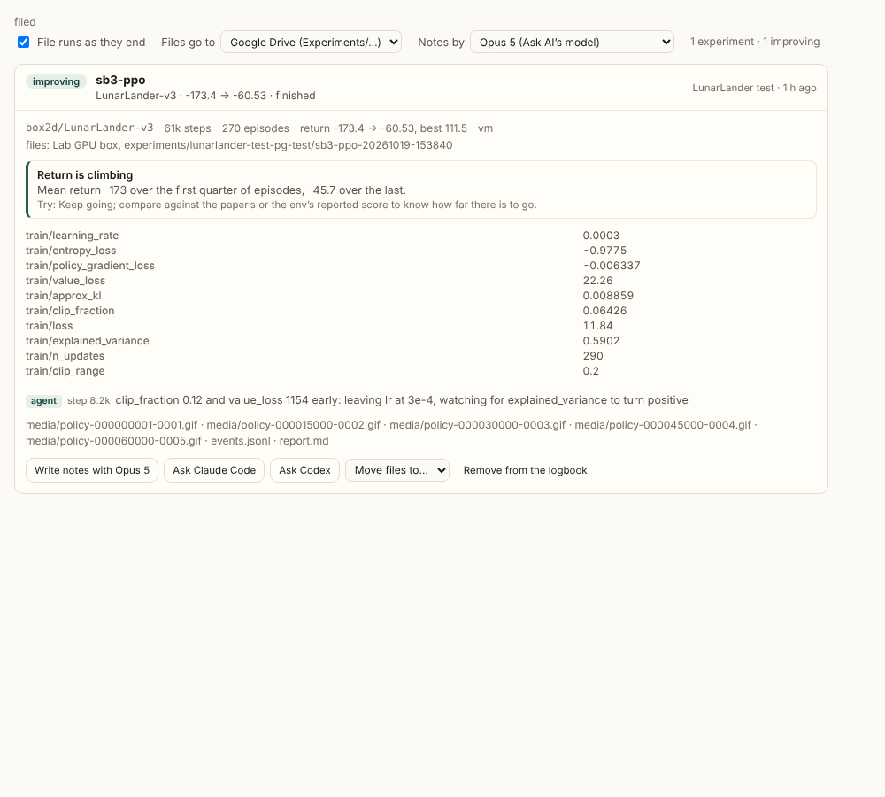
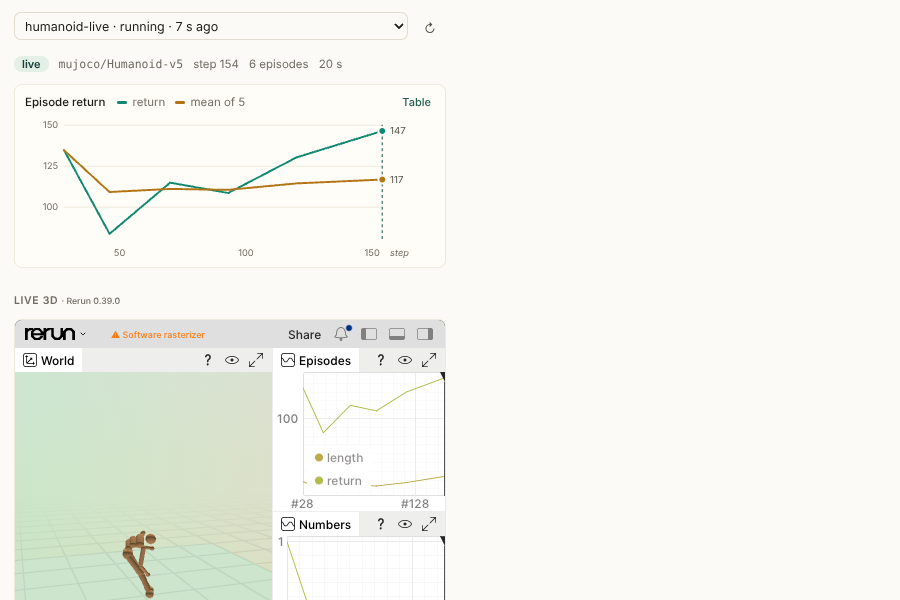
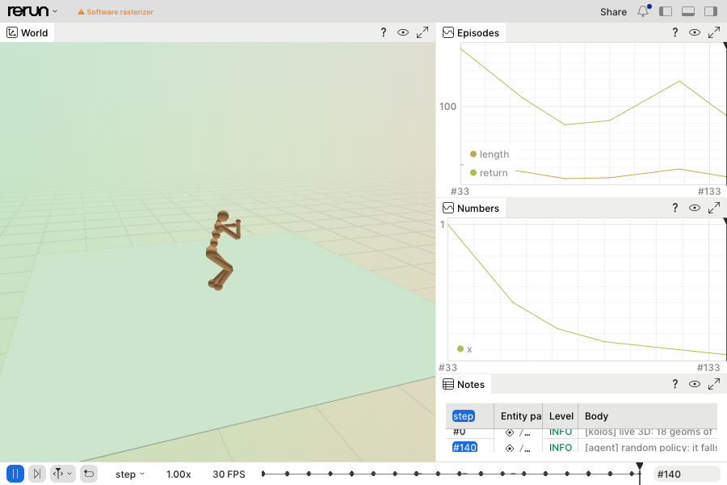

# Simulation: simulators, world models, and runs you can watch

The Playground can start a **simulation project**: any of 31 simulators, one of its environments, and a
starting point (a random agent, PPO, SAC, Stable-Baselines3, a world model from scratch, DreamerV3, TD-MPC2,
Isaac Lab). Every project writes its runs in one format, `koios_telemetry`, and the **Sim pane** beside the
editor draws them as they happen: episodes and returns, the numbers, the videos, a world model's dreams against
what really happened, the notes that the code and the coding agents leave on the timeline, and what looks wrong
with what to try. Coding agents (Claude Code, Codex, the page's own) are told to use the telemetry and to explain
each change in `LEARNING.md`, so the person can follow and learn.



| A game: SB3's PPO on LunarLander, finished | A made world: a world model dreaming the ball world |
|---|---|
|  |  |





| Live 3D in the Sim pane, through the Companion | The viewer in a window of its own |
|---|---|
|  |  |

This document records what was built, what was hard about it, and how each difficulty was handled.
[simulation-process.md](simulation-process.md) is the process: the order of work, every background run and its
result, the review against the existing code, and the checklist. It is a log
as much as a design. Each entry under [Challenges](#challenges-and-how-they-are-handled) says what is resolved,
what is worked around and what is still open.

---

## What is built

| Piece | Where | What it does |
|---|---|---|
| The telemetry module | `src/sim/koios_telemetry.py` | `Run`: episodes, numbers, videos, dreams, notes, checkpoints, heartbeats, crash capture. CLI: `doctor`, `summary`, `tail`, `note`, `bridge`. One file, no install. |
| The catalogue | `src/lib/simulators.ts` | 31 simulators in 8 families: install lines, GPU needs, Colab or not, example environments, a Gymnasium `env.py` or a native starter for each. |
| The templates | `src/sim/templates/*.py` | `random_agent.py`, `ppo.py`, `sac.py`, `sb3.py`, `world_model.py`: real files, run by hand on CartPole, InvertedPendulum and LunarLander (see [Verified](#verified)). |
| Project assembly | `src/lib/simProject.ts` | `env.py`, the template, `setup.sh`, `README.md`, `AGENTS.md` (+ `CLAUDE.md`), `LEARNING.md`, the telemetry module; DreamerV3, TD-MPC2 and Isaac Lab run scripts with their logs bridged. |
| The picker | `src/components/SimPicker.tsx` | **A simulation** on the Playground's home: filter by family, "Dexterous hands", "Runs on Colab", search; pick an environment and a template. |
| The Sim pane | `src/components/SimPane.tsx`, `src/lib/simTelemetry.ts` | The right-hand pane's **Sim** tab: run picker, status, findings, return and success charts, videos, dreams, grouped numbers with notes as dashed marks, timeline, traceback, config, checkpoints, and the machine's doctor. |
| Sync fix | `src/lib/playground.ts` (`isBinaryPath`) | The sync carries text; binary files (videos, images, weights) are now left where they are instead of being copied as broken text. |
| The paper in the folder | `src/lib/paperContext.ts`, `paperMarkdown.ts`, `paperFiles.ts` | A project from a paper carries the paper: `paper/paper.md` (its full text, from the reader's own reflow of the PDF, else arXiv's HTML), `paper/EXPLANATION.md`, `paper/paper.pdf`, `IMPLEMENTATION_PLAN.md`. Every agent is told to read it there, never to fetch it. |
| Evaluation, the paper's way | `koios_telemetry.py` (`Run.evaluation`, `Run.evaluate`), `simTelemetry.ts`, `experiments.ts`, `SimPane.tsx` | An `evaluation` event: the paper's own measure, with the paper's numbers beside ours; the Sim pane's table and the logbook's report show the gap. A default protocol when the paper gives none. |
| The page's agent runs its commands | `src/lib/projectAgent.ts`, `src/components/ProjectAgent.tsx` | A ```` ```sh run ```` block is run in the project's console on the connected machine as the agent answers; what it printed goes back; up to 6 rounds of 3. Stop interrupts the command. Off with a tick, and the commands are buttons. |
| Tests | `scripts/simulation.test.mjs`, `scripts/paper-context.test.mjs` | Catalogue integrity, every generated `.py` parses, parsing and diagnostics, and the Python module run for real: its events read by the pane's parser, its findings equal to the pane's. |

### The simulators

| Family | Simulators |
|---|---|
| Classic control | Gymnasium classic control, Box2D, gymnax (JAX) |
| Physics & locomotion | MuJoCo (Gymnasium), DeepMind Control Suite, MuJoCo Playground (MJX), Brax, PyBullet, Drake |
| Arms & hands | Gymnasium-Robotics (Shadow hand, Adroit, Fetch), MyoSuite, Meta-World, robosuite, ManiSkill 3, Genesis, Isaac Lab |
| Games & open worlds | Atari (ALE), MiniGrid, Crafter, Craftax, ViZDoom, NetHack (NLE), MineRL |
| Multi-agent | PettingZoo |
| Driving | highway-env, MetaDrive, CARLA |
| Engines & 3D worlds | Unity ML-Agents, Godot RL Agents, Habitat-Sim |
| Datasets | Minari (D4RL's successor) |

Dexterous hands specifically: the Shadow hand and Adroit (Gymnasium-Robotics), MyoSuite's musculoskeletal hand,
the LEAP hand (MuJoCo Playground), the D'Claw (ManiSkill), and the Allegro and Shadow hands in Isaac Lab.

### Templates, and what each teaches

| Template | For | What to watch |
|---|---|---|
| Random agent | every Gymnasium simulator | the floor: what chance scores; does it render here |
| PPO (one file) | discrete or continuous, flat or pixel observations | return; `approx_kl` < ~0.05; entropy falling slowly; `explained_var` → 1 |
| SAC (one file) | continuous control: arms, hands, MuJoCo | return after the random warm-up; `alpha` falling; `q_mean` against real returns |
| Stable-Baselines3 | a tested baseline; `MultiInputPolicy` for dict observations (goal-conditioned hands) | SB3's own names |
| World model from scratch | anything that renders, or a built-in ball world | `loss/recon`, `loss/dynamics`, the dream video and its error over the horizon |
| Starter (native) | simulators with their own API (JAX, engines, servers) | a first recorded rollout; Brax and MuJoCo Playground also train with `--train` |
| DreamerV3, TD-MPC2 | their repositories, as published (DMC, Atari, Crafter; DMC, Meta-World) | their metrics, bridged |
| Isaac Lab | RSL-RL PPO on an Isaac Lab task, headless | videos bridged; scalars in the TensorBoard pane |

---

## The telemetry format (schema 1)

A run is a folder, `runs/<name>-<YYYYmmdd-HHMMSS>/`:

- `run.json`: `{schema, id, name, sim, config, started, status, host, argv, pid}`, rewritten at the end with
  `status` (`finished` / `crashed` / `stopped`), `ended` and `error`.
- `events.jsonl`: one JSON object a line, appended and flushed as it happens. Every event has `kind` and `t`
  (machine seconds); most have `step` (**environment steps**, so runs compare).
- `media/`: MP4 (H.264, `yuv420p`, `faststart`), else GIF, else `.npz` frames.

| `kind` | Fields |
|---|---|
| `start` | `name`, `sim`, `config`, `host`, `resumed` |
| `scalars` | `step`, `values: {name: number}`; names group by their prefix (`loss/policy`) |
| `episode` | `step`, `index`, `return`, `length?`, `success?`, `extra?` |
| `media` | `step`, `name`, `path` (from the run's folder), `type` (`video`, `gif`, `image`, `frames`), `frames?`, `fps?`, `bytes`, `caption?` |
| `dream` | `step`, `name`, `path`, `type`, `error: [per-frame MSE]`, `context` (frames given, not predicted), `fps`, `horizon` |
| `note` | `step`, `text`, `by` (`code`, `agent`, `human`, `koios`), `tag?` (`problem`, `spaces`, `config`…) |
| `checkpoint` | `step`, `path`, `metrics` |
| `evaluation` | `step`, `name`, `metrics: {name: number}`, `episodes?`, `protocol?` (how it was measured), `paper?: {name: number, source?}` (the paper's numbers for the same metrics), `higher_is_better?` (bool or `{name: bool}`), `seeds?` |
| `heartbeat` | every 10 s from a thread: `step`, `env_steps`, `sps` |
| `end` | `status`, `step`, `episodes`, `elapsed`, `error?` (the traceback) |

NaN and the infinities are written as the strings `"nan"`, `"inf"`, `"-inf"`: JSON has no NaN, and a NaN loss is
exactly what has to be seen.

---

## Challenges, and how they are handled

### 1. A browser can't reach the machine's ports, and Colab's least of all
*Resolved.* Nothing is served from the machine. The pane runs a few lines of Python in the runtime's small second
kernel (`runQuietly`, the same path the TensorBoard pane takes) that lists the runs and returns the focused run's
file **from the byte where the last read stopped**, ending on a whole line. A long run costs only its new lines;
a file longer than 6 MB is read from its last part on first sight (and the pane says so). Polls run every 3 s
while a run is live, every 15 s otherwise, and at once while there is more of the file to read.

### 2. The sync carries text up to 2 MB, and videos are binary
*Resolved, and a bug fixed on the way.* The sync read every file as text, so a `.png` brought back by the default
rules (`*.png` is one) arrived corrupted. Binary files are now left where they are (`isBinaryPath`), and the Sim
pane fetches media **from the machine, byte for byte, in 2 MB base64 chunks**, played from a blob (up to 64 MB a
file; past that it says where the file is). The fetch refuses any path outside the project's folder.

### 3. No display: simulators that open windows fail on Colab and servers
*Resolved, and verified.* `koios_telemetry` picks an off-screen renderer **at import**, before any simulator
loads: on Linux with no `DISPLAY`, `MUJOCO_GL=egl` when there is a GPU (an `nvidia-smi` or a `/dev/dri` render
node), else `osmesa`; pygame gets `SDL_VIDEODRIVER=dummy`. Choosing EGL merely because its library is present was
wrong: on a CPU container the library exists and fails (found while testing here). Every generated `env.py` and
starter imports the telemetry first, and a test checks that order. `run.grab(render, frames)` and `run.wrap` turn
a renderer that fails into one note on the timeline ("rendering failed, so no videos… run the doctor"), and the
run goes on training. The doctor renders a small MuJoCo scene in a subprocess to prove it works.

### 4. Which simulator runs where
*Resolved for what can be known in advance.* Each catalogue entry says `gpu: no | helps | needs | rtx`,
`colab`, `linux`, `video`. The picker shows it on each card and filters by "Runs on Colab"; the place step warns
when an RTX-only or GPU-only simulator is about to go to Colab (`placeWarning`). On the machine, `python
koios_telemetry.py doctor` (and the pane's "This machine" section) reports GPUs, EGL / OSMesa / Vulkan, ffmpeg,
Java, torch and JAX, and which of the 31 simulators import.

### 5. Isaac Lab needs an NVIDIA RTX GPU, never Colab
*Worked around.* It runs on a machine added as a Jupyter server (a lab box, a rented RTX GPU) through the existing
Companion / server path. Its own training script runs headless with `--video`; its videos are **bridged** into the
Sim pane as they are written and its scalars, which RSL-RL writes as TensorBoard files, show in the TensorBoard
pane. Isaac Sim's install (Python 3.11, NVIDIA's package index) is left to its guide, linked from the project:
pinning it here would go stale within a release. *Open:* starting and stopping rented GPUs from the page, which
the Playground's own design lists as not built.

### 6. Existing codebases log their own way
*Resolved for the common formats.* `python koios_telemetry.py bridge <metrics.jsonl | .csv | glob> [--videos DIR]
[--follow | --until-pid PID]` follows another codebase's log as it grows and writes a Koios run: step keys
(`step`, `global_step`, `_step`, `frame`…), episode keys (`episode/score`, `episode_reward`, `eval/episode_reward`…),
lengths and success; videos are copied in when they stop growing. DreamerV3 (`metrics.jsonl`), TD-MPC2
(`eval.csv`), SB3 (`progress.csv`) and Isaac Lab's video folders are covered; the run scripts start training,
bridge until its process ends, then close the run. *Open:* a bridge from W&B-only codebases (DIAMOND), which
would need W&B's offline files.

### 7. Torch on a small CPU can be a hundred times slower with more threads
*Found while testing, resolved.* SAC ran at ~3 steps a second here. Profiling showed every tiny layer taking
milliseconds; a benchmark gave **0.26 ms on one thread against 25 ms on four**, the thread pool fighting a
container's CPU quota. Colab's two-core CPUs see the same, more mildly. PPO and SAC now use one thread on the CPU
(`KOIOS_TORCH_THREADS` to change it); SAC then did 15,000 steps in 2 minutes and solved InvertedPendulum. The
doctor measures both on each machine and prints the `export` to use.

### 8. A shared actor-critic body stopped PPO from learning
*Found while testing, resolved.* The first PPO shared one MLP body between the policy and the critic. The value
loss (returns in the hundreds) dominated the gradient, the whole gradient was clipped to 0.5, and the policy's part
shrank to nothing: `approx_kl` ~1e-4, `clipfrac` 0, return flat. **The pane's own diagnostic said "Return isn't
improving"** on that run. Flat observations now get separate bodies, as CleanRL does (images keep one shared
CNN, as the Atari PPO does); CartPole then climbed from 22 to 262 mean return in 100k steps, best 500.

### 9. Colab sessions end
*Partly resolved by what exists.* The `koios` checkpoint helper (`.reader/pylib/koios`) saves on a cadence and on
SIGTERM, and the page offers to resume elsewhere. The telemetry records `checkpoint` events, writes a heartbeat
every 10 s, and a run that stops writing for two minutes shows as **stalled** with what to try. `Run(resume=dir)`
carries on writing to the same run. AGENTS.md tells agents to checkpoint and resume. *Open:* tying `Run(resume)`
to `KOIOS_RESUME` automatically.

### 10. Agents must keep the telemetry and explain themselves
*Resolved by the briefing, checked by the pane.* Every project's `AGENTS.md` (Codex reads it; `CLAUDE.md`
includes it for Claude Code) makes the telemetry a rule: one `Run`, episodes, environment steps on the x axis,
videos on a schedule, dreams for world models, **a note for every change with its reason** (`run.note(...)` or
`python koios_telemetry.py note runs/<run> "…" --by agent` from a terminal), `LEARNING.md` entries written for a
learner, and `python koios_telemetry.py summary` read before changing anything. Agent notes appear as dashed lines
on every chart, so "the return jumped here" sits next to "lr 3e-4 → 1e-4: approx_kl was 0.2".

### 11. Two implementations of the diagnostics
*Resolved by a test.* The findings exist in Python (for agents, in `summary`) and in TypeScript (for the pane).
`scripts/simulation.test.mjs` runs both on the same ten synthetic runs (improving, no learning, collapse, NaN,
entropy collapse, exploding value loss, crashed, stalled, world-model drift, world model not improving) and
requires the same findings. The rule ids match.

### 12. Long and noisy runs
*Resolved.* Scalars are thinned on arrival past 20,000 points a series and drawn downsampled; returns are drawn
with a running mean (window n/10, at least 5); videos are recorded one episode in `video_every`, capped at 600
frames and 256 px, so a run's media stays megabytes, not gigabytes.

### 13. Versions move
*Worked around.* Gymnasium ids change version (`-v4` to `-v5`); `env.py`'s `resolve()` takes the newest
registered version of the name asked for. `make_env` retries without a render mode for environments that don't
offer `rgb_array`. Simulators with fragile installs say so on their card (Box2D's swig, MineRL's JDK 8,
ML-Agents' Python 3.10, Habitat's conda).

### 14. A live 3D view, from a browser
*Resolved, for a Companion; a file elsewhere.* Watching a robot move as it trains, not a clip of it after. The
choice was [Rerun](https://rerun.io): its web viewer runs in the page, it shows 3D, images and time series on
one timeline, and its Python SDK logs anything. What a run does now (`koios_telemetry`, with `rerun-sdk`
installed, which `setup.sh` does): a gRPC server sink and a `scene.rrd` file sink together (a plain `rr.save()`
would replace the stream), the web viewer on a port, and **scene.rrd served as a stream that follows the file**
on a third port. `run.scene(env)` logs a MuJoCo model's geoms once — spheres, capsules, boxes, cylinders,
ellipsoids, planes, meshes, with their colours — and `run.scene_step()` moves them (every second step, at most
thirty times a second); `run.wrap(env)` does both by itself. Scalars, episodes and notes are mirrored, and a
default blueprint opens the world large with the series beside it. The Sim pane embeds the viewer in a **Live
3D** section.

Three things were hard:
- **A browser can't reach the machine's ports.** The Companion (0.18.0) gains `/companion/ports/<ticket>/<port>/…`
  (`PortProxy`): a reverse proxy to a port on its computer, the ticket an HMAC of the port with the token (an
  iframe carries no Authorization header), answers **streamed chunk by chunk** — the VS Code proxy beside it
  buffers whole answers, which would never show a frame — and websockets relayed. The page and the Companion
  compute the ticket the same way; both test suites pin one vector. On a plain Jupyter server or Colab there is no
  proxy: the pane offers `scene.rrd` to download and open in Rerun on this computer.
- **Rerun's own stream can't be proxied by path.** The viewer takes its gRPC source only as
  `rerun+http://host:port/proxy`, an origin and nothing else; found when the viewer said *Failed to parse URL* for
  the proxied address. Instead the run serves its `scene.rrd` over HTTP as a never-ending chunked response that
  follows the file, which the viewer loads from any URL and decodes as the bytes arrive. The gRPC server stays
  for the native viewer on the machine itself (`rerun rerun+http://127.0.0.1:<port>/proxy`).
- **MuJoCo's floor.** A 40 m plane drawn whole makes the body a speck in the viewer's first framing; the floor
  drawn is capped at 6 m across. Rerun's capsules start at the origin where MuJoCo's are centred; they are shifted
  by half their length.

Verified here: a random Humanoid-v5 run, the viewer loaded in headless Chromium through the real `PortProxy`
(a tornado app with the handler and a paired Companion's state), the humanoid moving, the series and notes beside
it; and the same inside the Sim pane (the pictures at the top). Not verified: through the Companion's HTTPS tunnel
from another network (the proxy is the same code either way), and in the desktop app's Electron window.

### 15. Experiments, filed as they end, with notes
*Built.* A run that is over becomes an **experiment**: a record (`src/lib/experiments.ts`: where it ran, how it
ended, returns first/last/best, success, the last value of each number, the findings, the agents' notes, the
config) kept in the project's **Logbook → Experiments** tab, and a folder with the run's files — `events.jsonl`,
the videos, the dreams, `scene.rrd`, `report.md`, `report.json` — in **Google Drive by default**, under the Koios
folder's `Experiments/<project>/<run>/`, or on **a computer of yours** (any Jupyter server or Companion the page
knows), chosen once on the tab or per experiment with *Move files to…*. The workspace files runs by itself while the
machine is connected (`src/components/ExperimentFiler.tsx`, every twenty seconds, runs that ended in the last two
days), says so in a toast with the folder and the move, and the Sim pane shows *filed in Google Drive ↗* on the
run. A shared project's room keeps the records too (`worker/logbook.js`, `experiment:` keys, cleaned like the rest).

**Notes.** By default the model the app is set to for Ask AI (Claude, DeepSeek or Gemini, on your keys or the
site's) writes the notes from the record and the project's `LEARNING.md`: what was tried, what happened, what it
means, what next, and one idea explained for a learner. They are kept in the record and as `summary.md` beside the
files. *Ask Claude Code* / *Ask Codex* on an experiment queues the request to that agent on the machine instead,
which can read the run's files itself and writes `runs/<run>/summary.md` and a line in `LEARNING.md`.

What was hard: a logbook entry has to stay small (the room keeps each under a Durable Object's value limit), so
the record holds digests and the folder holds the files; media are capped (8 MB a file, 40 MB a run) and what is
left out is named; a Jupyter server takes bytes through its contents API (`writeBase64`, added to the file hosts),
Drive through its own; and a run must be filed once, which this browser remembers (`experiments:filed:<playground>`).

### 16. A paper's experiments, wired to a simulator by the agents
*Built.* A project started **from a paper** now carries the simulation toolkit — `koios_telemetry.py` and
`koios_simulators.json`, the catalogue as data — and its `AGENTS.md` (read by Codex, by Claude Code through
`CLAUDE.md`, and named to the page's own agent) says: if the paper's experiments run in a simulator,
`python koios_telemetry.py simulators` lists them with what each needs, `python koios_telemetry.py use
<simulator> [env]` writes `env.py` and `setup.sh` (and a starter for a simulator with its own API), log every run
through `koios_telemetry.Run`, keep the paper's reported numbers in the README. The page writes the same two files
to every machine's helper path, so the commands work in any project's console; Claude Code and Codex started
from the page get that path in their `PYTHONPATH` and a line in their briefing naming the commands, and `use`
run from there copies the module and the catalogue into the folder, so the project stands on its own. A test
holds the `env.py` the machine writes equal to the one the page writes. When the files are on a Companion of yours
and the code runs elsewhere (Colab, a GPU server), the agent pane also offers the agent **on the files' computer**,
editing them where they are and running on the compute with `koios run` (docs/compute-link.md, section 0).

### 17. Not every browser plays H.264
*Worked around.* Videos are MP4/H.264, which Chrome, Edge, Safari and Firefox play. Open-source Chromium builds
(the one Playwright drives, some Linux packages) ship without H.264: found when screenshotting the pane, where
the player loaded the video but stayed at 0:00. `KOIOS_VIDEO=gif` makes the module write GIFs instead, which every
browser plays, at a larger size.

### 18. The agents went looking for the paper online
*Fixed.* A project from a paper used to give the agents the title, the abstract and the plan — enough that Claude
Code on Colab, asked to implement the paper, went and fetched it from arXiv with its web tool. The reader already
had everything: the PDF (in Drive or through the proxy), the text it reflows from the PDF for its own Reflow view,
the Explain page and the Implementation page. So a project that starts from a paper, or opens with one cited, now
puts the paper in its folder (`src/lib/paperContext.ts`):

```
paper/paper.md            the full text — front matter (title, authors, arXiv id, where the text came from), the
                          abstract, then the reflow as Markdown: headings, paragraphs, lists, tables, captions,
                          maths as TeX (src/lib/paperMarkdown.ts walks the reader's own HTML)
paper/EXPLANATION.md      the Explain page, as the file the reader keeps in Drive
paper/paper.pdf           the PDF, where the folder can hold a binary file (Drive, a server, a kernel; not a
                          browser-kept folder, and the sync to the compute carries text only)
IMPLEMENTATION_PLAN.md    the plan, as before
```

The text and the PDF are gathered once, when the folder lacks them (one fetch of the PDF serves both); the
explanation is read from the reader's cache each time and rewritten only when it changed, and the full text is
compared without its date so it is never written twice for nothing. The files are put there as the project opens
and again before any agent is asked anything, so an agent never starts before them. Then every briefing says the
same line (`PAPER_FILES_NOTE` in `src/lib/paperFiles.ts`): the plan file, `AGENTS.md`, Claude Code's and Codex's
`--append-system-prompt`, the agent by the files, and the page's own agent, which also gets the text itself in
each request (120k characters of it, after the plan) — *read these; they are the paper; do not search the web
for it or fetch it from arXiv*. What could not be had is said in the agent pane (no Explain page yet; a folder
that cannot hold the PDF; only the abstract when neither the PDF nor an HTML rendering could be read), and the
file written says it too, in its front matter. The modules the briefings import name the files only
(`paperFiles.ts`), so the agent's prompt builder pulls in none of the reader's PDF machinery; the test bundler
learned Vite's `?worker&url` imports on the way, so the gathering module can be tested in Node, and the
HTML-to-Markdown walk is tested in Chromium, where a DOM is.

### 19. The page's own agent could only suggest commands
*Built.* The page's own agent (Koios AI) wrote files where the project keeps them, but its commands were buttons:
it never saw a run, so it could not fix what failed without being asked again, and the GPU the project is
connected to was a click away from it. Now a command it answers with is run for it in the project's console —
the same console the reader types into, on the same machine: Colab's T4, a Jupyter server, a Companion — the
folder copied over first when it is kept elsewhere, as for any command. What the command printed (its head and
its tail, where the traceback is, up to 6,000 characters) goes back to the agent, which writes again, runs
again, or answers: up to 3 commands a round, 6 rounds a request. Files in the same answer are written before the
command, so it runs the code just written; a file written twice in one request undoes to what was there before
the first. The agent is told which of the two regimes it is in, in the request's `<where>` block, so the cached
system prompt never changes; **runs commands** under the box turns it off and the commands are buttons again.
**Stop** interrupts the command on the machine (the agent is then stopped too). An answer that has run a
command cannot be picked up after a reload, since the earlier rounds would run their commands again; the job is
let go of at the first command, and the pane says what ran. Long trainings stay the reader's: the briefing asks
the agent to keep its commands to what ends in a few minutes and to suggest a training rather than start it.

Claude Code and Codex in the same pane already run their own commands, on the compute's copy of the folder, with
their edits brought back; and in a project with the paper in its folder Claude Code now has its web tools off
(`--disallowedTools WebFetch WebSearch`), so it cannot fetch the paper even if the briefing were ignored. Codex's
web search is off unless asked for on its command line, which the page never does.

### 20. Watching Claude Code and Codex work
*Built.* Their pane already showed each step as it happened — every command with its output, every file edited
with a button to open it, the model's words between — polled from the machine every second or so. What it did
not do was show the edits *in the editor* until the run ended, because with the files kept elsewhere (Drive, a
computer of yours) the agent edits the compute's working copy and the edits came home only at the end. Now the
pane tells the page of each edit as it is seen in the stream, and the page brings the changed files home a couple
of seconds later (one pull at a time, never during a push) and reads the open files again: the explorer and the
tab in front follow the agent as it writes. The page's own agent writes home directly, so its edits were always
live; its runs now show in its pane too, folded under each command.

### 21. A paper's implementation had nowhere to log its runs
*Built.* Runs are filed in a Project's logbook (challenge 15) — a Project being a collection with a question, papers
in roles and a playground as its code. A playground made from a paper — the Playground's **from a paper**, the
Implementation page's **Local → Open as a project…** — belonged to no Project, so its runs went to a lone folder
with no logbook, no notes and no place in the project room. Now the moment such a playground is made, a Project
is made for it (`src/lib/implementationProject.ts`): named after the paper's head (*Dreamer — implementation*,
numbered beside one already so named), the paper in it as its **core**, the playground as its code, opening on
the question *Reimplement "…": its method, a run of its experiments, and how the numbers compare with the
paper's*. From then on every run the playground makes is filed in that Project's logbook with its notes, videos
and results, and the Project page shows the code, the logbook and the paper side by side. A playground that
already has a Project keeps it.

### 22. Evaluating the way the paper does
*Built.* Training episodes say whether a run learns; they are not what a paper reports. Papers evaluate in their
own ways — a mean return over ten seeded episodes with a deterministic policy, a success rate over fifty, a
human-normalised Atari score, an open-loop prediction error, a distance to the goal — and a reimplementation is
judged by the same measure or not at all. So the telemetry has an `evaluation` event (`run.evaluation(metrics,
name=, step=, episodes=, protocol=, paper=, higher_is_better=)`): whatever the paper measures, as numbers; how it
was measured, in words; the paper's numbers for the same metrics (`paper={"return": 850, "source": "Table 1"}`),
and which way is better where the name does not say (loss, error, distance, cost, regret and time are taken as
lower-is-better). The Sim pane draws the latest evaluation of each name as a table — ours, the paper's, the gap
in absolute and per cent, coloured by whether it is the better way — with the protocol under it; the logbook's
record keeps the latest of each name and the report writes the same table; the notes are asked to read it.

Which protocol is the agent's to find, not the toolkit's to guess: `AGENTS.md`, the plan file and the Claude
Code briefing say to read how the paper evaluates in `paper/paper.md`, measure that, keep the paper's reported
numbers in `paper_results.json`, and pass them as `paper=`. When the paper gives no protocol, `run.evaluate(make_env,
act, episodes=10)` is the default — seeded episodes, deterministic actions, mean and standard deviation of the
return, mean length, the success rate where the task reports one, the first episode on video — and its protocol
string says it is the default, so a reader knows the comparison is loose. The templates evaluate at the end:
PPO and SAC with the policy's mode, SB3 deterministically, the random agent as the baseline, the world model with
its open-loop error. `python koios_telemetry.py summary` prints each run's evaluations against the paper's numbers,
so an agent reads them before changing anything.

---

## Verified

On this repository's Linux container (4 CPUs, no GPU), with `gymnasium 1.x`, `mujoco 3.x`, CPU torch:

- `ppo.py` on CartPole-v1, 100k steps: mean return 22 → 262, best 500, three videos; finding: *Return is climbing*.
- `sac.py` on InvertedPendulum-v5, 15k steps: 2 min 17 s, best return 1000, 23 videos.
- `sb3.py` (PPO) on LunarLander-v3, 20k steps: mean return −155 → −70, videos of the policy.
- `world_model.py` on CartPole and on the built-in ball world: reconstruction and dynamics losses logged, dream
  videos with per-frame error. On the ball world, after 600 iterations, the error stayed near 6e-3 for the five
  given frames and rose to 8e-3 by frame 45: compounding error, visible on the horizon chart.
- The Sim pane and the picker, rendered in Chromium against these runs (the kernel call replaced by a local
  Python): findings, charts, the video list, the dream view and the hands filter all drawn from the real files.
- MuJoCo off-screen rendering through OSMesa to H.264 MP4.
- The doctor, the summary, `note` and `bridge` from the CLI.

Not run here (no GPU, or a server to install): the JAX simulators, ManiSkill, Genesis, Isaac Lab, CARLA, Habitat,
MineRL, ML-Agents, Godot. Their starters follow each project's documented API and every generated file is
checked to parse; they are the first thing to try on a GPU machine.

## Next

- Compare runs: two or more runs' returns on one chart (before and after an agent's change).
- An "Ask the agent about this run" button that sends the summary and the findings to the agent pane.
- `Run(resume=…)` from `KOIOS_RESUME`, so a resumed run continues its own timeline.
- Rented GPUs started from the page (the Playground design's open item), for Isaac Lab and CARLA.
- A W&B offline bridge, for DIAMOND and other W&B-only codebases.
