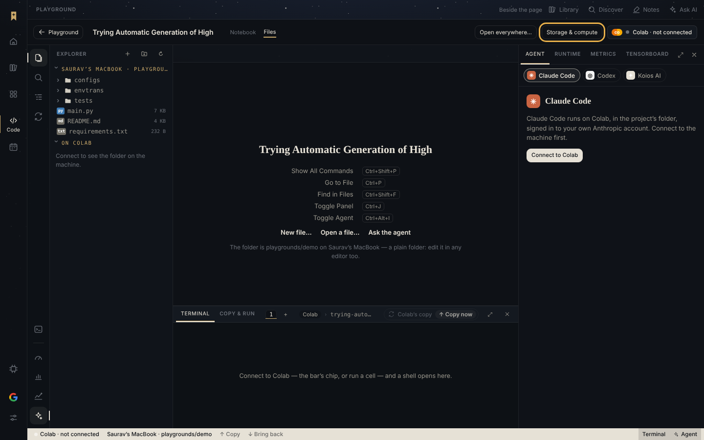
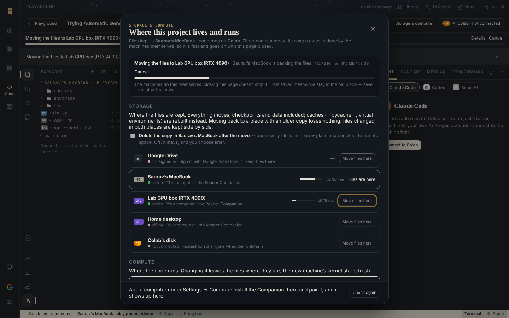
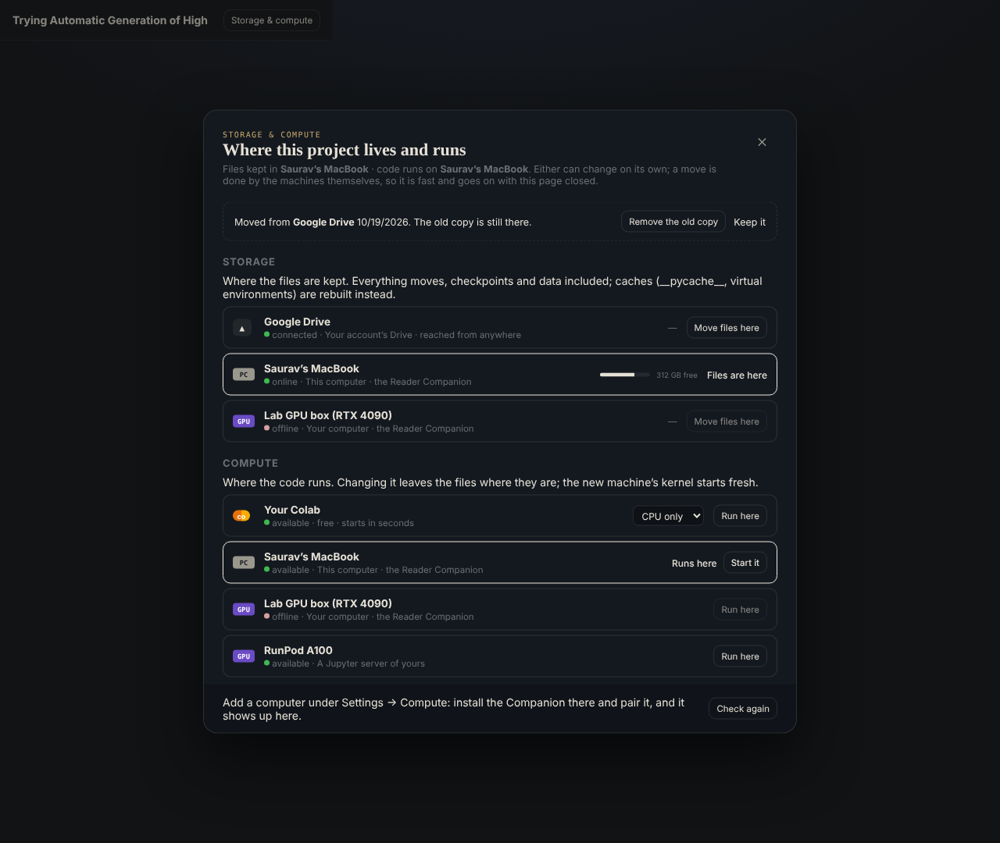
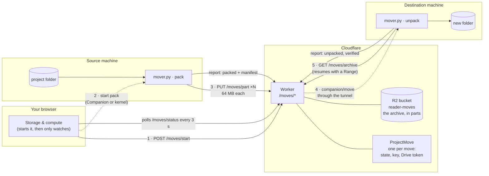
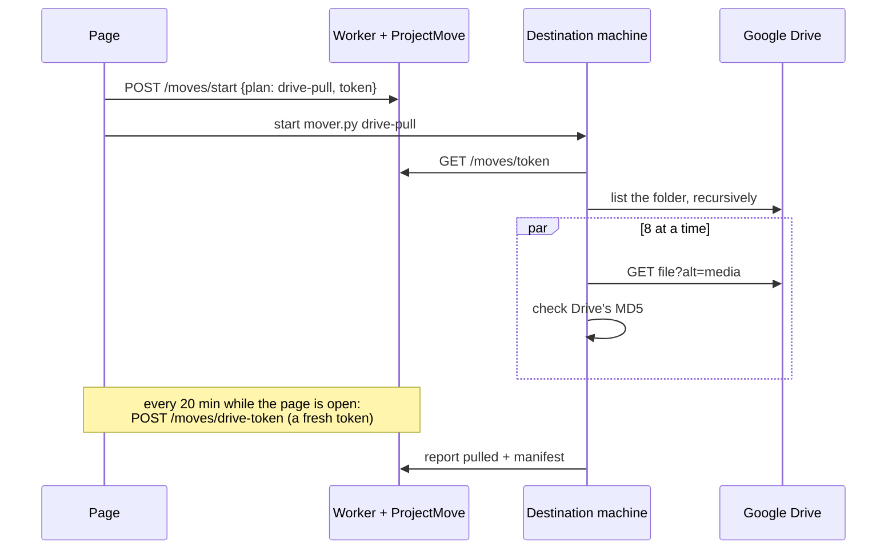
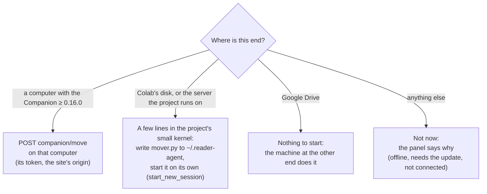
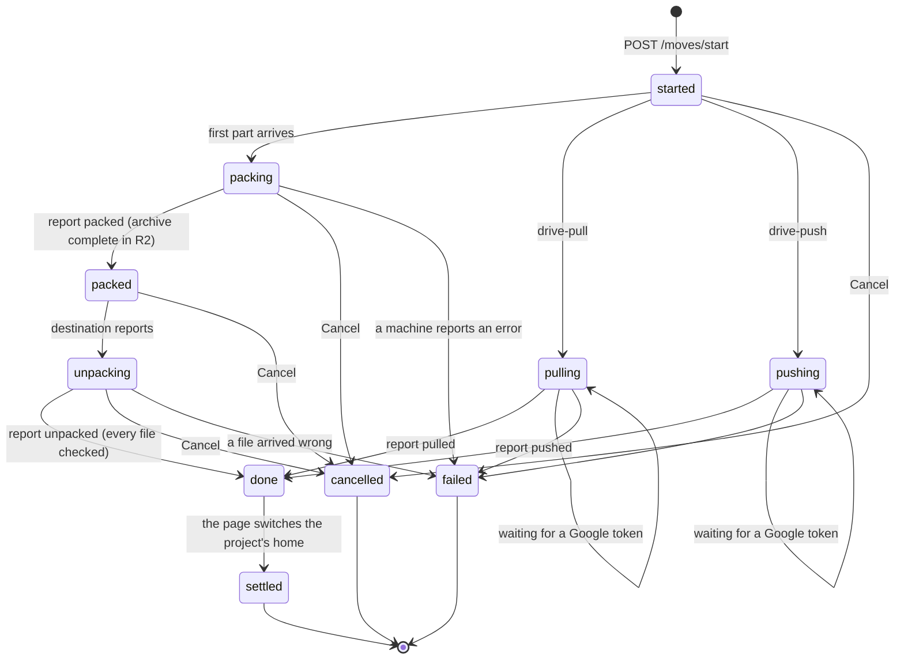
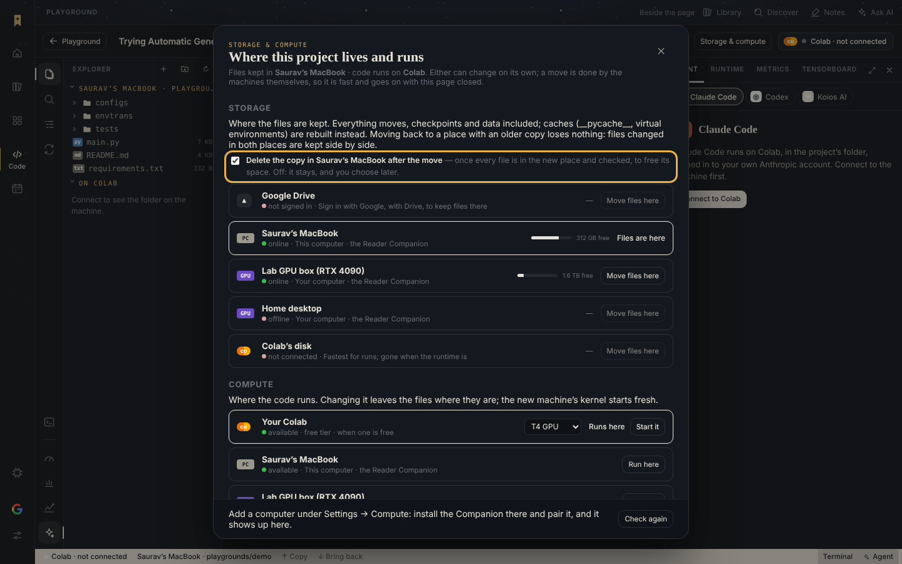
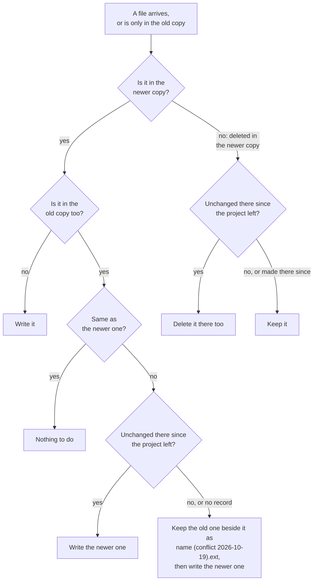
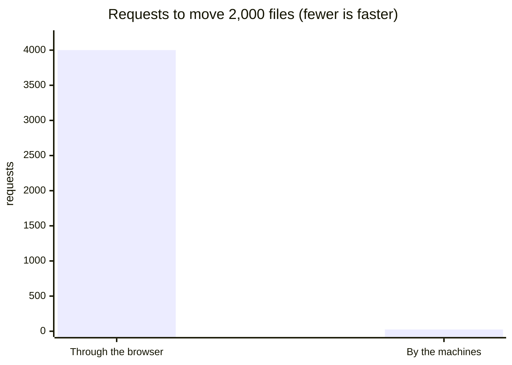

# Storage & compute: moving a project's files, and changing its machine

A playground project has two parts that can each be replaced on its own:

- **Storage**: where its files are kept. That can be your Google Drive, one of your computers running the Reader
  Companion, or the disk of its own Colab machine.
- **Compute**: where its code runs. That can be your Colab, one of your computers, or another Jupyter server of yours.

The **Storage & compute** panel lists every place and machine that's connected right now, with whether each is
online and how much disk it has free. From there you can **move the files** somewhere else, or **run the code**
somewhere else. A move is done by the machines at each end, not by your browser. It goes at the machines' own speed,
it moves everything (checkpoints and data included), and it carries on if you close the page.

This page describes the design as built: what the person sees, how the move works, the setup it needs, and the
limits. The figures are Mermaid diagrams, which GitHub draws.

- [1. What you see](#1-what-you-see)
- [2. How a move works](#2-how-a-move-works)
- [3. The three ways files travel](#3-the-three-ways-files-travel)
- [4. Who starts each step](#4-who-starts-each-step)
- [5. A move's states](#5-a-moves-states)
- [6. Deleting the old copy](#6-deleting-the-old-copy)
- [7. Moving back over an old copy](#7-moving-back-over-an-old-copy)
- [8. Changing the machine](#8-changing-the-machine)
- [9. Why it is faster](#9-why-it-is-faster)
- [10. Safety and privacy](#10-safety-and-privacy)
- [11. Setting it up](#11-setting-it-up)
- [12. Using it, step by step](#12-using-it-step-by-step)
- [13. When something goes wrong](#13-when-something-goes-wrong)
- [14. Limits](#14-limits)
- [15. Reference: files, routes, tests](#15-reference-files-routes-tests)

## 1. What you see

The project's bar has a **Storage & compute** button, just left of the machine chip, on both the Notebook and Files
tabs. It opens the panel.



*Figure 1. Where the button is.*


*Figure 2. The panel. Each row shows its state (online, offline, not signed in) and, for storage, how much disk is
free. The place the files are now, and the machine the code runs on now, are outlined. Above the list is the choice
to delete the old copy after a move (section 6).*

Once a move starts, a strip above the editor shows it from any page of the project. The panel shows the same thing in
more detail:



*Figure 3. A move from the laptop to the GPU box, partway through. The strip at the top stays visible while you work.
Its Details link opens this panel.*

When every file has arrived and been checked, the project switches to the new place by itself. The old copy is kept
until you decide what to do with it:



*Figure 4. Done. **Delete the old copy** sends Drive's folder to the bin (Drive keeps it for 30 days), or deletes the
folder on a computer. **Keep it** leaves the old copy alone and stops asking.*

## 2. How a move works

Three parties take part, and your browser only starts the move and watches it:

| Party | What it does | Where |
| --- | --- | --- |
| **The page** | Asks for the move, tells the first machine to start, shows how it is going, switches the project over once it is done. | `src/lib/moves.ts`, `src/components/StoragePanel.tsx` |
| **The Worker** | Keeps the move's state in a Durable Object (one per move). Hands each machine a key. Stores the archive in R2 between the two machines. Tells a Companion destination to unpack. | `worker/moves.js` (`ProjectMove`) |
| **The mover** | A Python script that runs on each machine and does the actual work there: pack, unpack, fetch from Drive, send to Drive, remove. Standard library only. | `companion/reader_companion/mover.py` |



*Figure 5. A move between two machines. The bytes go from the source to R2 and from R2 to the destination, never
through the page. The dotted arrows are the two times a machine is told to start: once by the page, once by the
Worker.*

A move from the Colab machine's disk to your laptop, step by step:

```mermaid
sequenceDiagram
  autonumber
  participant Page
  participant Worker as Worker + ProjectMove
  participant R2
  participant Colab as Colab (source)
  participant Laptop as Laptop's Companion (destination)
  Page->>Worker: POST /moves/start {from: Colab disk, to: Laptop, plan: archive}
  Worker->>R2: createMultipartUpload
  Worker-->>Page: {key, api}
  Page->>Colab: start mover.py pack (in the project's small kernel)
  Note over Page: the page may close from here on
  loop each 64 MB of the .tar.gz
    Colab->>Worker: PUT /moves/part?n
    Worker->>R2: uploadPart(n)
  end
  Colab->>Worker: report packed + manifest (every file's size and SHA-256)
  Worker->>R2: complete upload · put manifest.json
  Worker->>Laptop: POST companion/move {mode: unpack} (through its tunnel)
  Laptop->>Worker: GET /moves/manifest, GET /moves/archive
  Worker->>R2: get (from a Range if the connection broke)
  Laptop->>Laptop: unpack, check every file's SHA-256
  Laptop->>Worker: report unpacked, verified
  Worker->>R2: delete the archive
  Page->>Worker: GET /moves/status → done
  Page->>Page: home = Laptop; remember the old place
  Page->>Worker: POST /moves/settled
```

*Figure 6. Each machine reports its progress (files, bytes, totals) about every two seconds. That is what the
page's progress bar shows.*

## 3. The three ways files travel

Which way the files go depends only on the two ends (`planOf` in `src/lib/movePlan.ts`):

| From ↓ / To → | Google Drive | A computer (Companion) | The Colab machine's disk |
| --- | --- | --- | --- |
| **Google Drive** | — | **drive-pull**: the computer fetches from Drive | **drive-pull**: Colab fetches from Drive |
| **A computer** | **drive-push**: the computer sends to Drive | **archive** through R2 | **archive** through R2 |
| **The Colab machine's disk** | **drive-push**: Colab sends to Drive | **archive** through R2 | — |
| **This browser** | refused: move it out of the browser first (the explorer offers this) | refused | refused |

Drive is one end of most moves, and no machine "owns" Drive. So the machine at the other end talks to Drive itself,
using the account's Google token:



*Figure 7. Drive to a machine. Moving to Drive is the mirror image (`drive-push`): folders are made first, then files
go up eight at a time. Files up to 5 MB go in one request; bigger ones go in 16 MB resumable pieces. Sending the same
folder again replaces the files rather than doubling them.*

Google's sign-in token only lasts an hour. While the page is open it renews the token every 20 minutes and hands the
new one to the Worker. If a token runs out with no page open, the machine waits for up to an hour, saying so in the
progress line, and finishes as soon as you open the project again.

## 4. Who starts each step

A machine has to be told to start, and there are two ways to tell it (`runnerFor` in `src/lib/moves.ts`):



*Figure 8. Either way, the mover is started as its own process. It outlives the kernel, the Companion's request, and
the page.*

The **first** step (pack, or fetch from Drive, or send to Drive) is always started by the page when you click. The
page checks that the machine can be told *before* it starts the move, so a move never begins with nobody to do it.

The **second** step of an archive move (unpack) is started by whichever comes first:

1. **The Worker itself**, the moment the archive is complete, when the destination is a computer with the Companion.
   It looks the computer up in the account's device list (`worker/devices.js`) and calls `companion/move` through
   the computer's tunnel. No page needs to be open for this.
2. **The page**, when it is open: right away for Colab or a plain Jupyter server, and after 20 seconds for a
   Companion, in case the Worker couldn't reach it.

If both try at once, the Worker lets only one machine work on a step. A second mover starting the same step is told
to stop, unless the first has said nothing for two minutes (`RUNNER_QUIET_MS`).

## 5. A move's states



*Figure 9. The project's own record (`Playground.moving`) holds the move's id until the page sees `done`. Then the
page sets `home` to the new place and `movedFrom` to the old one. The record is synced through Drive like the rest
of the project, so any browser of the account follows the move and can finish it.*

What is cleaned up, and when:

| What | Deleted |
| --- | --- |
| The archive in R2 | As soon as the destination reports it unpacked; on Cancel; at the latest a week after the move started. |
| The manifest in R2 | On Cancel, or a week after the move started. |
| An unfinished multipart upload | Aborted on Cancel, or after a week. |
| The move's key | When the move ends, from this browser's storage; the Durable Object empties itself after a week. |
| The Google token | As soon as the move is done, failed or cancelled. |
| The mover's config file on a machine (it holds the key) | Deleted by the mover the moment it has read it. |

## 6. Deleting the old copy

By default a move copies: the old place keeps its files until you decide. To free its space as part of the move,
tick **Delete the copy in … after the move** above the list of places before clicking **Move files here**:



*Figure 10. The choice is remembered in this browser. With it on, the page asks once more before the move starts.*

The old copy goes **only after** the destination has reported every file in and checked. If the move fails or is
cancelled, nothing is deleted. Who deletes it depends on where it is:

| The old copy is on | Deleted by | When |
| --- | --- | --- |
| Google Drive | the Worker, with the account's token, before the token is let go | at once: the folder goes to Drive's **bin**, kept there 30 days |
| A computer with the Companion | the Worker, through the computer's tunnel (`companion/move`, `remove`) | at once if it is online; otherwise the page does it when it can reach it |
| The Colab machine's disk | the page, through the project's kernel | as soon as the page is open with Colab connected |

A linked folder (a folder of your own that the Companion links into its folder) is only **unlinked**, never emptied.
The Worker and the page both refuse to delete anything when the old place and the new one are the same folder.

Until it is gone, the panel says so: "Its old copy is deleted as soon as … can be reached", with **Delete it now** and
**Keep it instead**. Without the box ticked, the panel offers **Delete the old copy** and **Keep it** after the move,
as before.

## 7. Moving back over an old copy

A project can return to a place it left, say back to your laptop after a week on the GPU box. Your laptop may still
have the old copy, and that copy may have been edited since. Copying straight over it would lose those edits, and
files deleted on the GPU box would come back. So a move never copies straight over an old copy. It compares each file
three ways:

- **as it left:** when the project leaves a place, the old copy keeps a small record of every file's MD5 in
  `.reader/moved-away.json`. That record never travels with the files.
- **as it is there now:** the old copy, possibly edited since.
- **as it arrives:** the newer copy.



*Figure 11. How each file is decided (`decide` in `mover.py`). Nothing is lost on either side, and nothing is asked
mid-move. The project's own files under `.reader/` (the agent's conversations) simply follow the newer copy.*

| What happened | Example | Result |
| --- | --- | --- |
| Changed only in the newer copy | `train.py` edited on the GPU box | the newer version |
| Changed in both places | `config.yaml` edited on both | the newer version, with the old copy's version kept beside it as `config (conflict 2026-10-19).yaml` |
| Deleted in the newer copy, untouched in the old | `old_experiment.py` deleted on the GPU box | deleted in the old copy too |
| Deleted in the newer copy, but edited in the old | | kept |
| Made in the old copy after the project left | `notes.md` written on the laptop | kept |
| An old copy with no record (a folder that was there before) | | anything that differs is kept beside the newer version |

The panel reports what it found once the move is done:


*Figure 12. A move back with the old copy also deleted from the MacBook. Open the conflict copies in the editor to
compare and keep what you want, then delete them.*

The same rules apply whichever way the files travel. On a machine, the mover renames the old file. In Drive, it
renames the Drive file, and sends files deleted in the newer copy to the bin. Moving to Drive also skips files that
are already identical there, which makes a move back to Drive quicker.

## 8. Changing the machine

**Run here** changes only where the code runs. The files stay where they are:

- If the files are on the new machine already (a computer that is both storage and compute), commands run in that
  folder directly.
- Otherwise the folder is copied to the machine before each command, as projects with "code here, run there" already
  do.
- Leaving a Colab machine of the project's own stops that machine, so it doesn't keep using units until Colab's idle
  limit.
- A project whose files are on its Colab machine's own disk can't switch to another machine. The files would stay
  behind on that disk, so the panel asks you to move them first (`computeChangeRefused`).

The new machine's kernel starts fresh, so re-run the cells that set things up. Colab's row has a picker for the
machine type (CPU, T4, L4, A100…). A machine that is offline can't be picked.

## 9. Why it is faster

The browser used to copy a project through Drive's API one file at a time, a read and a write for each file. A move
now sends one compressed archive, written and read by the machines over their own connections:

| A project of 2,000 files, 1.3 GB | Copied through the browser | Moved by the machines |
| --- | --- | --- |
| Requests | about 4,000 (a read and a write for each file) | about 25 (21 parts of 64 MB, a manifest, a few reports) |
| Who carries the bytes | your browser, on your connection | the two machines, on theirs |
| Big files (checkpoints, data) | skipped: text only | moved, byte for byte |
| Survives closing the page | no | yes |
| Checked at the end | no | every file's SHA-256 (or Drive's MD5) |



*Figure 13. Most of the time in the old way went on waiting for each request to come back, not on sending the bytes.*

## 10. Safety and privacy

- **Who can start or see a move.** Starting a move, reading its status, cancelling it, or handing on a token takes
  the person's pass from a page of the site. A move belongs to the account that started it; anyone else gets 403.
- **The machines' key.** Each move has its own random key (48 hex characters), sent only to the machines. It is
  checked in constant time, and it is good for that one move only. The status a page reads never contains it.
- **The Companion's endpoint.** `companion/move` requires the Companion's own token and the site's origin, like
  every endpoint that touches files. It only accepts a folder **inside** the Companion's own folder (`prepare` in
  `mover.py`), never `..` or an absolute path, and only an `https` address for the Worker.
- **What gets unpacked.** Every path in the archive is checked (`safe_member`). Nothing absolute or climbing out is
  extracted, and a symbolic link is made only when it points inside the folder.
- **Removing the old copy.** `remove` refuses the home folder, `/`, and paths with too few parts. A folder of your
  own that was *linked* into the Companion is only unlinked, never emptied. Drive's folder goes to the bin, where
  Drive keeps it for 30 days.
- **The Google token.** It is kept in the move's Durable Object for as long as the move needs it and deleted when the
  move ends. It is the same `drive.file` token the page already uses, which only sees the files the site made.
- **Your files in R2.** The archive sits in your Cloudflare account's bucket only between the two machines. It is
  deleted once unpacked, and anything left over is deleted after a week.

## 11. Setting it up

These are one-time steps for the site's owner. In order:

**1. Make the R2 bucket.** In the repository, signed in to Cloudflare:

```sh
npx wrangler r2 bucket create reader-moves
```

If R2 isn't enabled on the Cloudflare account yet, enable it first. In the dashboard's left menu it's under
**Storage & databases → R2 object storage** (or type "R2" in **Quick search**); the first visit asks you to add a
payment method and turn R2 on. The free tier is 10 GB of storage with no charge for downloads, and moves only use
it briefly. The bucket can be made there too (**Create bucket**, named `reader-moves`, location Automatic) instead
of with the command.

The merge also does this step for you: the **Deploy worker** workflow now creates the bucket when it's missing,
before it deploys. That needs the `CLOUDFLARE_API_TOKEN` secret to include **Workers R2 Storage: Edit**. The "Edit
Cloudflare Workers" token template includes it; a hand-made token may not.

**2. Merge the pull request.** The merge deploys the Worker with:

- the `PROJECT_MOVES` Durable Object (migration `v9`), and
- the `MOVES` R2 binding to `reader-moves`.

Both are in `wrangler.toml`. To deploy by hand instead: `npm run deploy:worker`.

**3. Check it.** With your pass (or `READER_TOKEN`), from the site:

```sh
curl -s -X POST https://api.koios.dev/moves/start -H 'Origin: https://koios.dev' \
  -H "Authorization: Bearer $READER_TOKEN" -H 'Content-Type: application/json' -d '{}'
```

`{"error":"which move?"}` means it is set up. `{"error":"moves need an R2 bucket…","setup":true}` means the bucket
or the Durable Object isn't bound yet.

**4. Update the Companion on each computer to 0.16.0.** That's the version whose mover handles moves (and moving back over an old copy, section 7). The site's build
publishes the new wheel. Then, in **Settings → Updates**, each paired computer shows **Update**: the Companion
installs the new version itself and starts again (see [companion.md](companion.md)). Until a computer is updated,
the panel shows it with **Needs Companion 0.16.0**, and moves to or from it are disabled.

Nothing is needed on Colab or on a plain Jupyter server: the page sends the mover there each time.

## 12. Using it, step by step

**To move a project's files:**

1. Open the project and click **Storage & compute** in its bar.
2. Under **Storage**, find where you want the files, for example your laptop, and check it says *online* with
   enough free space.
3. Click **Move files here**. If the place the files are now is a machine (Colab's disk, or a computer), it has to
   be reachable. For Colab's disk, connect to Colab first.
4. Watch the strip above the editor, or don't: you can close the page. The machines carry on.
5. When it says every file is in and checked, the project opens its files from the new place.
6. Open the panel again and choose **Delete the old copy** or **Keep it**. Or tick **Delete the copy … after the
   move** before step 3, and it goes on its own once the move is checked (section 6).

**To change where the code runs:**

1. Click **Storage & compute**.
2. Under **Compute**, pick a machine that says *available*. For Colab, first choose the machine type in the picker.
3. Click **Run here**. Then click **Start it** on the outlined row, or run a cell, to start the new machine's kernel.

**Recommended set-ups:**

| You want | Storage | Compute |
| --- | --- | --- |
| Fastest editing and runs on your own GPU | your computer | the same computer |
| Free GPU, files that survive the runtime | your computer, or Drive | Colab (T4) |
| Open the project from any device | Google Drive | any |
| A big run on a rented GPU | your computer | the RunPod / lab server |

## 13. When something goes wrong

| You see | What it means | What to do |
| --- | --- | --- |
| **Needs Companion 0.16.0** on a computer | Its Companion is older than moves. | Settings → Updates → **Update** for that computer. |
| **Offline** on a computer | It didn't answer when the panel asked (it's asleep, off, or its Companion isn't running). | Wake it up or start its Companion, then **Check again**. A move already waiting for it carries on once it's back. |
| *Packed — waiting for … to unpack* | The archive is complete in R2, and the destination hasn't started. | If it's a computer, it unpacks when it comes online; if it's Colab, open the project with Colab connected. |
| *Waiting for your Google sign-in to be renewed* | A Drive move ran past the token's hour with no page open. | Open the project; the page hands on a fresh token and the move continues. |
| *It stopped: N file(s) didn't arrive whole* | A file arrived with the wrong size or SHA-256. | **Dismiss** and move again. The old copy wasn't touched. |
| *It stopped: …* anything else | The machine's own error message. Its full log is in `~/.reader-agent/move-<id>.log` on that machine. | Fix what it says (disk full, folder not writable), then move again. |
| **moves need an R2 bucket** | The Worker isn't set up. | Section 9. |

A failed or cancelled move never changes the project: its home stays where it was until a move reports `done`.

## 14. Limits

- **One move at a time per project.** While a move is under way, the other rows' **Move files here** buttons are
  off.
- **Edits made during a move stay in the old place.** Save before moving, or redo the edits after.
- **Caches aren't moved.** `__pycache__`, `.ipynb_checkpoints`, `.venv`/`venv`, `node_modules` and `.cache` are rebuilt
  rather than copied. Everything else moves, `.git` and `.reader/` (the agent's conversations) included.
- **Google Docs, Sheets and Slides** in a project's Drive folder aren't Drive files with bytes, so a pull skips them.
- **Shared projects.** While the project is open in a live shared session, the panel only shows; it changes nothing.
- **Size.** One archive can be up to 10,000 parts of 64 MB. In practice the limits are the machines' disks and R2's
  storage price for the time the archive waits.
- **A plain Jupyter server** that isn't the project's machine and has no Companion can't be told to start, so it isn't
  offered as storage.

## 15. Reference: files, routes, tests

| File | What is in it |
| --- | --- |
| `src/lib/movePlan.ts` | Pure: the new home for each place, `planOf`, `stepsOf`, `computeChangeRefused`, `launchCode`, the words for each step. |
| `src/lib/moves.ts` | Starting a move, telling a machine (`runnerFor`, `runStep`), the unpack from the page, settling, cancelling, the token, removing the old copy, free disk. |
| `src/lib/moverScript.ts` | `mover.py` as text (Vite's `?raw`), for machines without the Companion. |
| `src/components/StoragePanel.tsx` | The panel, `useMove` (following a move), and the progress strip. |
| `worker/moves.js` | `ProjectMove`, `handleMoves` (the routes), `tellDestination`. |
| `companion/reader_companion/mover.py` | The mover: `pack`, `unpack`, `drive_pull`, `drive_push`, `remove`, `prepare`, `start_detached`. |
| `companion/reader_companion/extension.py` | `MoveHandler`: `GET`/`POST companion/move`. |

The Worker's routes:

| Route | Called by | Does |
| --- | --- | --- |
| `POST /moves/start` | page (pass) | Opens the move and, for an archive, its R2 multipart upload; answers with the machines' key and the Worker's address. |
| `GET /moves/status?id` | page (pass) | The move's state, progress, error. Never the key or the token. |
| `POST /moves/drive-token` | page (pass) | A fresh Google token for a Drive move. |
| `POST /moves/cancel` | page (pass) | Stops it: machines are told, the upload aborted, R2 emptied. |
| `POST /moves/settled` | page (pass) | The project has switched over; the token goes. |
| `PUT /moves/part?id&n` | machine (key) | One part of the archive (≤ 95 MB) into R2. |
| `POST /moves/report?id` | machine (key) | Progress; `packed` completes the upload and tells a Companion destination; `unpacked` deletes the archive. |
| `GET /moves/manifest?id` | machine (key) | Every file's path, size and SHA-256. |
| `GET /moves/archive?id` | machine (key) | The archive, from a `Range: bytes=N-` when resuming. |
| `GET /moves/token?id` | machine (key) | The current Google token. |

Tests:

| Test | Checks |
| --- | --- |
| `scripts/moves.test.mjs` | The Worker's routes against a stand-in R2. Deleting the old copy (Drive to the bin, a computer through its Companion, never the same folder) and what the move keeps of the conflicts. The real `mover.py` packing a folder through the real Worker and unpacking it elsewhere, byte for byte. |
| `scripts/move-plan.test.mjs` | Every pair of places, which end goes first, the machine-change guard. The kernel launch code, run in a real Python, starting the mover on its own. |
| `companion/tests/test_mover.py` | The three-way decision for every case; a round trip out and back with edits on both sides (nothing lost, conflicts kept beside, stale files gone, files made there kept); an old copy with no record; Drive as the old copy; the record left in Drive. Pack → unpack in several parts with binaries and links; a damaged archive and a changed file caught; cancel; paths that climb out; Drive pull and push against a stand-in Drive; remove (a linked folder only unlinked); `prepare`'s refusals. |
| `companion/tests/test_move_handler.py` | `companion/move`: free disk, the token, a folder outside its own refused. |
